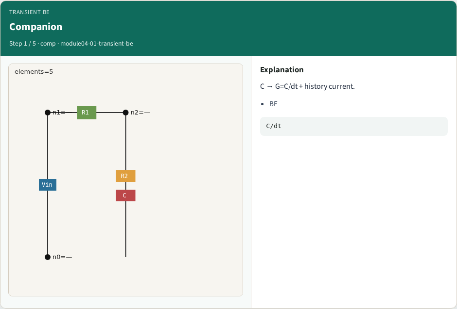
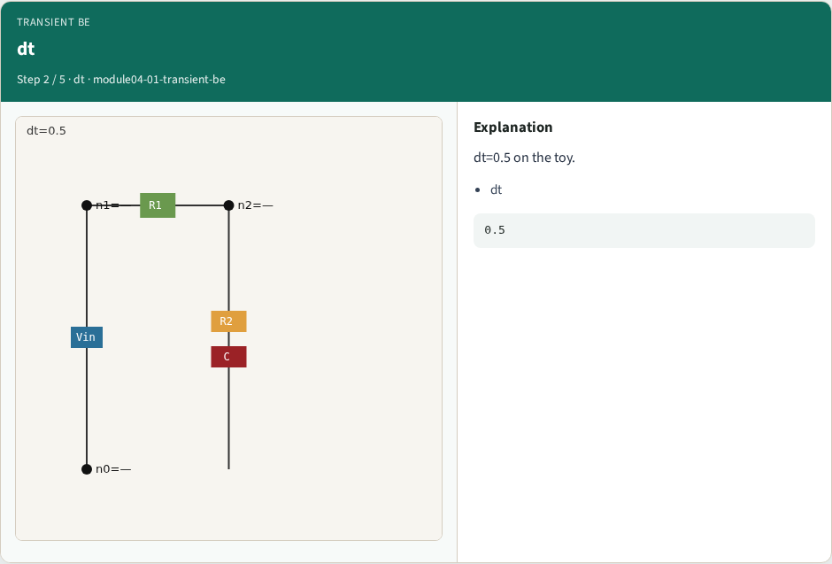
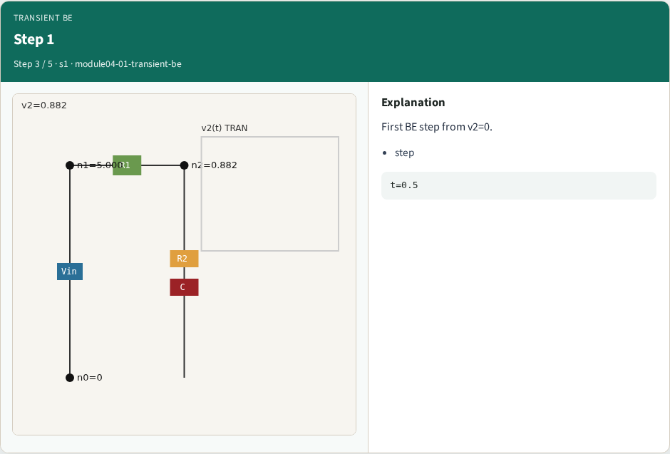
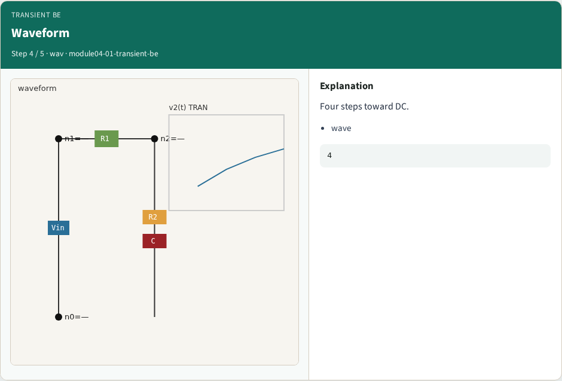
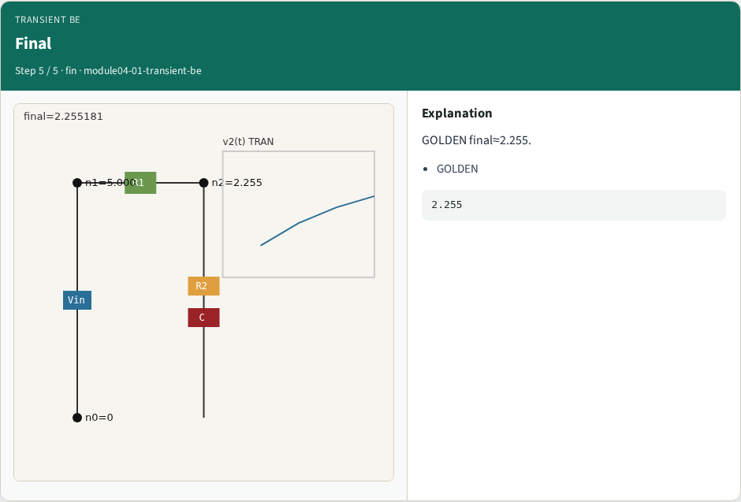
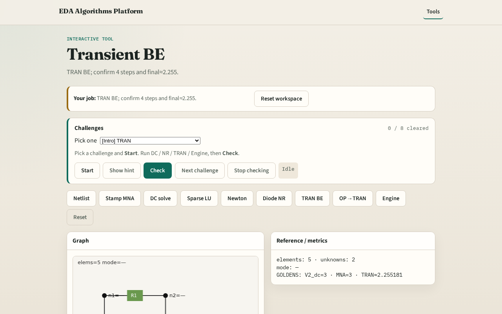

# Backward Euler transient

**Module id:** module04-01-transient-be
**Lab:** transient-be
**Tracks:** A (implement) · B (browser lab)

## Slide 1 — Why transient

Transient analysis steps time: capacitors use companion models at each dt.

## Slide 2 — The idea

GOLDEN: dt=0.5, 4 steps, final_v2≈2.255181 (BE RC from v2_init=0).

<!-- algorithm-walkthrough -->

## Slide 3 — Companion

C → G=C/dt + history current.

## Slide 4 — dt

dt=0.5 on the toy.

## Slide 5 — Step 1

First BE step from v2=0.

## Slide 6 — Waveform

Four steps toward DC.

## Slide 7 — Final

GOLDEN final≈2.255.

<!-- /algorithm-walkthrough -->

## Slide 8 — Browser lab track

Open **transient-be**. Run BE; confirm final_v2≈2.255181.

## Slide 9 — Implement track

Call transient_be(dt=0.5, steps=4); assert abs(final_v2-2.255181)<1e-5.

## Slide 10 — Pitfalls

Using forward Euler by mistake. Wrong initial capacitor voltage.

## Slide 11 — Your turn

Next: OP then TRAN pipeline.
