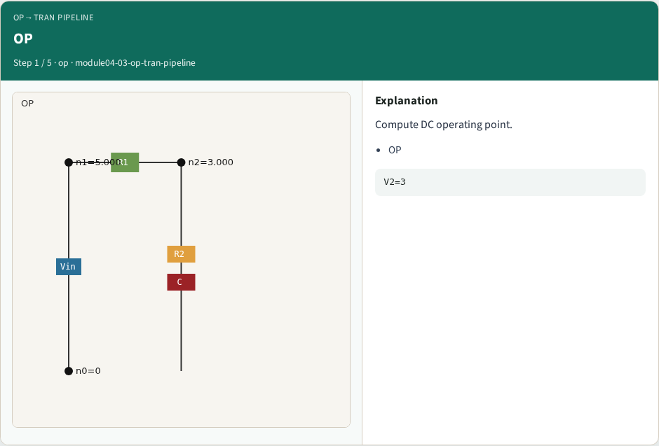
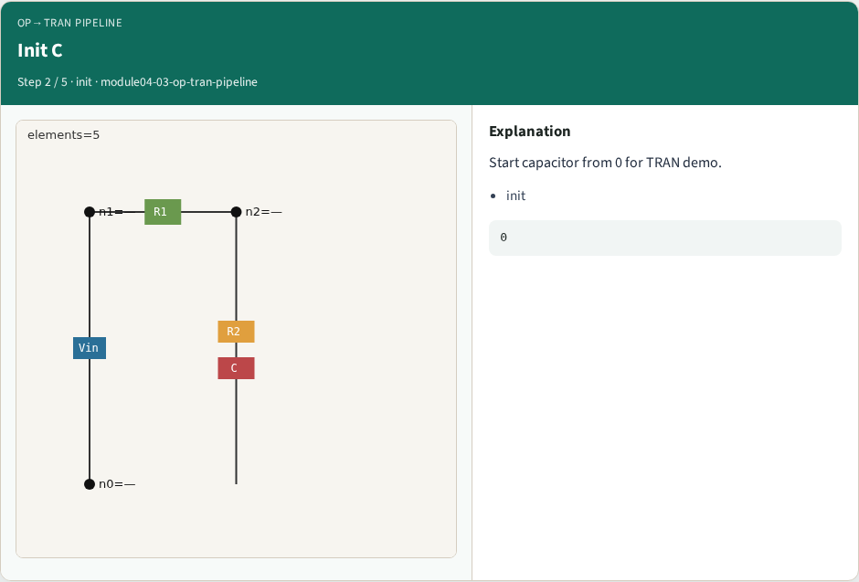
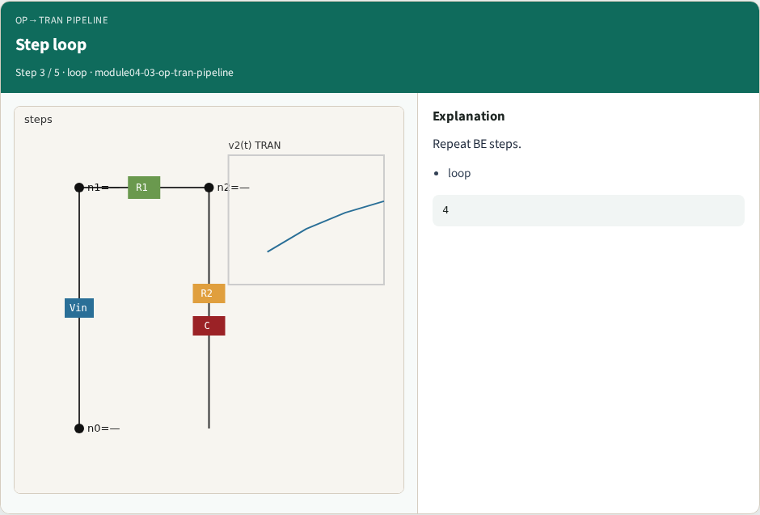
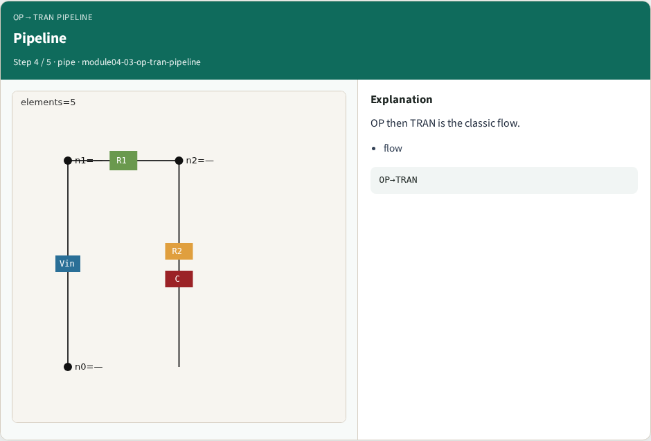
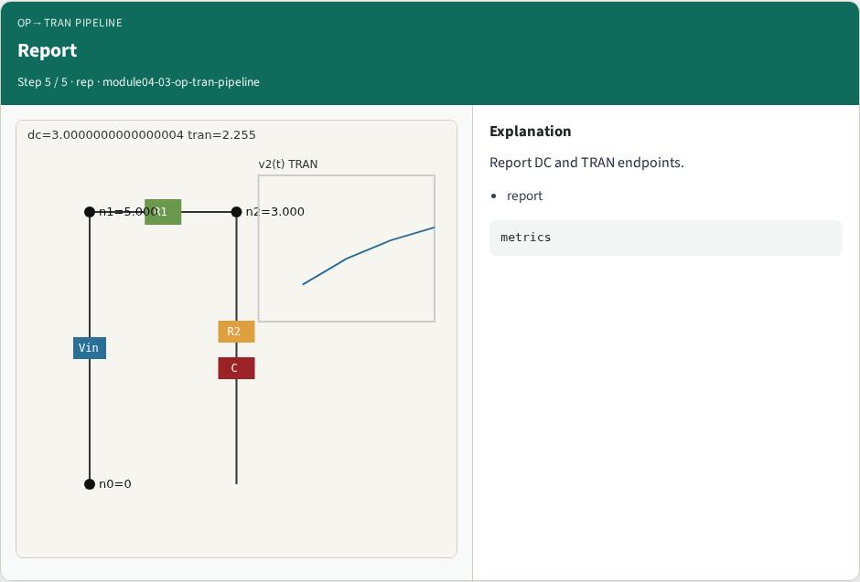

# OP then TRAN pipeline — step-by-step (for slides / transcript)

**Module:** `module04-03-op-tran-pipeline`  
**Lab / algo:** `op-tran-pipeline`  
**Viewer:** `/tools/algorithm-walkthrough/?algo=op-tran-pipeline&step=1`

Use each **Caption** as spoken prose (or a shortened slide note).
Use **Bullets** on the PPT; pair with the PNG in `assets/steps/`.

## Step 1 — OP



**Caption (transcript):** Compute DC operating point.

**Slide bullets:**

- OP

**On-screen metrics:**

```
V2=3
```

## Step 2 — Init C



**Caption (transcript):** Start capacitor from 0 for TRAN demo.

**Slide bullets:**

- init

**On-screen metrics:**

```
0
```

## Step 3 — Step loop



**Caption (transcript):** Repeat BE steps.

**Slide bullets:**

- loop

**On-screen metrics:**

```
4
```

## Step 4 — Pipeline



**Caption (transcript):** OP then TRAN is the classic flow.

**Slide bullets:**

- flow

**On-screen metrics:**

```
OP→TRAN
```

## Step 5 — Report



**Caption (transcript):** Report DC and TRAN endpoints.

**Slide bullets:**

- report

**On-screen metrics:**

```
metrics
```

