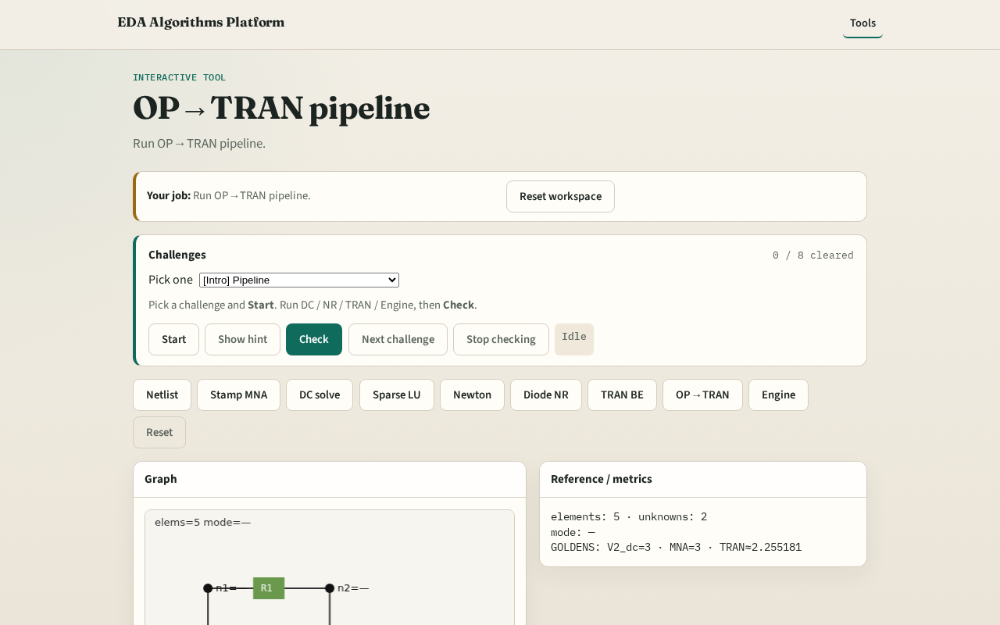

# Why pipeline

Production SPICE runs OP first, initializes storage elements, then steps TRAN

---

## The idea
- GOLDEN: OP V2=3.0; TRAN from v2_init=0 → final_v2≈2.255181

---

## OP

---

## Init C

---

## Step loop

---

## Pipeline

---

## Report

---

## Browser lab track

---

## Implement track
- Call dc_linear_solve() then transient_be(v2_init=0.0); report both v2 values

---

## Pitfalls
- Starting TRAN from OP cap voltage when lab sets v2_init=0
- Skipping OP check

---

## Your turn
- Next: full spice_engine integration

