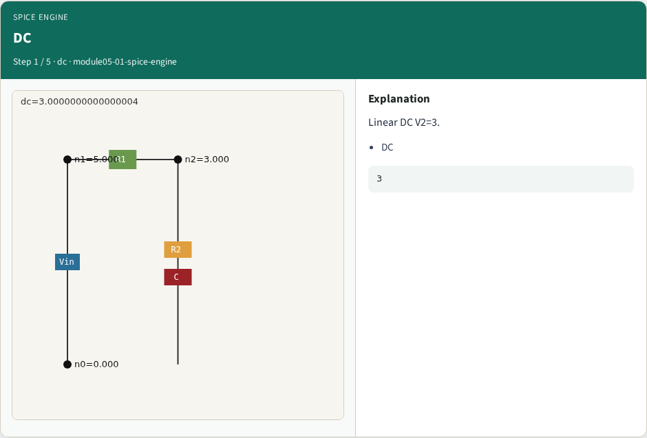
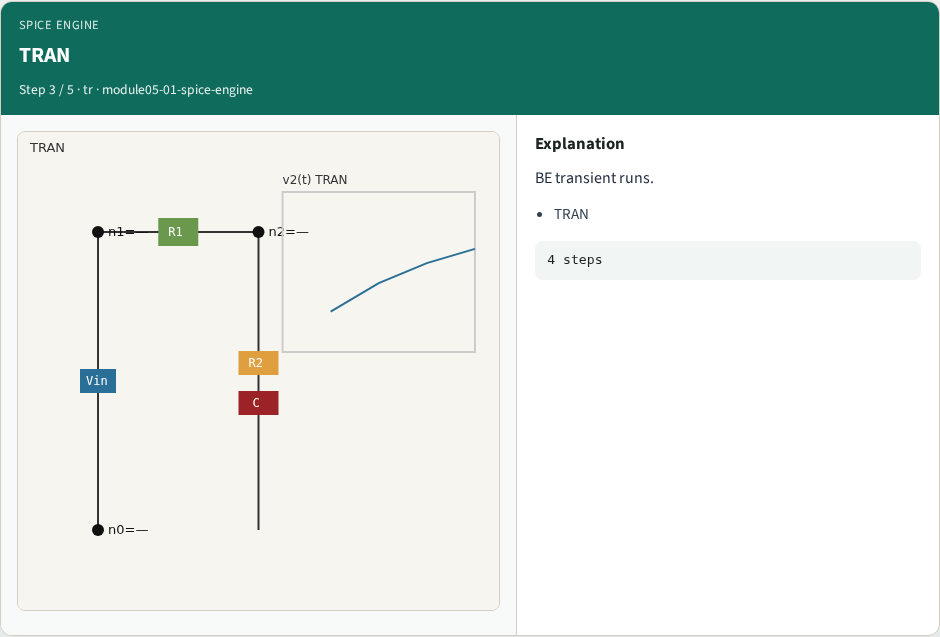
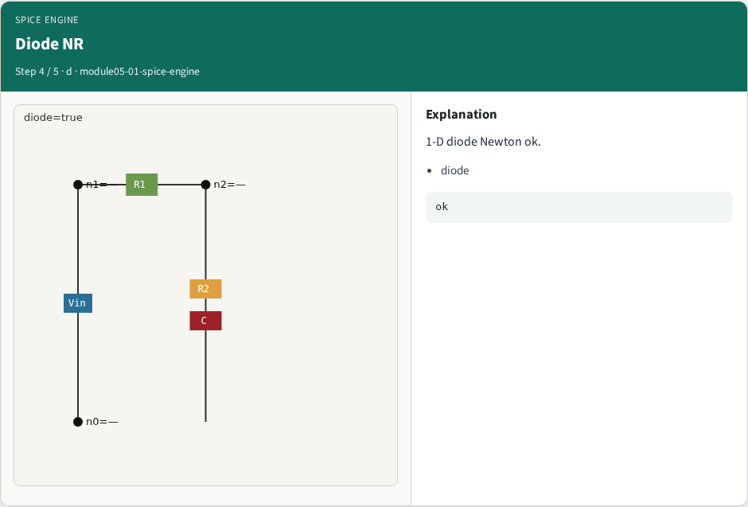
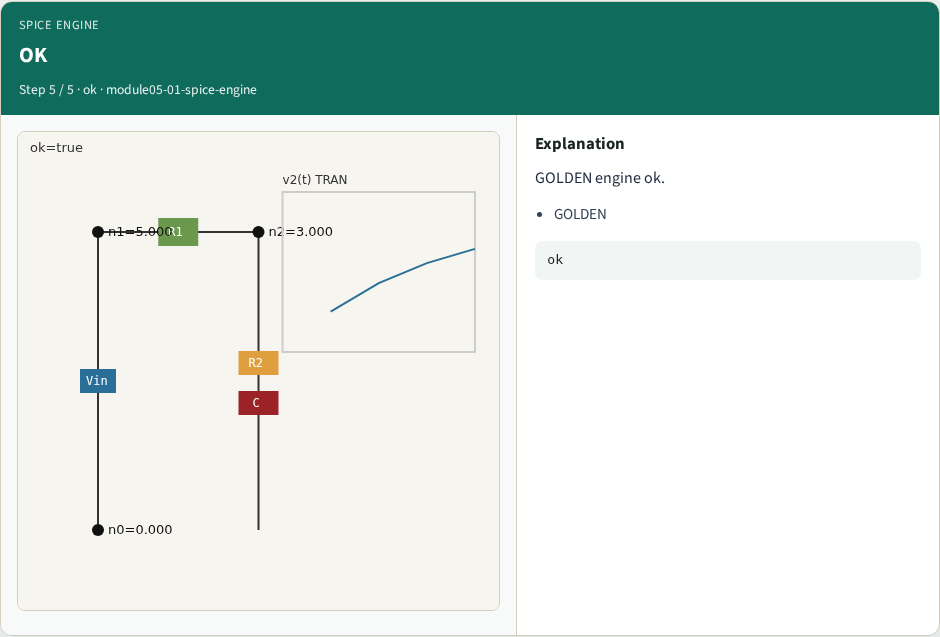
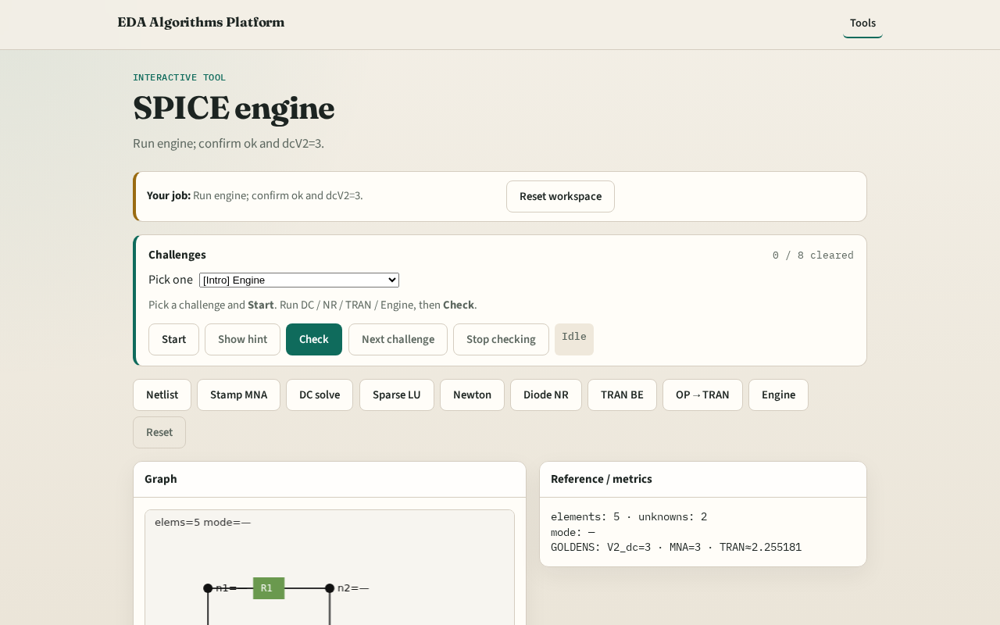

# SPICE engine integration

**Module id:** module05-01-spice-engine
**Lab:** spice-engine
**Tracks:** A (implement) · B (browser lab)

## Slide 1 — Why engine

A tiny engine chains DC, NR, transient, and diode checks on one netlist.

## Slide 2 — The idea

GOLDEN: dc_v2=3, nr converged, tran final_v2≈2.255181, diode NR ok.

<!-- algorithm-walkthrough -->

## Slide 3 — DC

Linear DC V2=3.

## Slide 4 — NR

NR converges in 1 iter.

## Slide 5 — TRAN

BE transient runs.

## Slide 6 — Diode NR

1-D diode Newton ok.

## Slide 7 — OK

GOLDEN engine ok.

<!-- /algorithm-walkthrough -->

## Slide 8 — Browser lab track

Open **spice-engine**. Run engine; confirm all goldens.

## Slide 9 — Implement track

Call spice_engine(); assert ok, dc_v2≈3.0, nr_converged, diode converged.

## Slide 10 — Pitfalls

Reporting partial results. Mixing linear and nonlinear paths inconsistently.

## Slide 11 — Your turn

Next: offline benchmark compare, then wrap.
