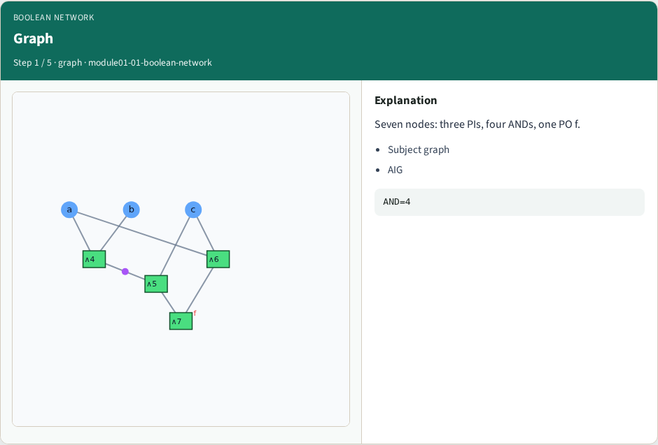
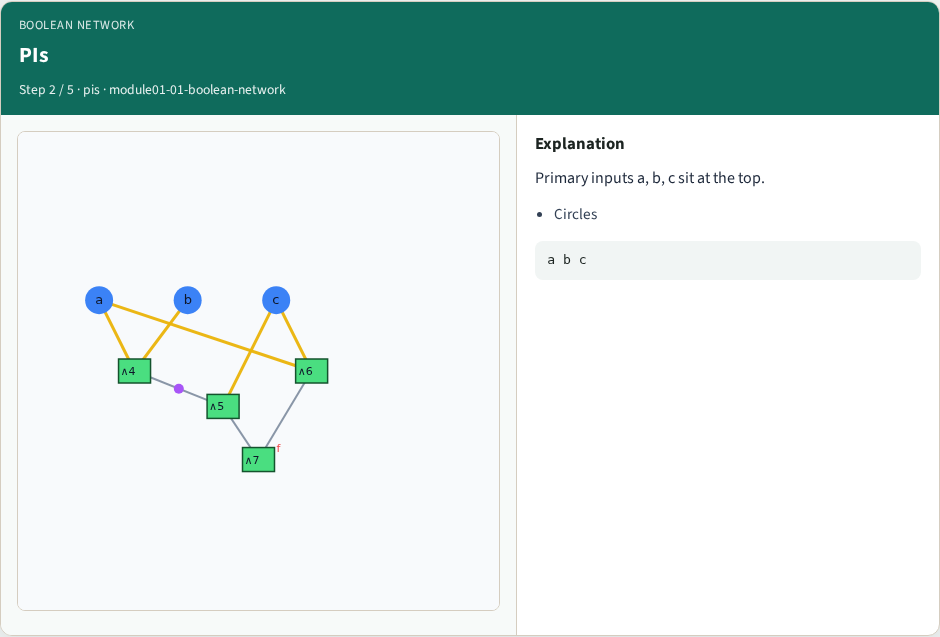
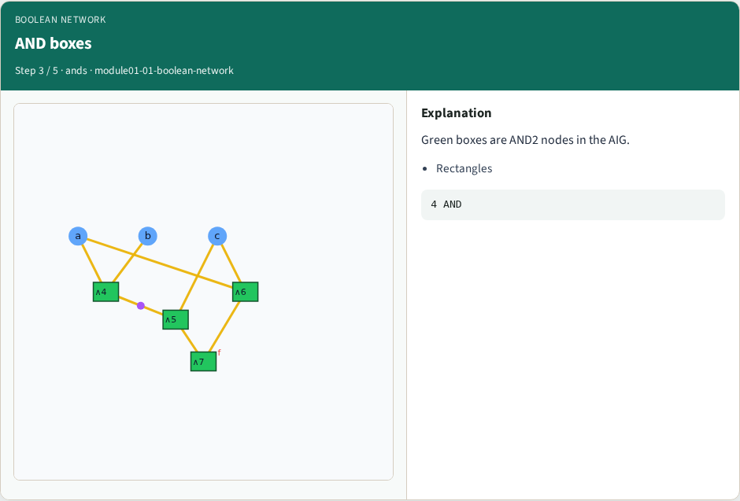
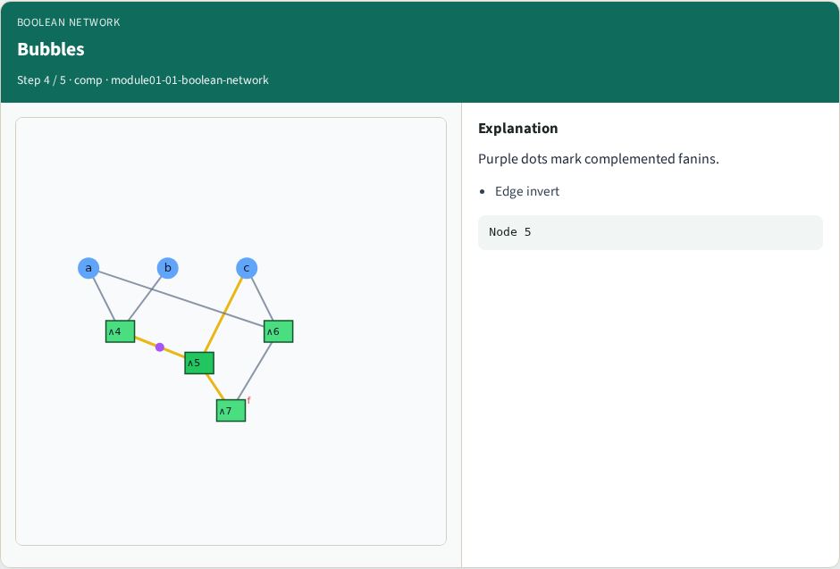
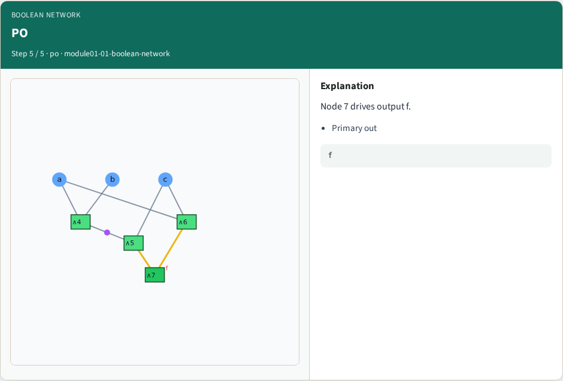

# Boolean network / subject graph — step-by-step (for slides / transcript)

**Module:** `module01-01-boolean-network`  
**Lab / algo:** `boolean-network`  
**Viewer:** `/tools/algorithm-walkthrough/?algo=boolean-network&step=1`

Use each **Caption** as spoken prose (or a shortened slide note).
Use **Bullets** on the PPT; pair with the PNG in `assets/steps/`.

## Step 1 — Graph



**Caption (transcript):** Seven nodes: three PIs, four ANDs, one PO f.

**Slide bullets:**

- Subject graph
- AIG

**On-screen metrics:**

```
AND=4
```

## Step 2 — PIs



**Caption (transcript):** Primary inputs a, b, c sit at the top.

**Slide bullets:**

- Circles

**On-screen metrics:**

```
a b c
```

## Step 3 — AND boxes



**Caption (transcript):** Green boxes are AND2 nodes in the AIG.

**Slide bullets:**

- Rectangles

**On-screen metrics:**

```
4 AND
```

## Step 4 — Bubbles



**Caption (transcript):** Purple dots mark complemented fanins.

**Slide bullets:**

- Edge invert

**On-screen metrics:**

```
Node 5
```

## Step 5 — PO



**Caption (transcript):** Node 7 drives output f.

**Slide bullets:**

- Primary out

**On-screen metrics:**

```
f
```

