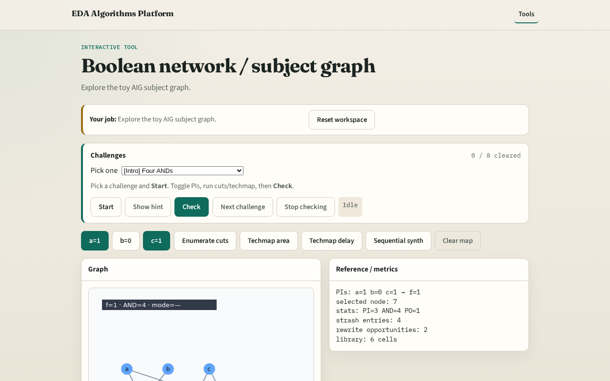

# Boolean network / subject graph

**Module id:** module01-01-boolean-network
**Lab:** boolean-network
**Tracks:** A (implement) · B (browser lab)

## Slide 1 — Boolean net

Synthesis starts from a technology-independent subject graph.

## Slide 2 — The idea

Our subject graph is an And-Inverter Graph: AND nodes with optional complemented edges.

<!-- algorithm-walkthrough -->

## Slide 3 — Graph

Seven nodes: three PIs, four ANDs, one PO f.

## Slide 4 — PIs

Primary inputs a, b, c sit at the top.

## Slide 5 — AND boxes

Green boxes are AND2 nodes in the AIG.

## Slide 6 — Bubbles

Purple dots mark complemented fanins.

## Slide 7 — PO

Node 7 drives output f.

<!-- /algorithm-walkthrough -->

## Slide 8 — Browser lab track

Open **boolean-network**. Click nodes; toggle PIs and watch f.

## Slide 9 — Implement track

Load tiny_synth.json; print aig_stats.

## Slide 10 — Pitfalls

Treating INV as a separate AIG node type. Ignoring complement bubbles.

## Slide 11 — Your turn

Next: AIG node types in detail.
