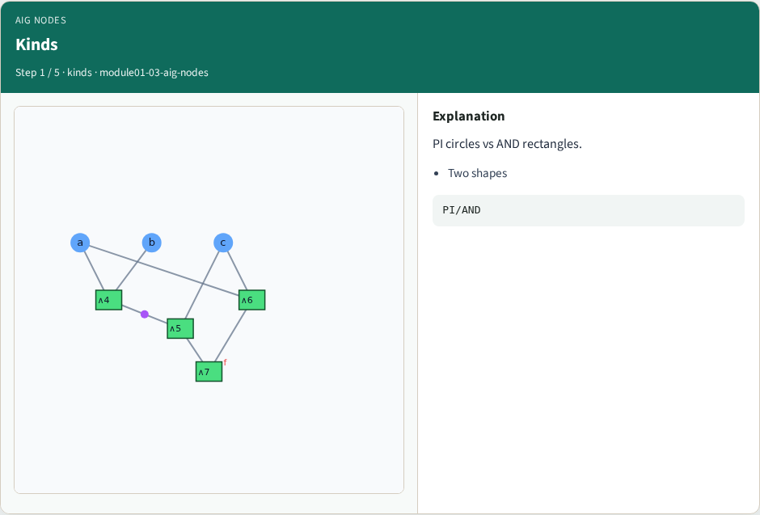
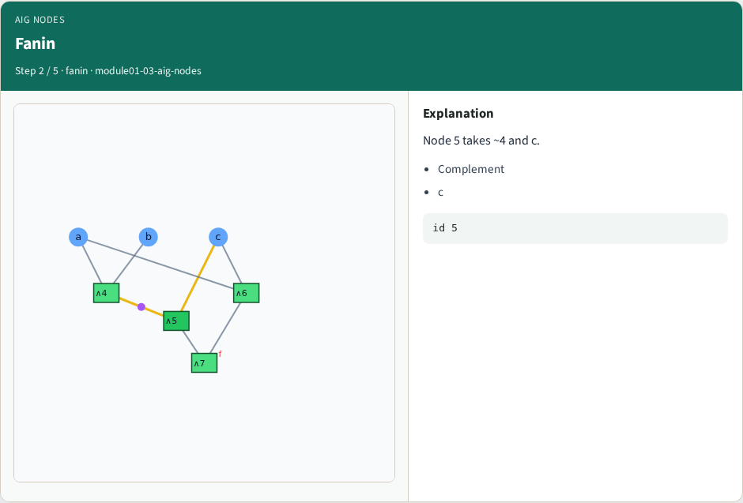
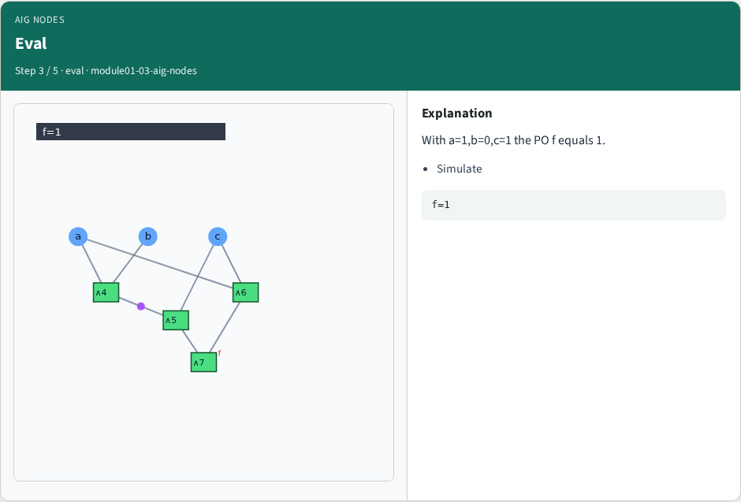
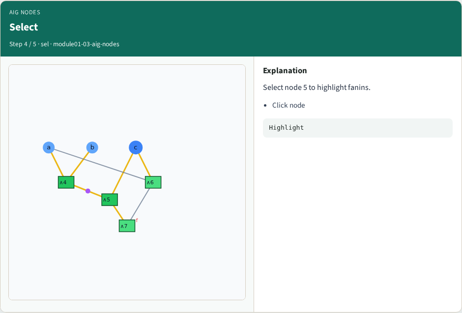
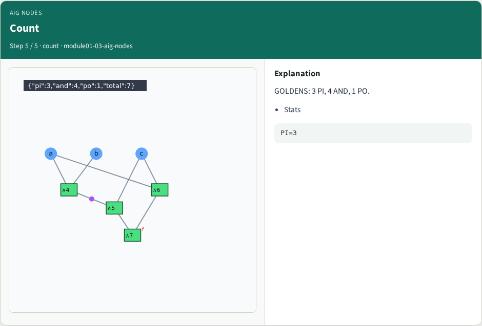
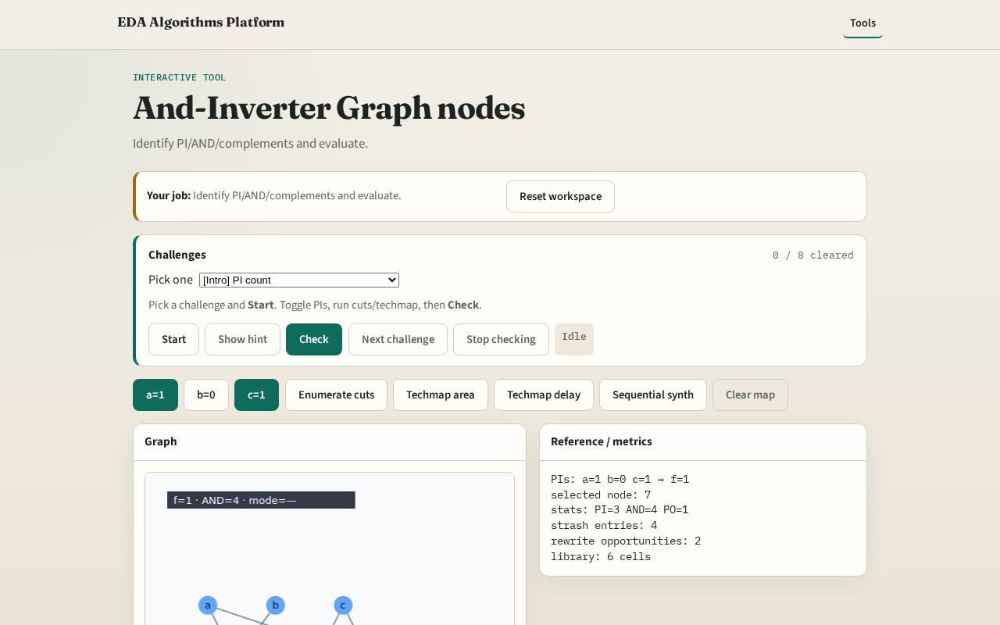

# AIG nodes

AIGs use only AND + optional edge complement , not arbitrary gates yet

---

## The idea
- Each AND has two fanins (id, complemented)
- Evaluate bottom-up with bitwise AND

---

## Kinds

---

## Fanin

---

## Eval

---

## Select

---

## Count

---

## Browser lab track

---

## Implement track
- Call output_value for assignments (1,0,1) and (1,1,1)

---

## Pitfalls
- Evaluating complemented edges wrongly
- Mixing PI names with ids

---

## Your turn
- Next: structural hashing

