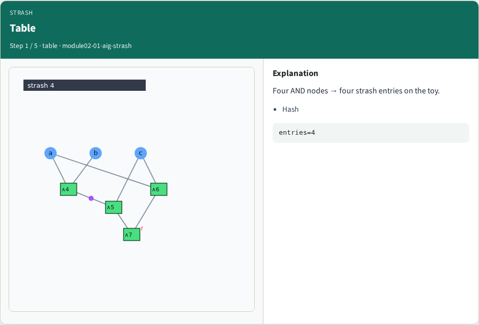
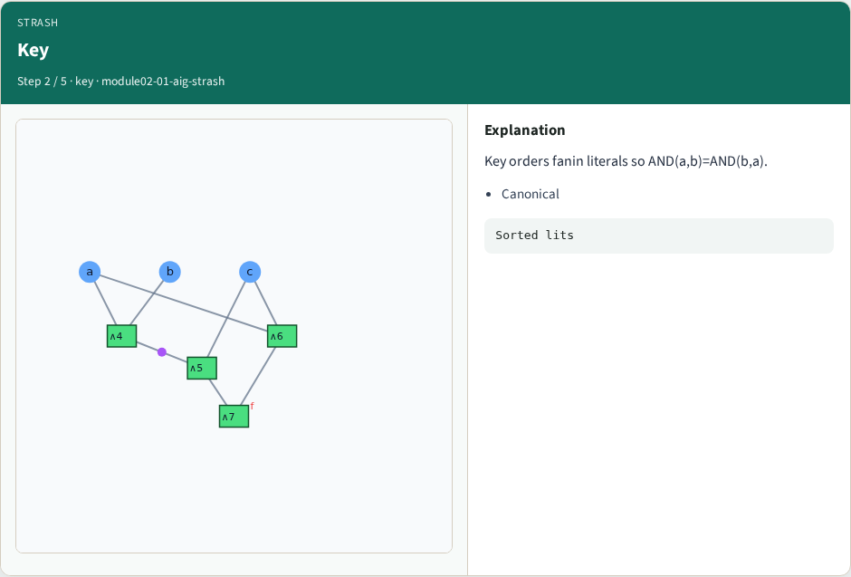
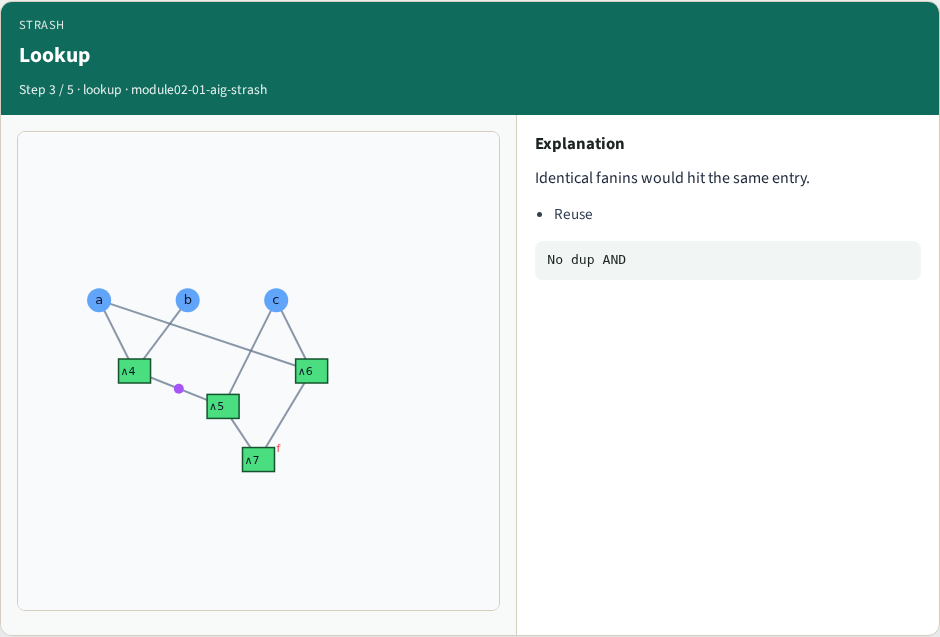
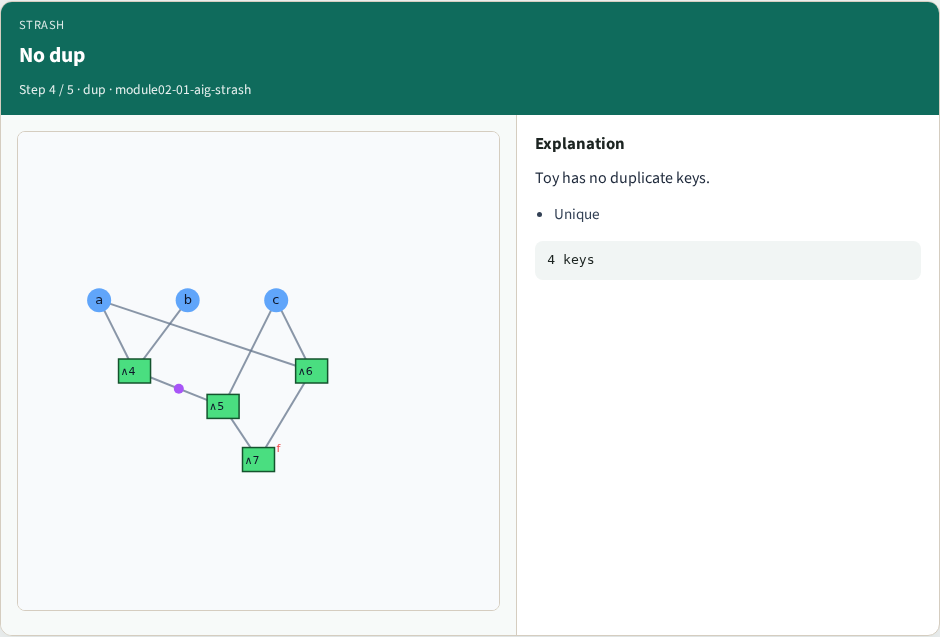
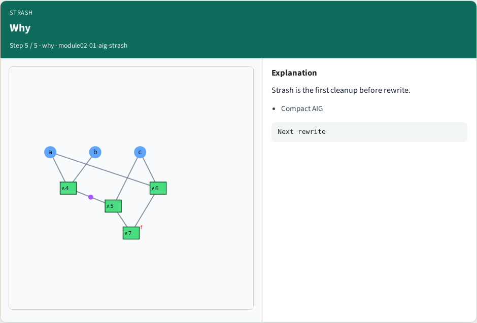

# Structural hashing (strash) — step-by-step (for slides / transcript)

**Module:** `module02-01-aig-strash`  
**Lab / algo:** `aig-strash`  
**Viewer:** `/tools/algorithm-walkthrough/?algo=aig-strash&step=1`

Use each **Caption** as spoken prose (or a shortened slide note).
Use **Bullets** on the PPT; pair with the PNG in `assets/steps/`.

## Step 1 — Table



**Caption (transcript):** Four AND nodes → four strash entries on the toy.

**Slide bullets:**

- Hash

**On-screen metrics:**

```
entries=4
```

## Step 2 — Key



**Caption (transcript):** Key orders fanin literals so AND(a,b)=AND(b,a).

**Slide bullets:**

- Canonical

**On-screen metrics:**

```
Sorted lits
```

## Step 3 — Lookup



**Caption (transcript):** Identical fanins would hit the same entry.

**Slide bullets:**

- Reuse

**On-screen metrics:**

```
No dup AND
```

## Step 4 — No dup



**Caption (transcript):** Toy has no duplicate keys.

**Slide bullets:**

- Unique

**On-screen metrics:**

```
4 keys
```

## Step 5 — Why



**Caption (transcript):** Strash is the first cleanup before rewrite.

**Slide bullets:**

- Compact AIG

**On-screen metrics:**

```
Next rewrite
```

