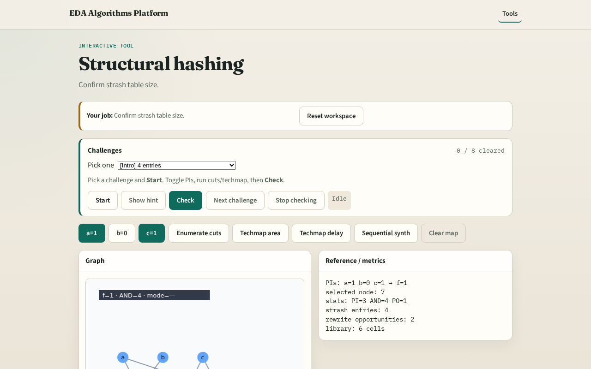

# Strash

Strash reuses identical AND structures so the graph stays compact

---

## The idea
- Canonical key sorts the two literals; table maps key → node id

---

## Table

---

## Key

---

## Lookup

---

## No dup

---

## Why

---

## Browser lab track

---

## Implement track
- Call build_strash_table; assert len==4

---

## Pitfalls
- Forgetting to sort fanins
- Hashing node id instead of literals

---

## Your turn
- Next: local rewrite opportunities

