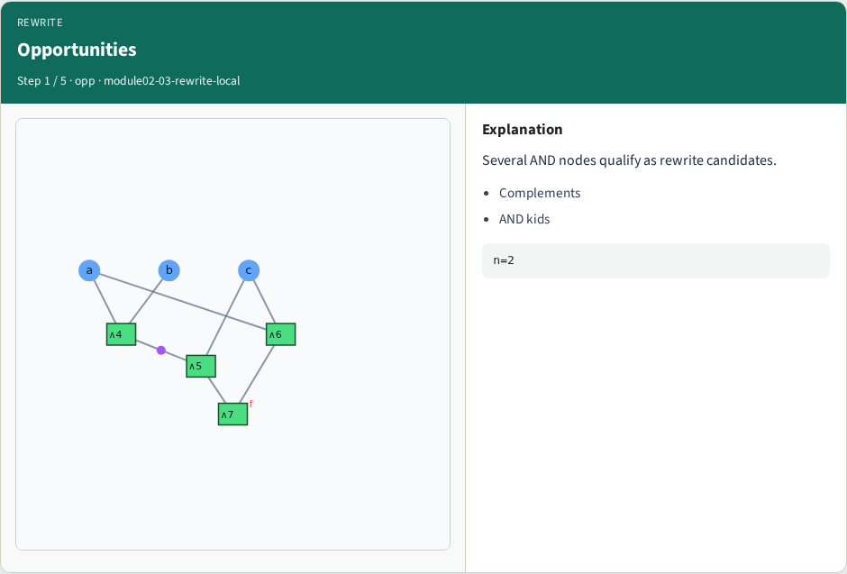
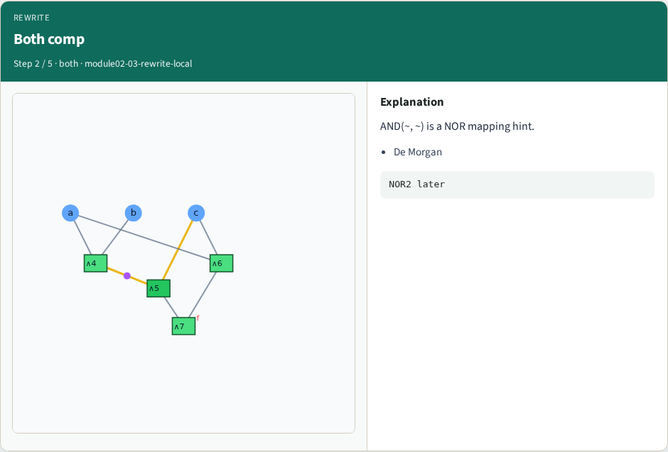
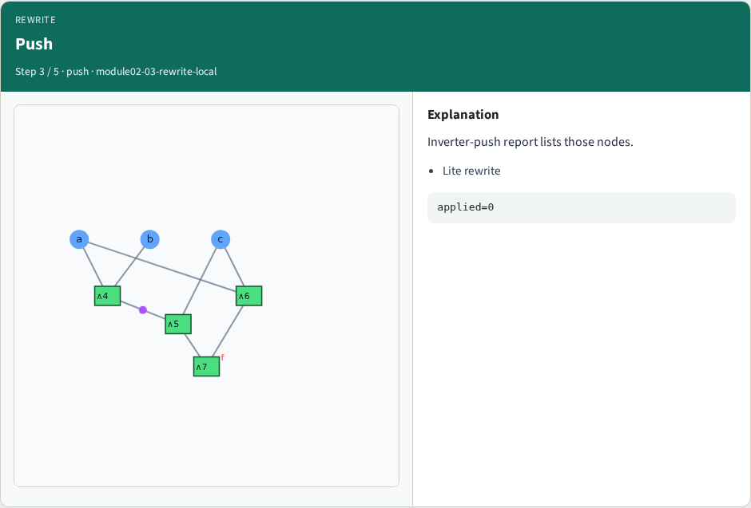
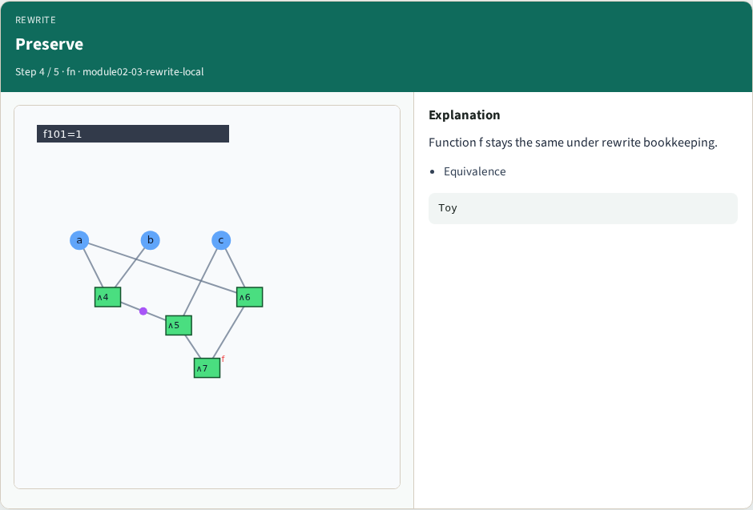
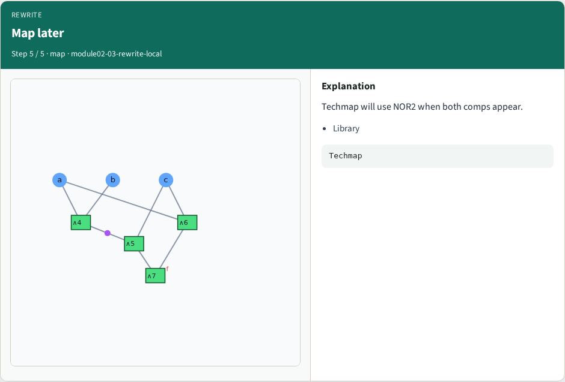
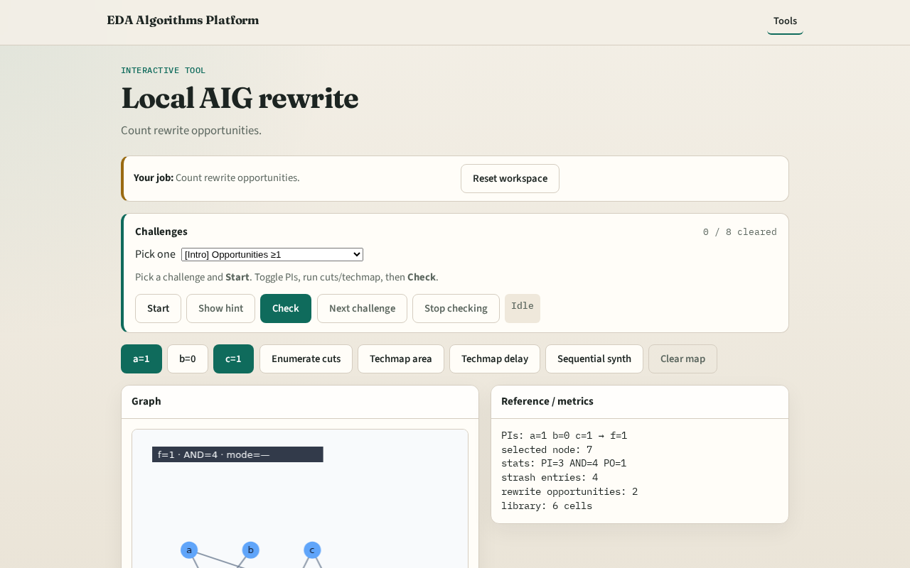

# Local AIG rewrite

**Module id:** module02-03-rewrite-local
**Lab:** rewrite-local
**Tracks:** A (implement) · B (browser lab)

## Slide 1 — Rewrite

Rewriting reshapes the AIG before mapping without changing function.

## Slide 2 — The idea

Count nodes with complemented edges or AND children; flag AND(~x,~y) as NOR-friendly.

<!-- algorithm-walkthrough -->

## Slide 3 — Opportunities

Several AND nodes qualify as rewrite candidates.

## Slide 4 — Both comp

AND(~, ~) is a NOR mapping hint.

## Slide 5 — Push

Inverter-push report lists those nodes.

## Slide 6 — Preserve

Function f stays the same under rewrite bookkeeping.

## Slide 7 — Map later

Techmap will use NOR2 when both comps appear.

<!-- /algorithm-walkthrough -->

## Slide 8 — Browser lab track

Open **rewrite-local**. Read rewrite opportunity count.

## Slide 9 — Implement track

Call local_rewrite_count and apply_inverter_push.

## Slide 10 — Pitfalls

Mutating function accidentally. Counting PIs as rewrite targets.

## Slide 11 — Your turn

Next: k-feasible cuts.
