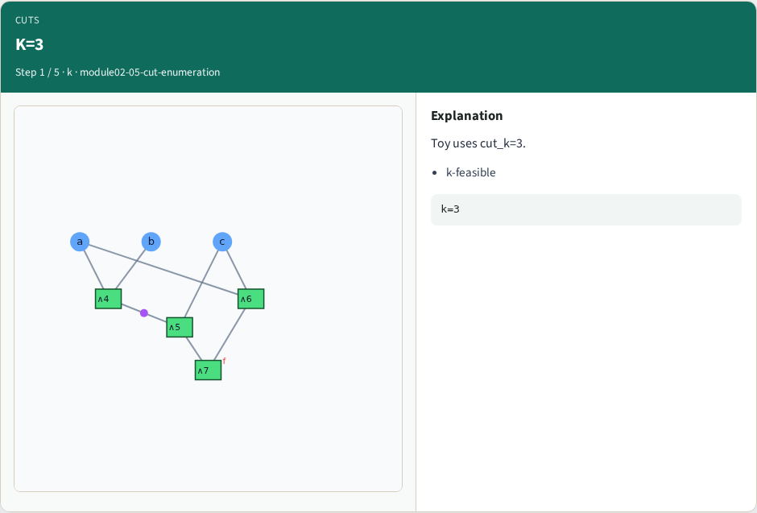
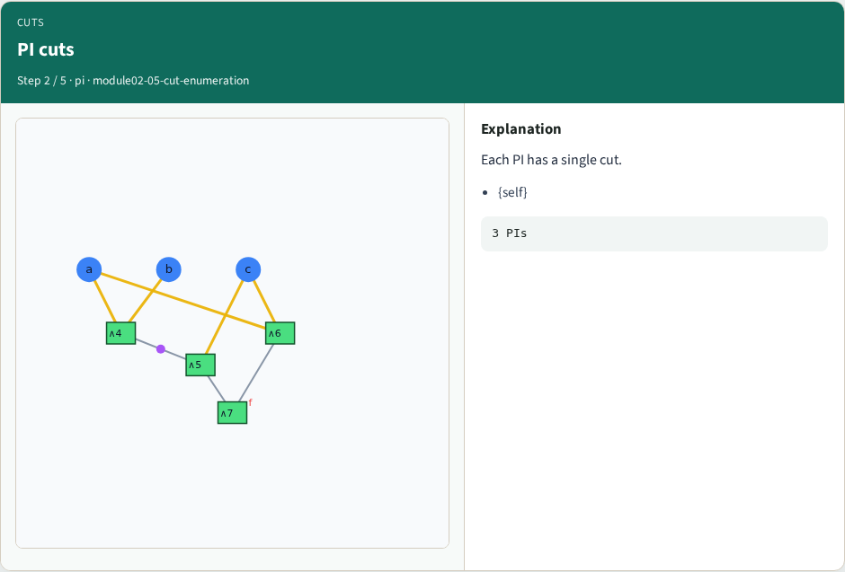
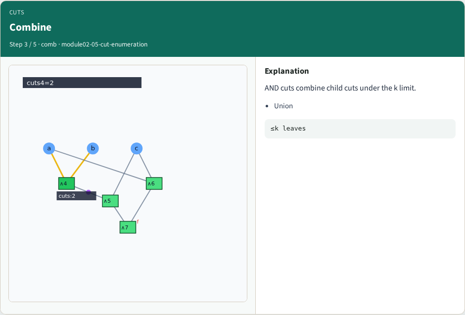
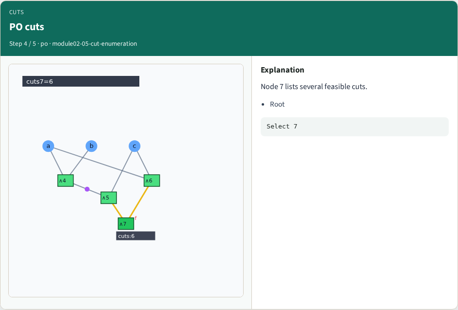
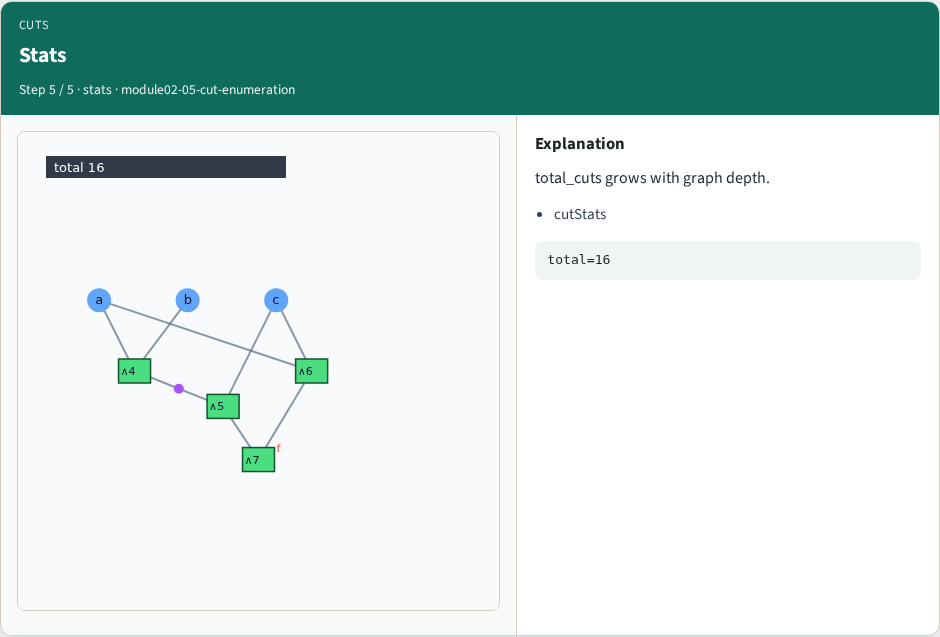
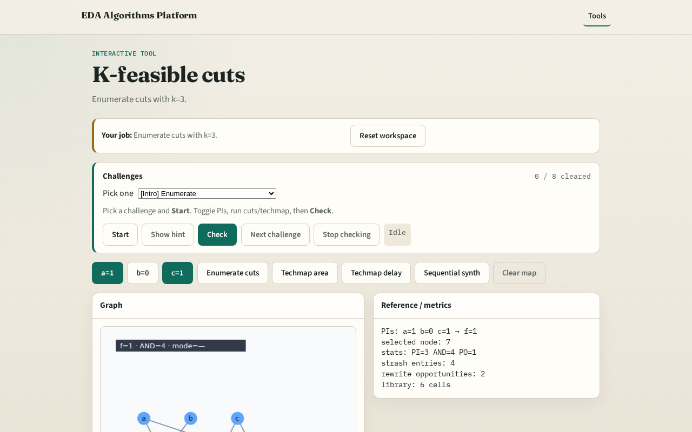

# Cuts

Cuts describe which leaves a subgraph may stand on for techmapping

---

## The idea
- PI cut={self}
- AND cuts = unions of fanin cuts with size ≤ k, plus trivial {self}

---

## K=3

---

## PI cuts

---

## Combine

---

## PO cuts

---

## Stats

---

## Browser lab track

---

## Implement track
- Call enumerate_cuts(k=3); assert all |cut|≤3

---

## Pitfalls
- Allowing cuts larger than k
- Forgetting the trivial cut

---

## Your turn
- Next: the cell library

