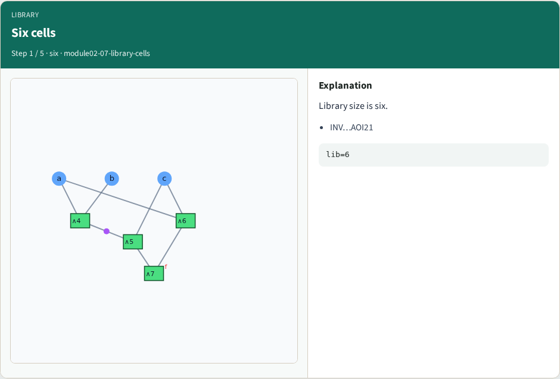
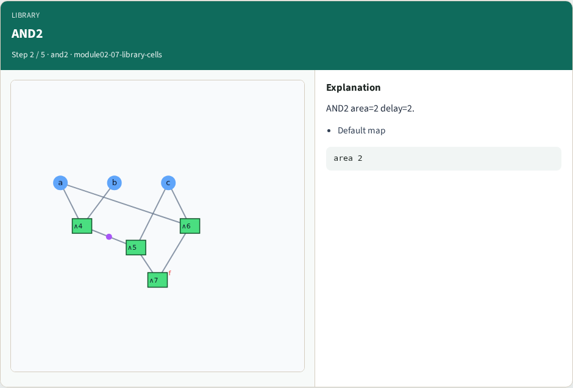
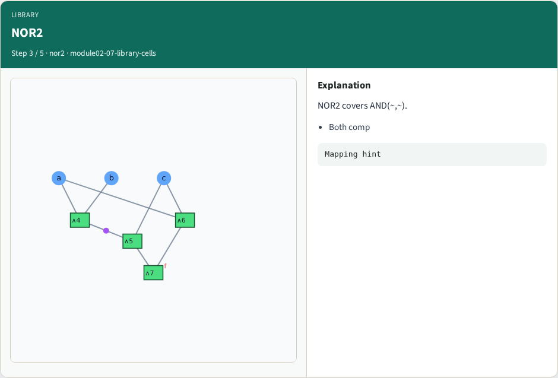
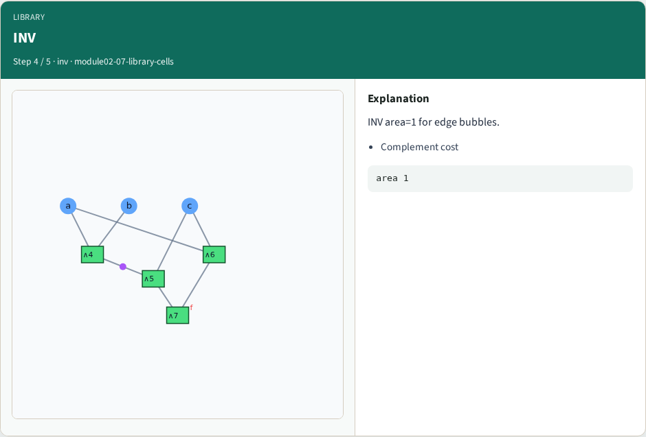
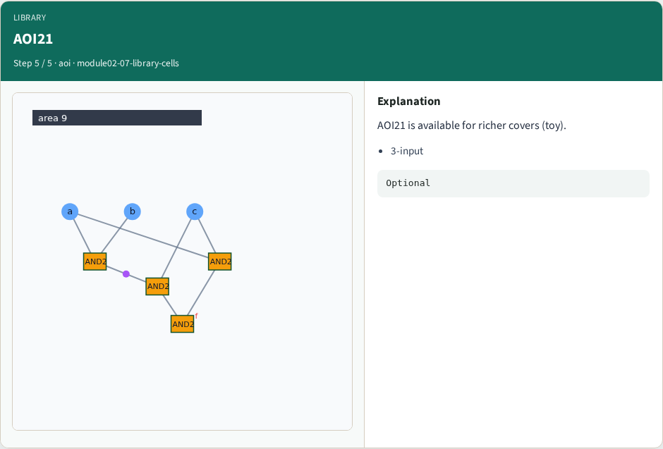
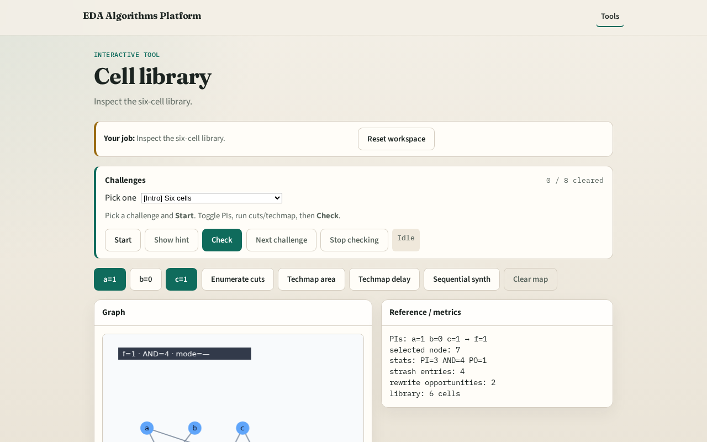

# Library

Techmapping chooses library cells that cover AIG cuts

---

## The idea
- Six cells: area and delay costs; INV for complemented edges

---

## Six cells

---

## AND2

---

## NOR2

---

## INV

---

## AOI21

---

## Browser lab track

---

## Implement track
- Print data['library']; assert len==6

---

## Pitfalls
- Ignoring area when comparing
- Mapping without INV cost

---

## Your turn
- Next: area-oriented techmap cover

