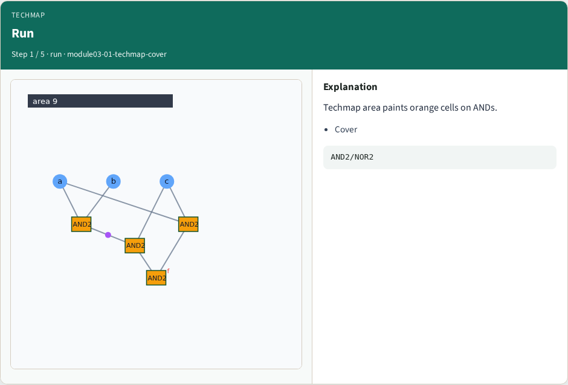
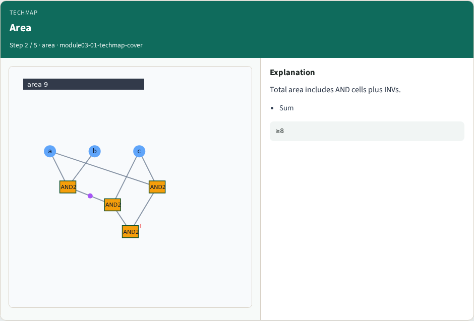
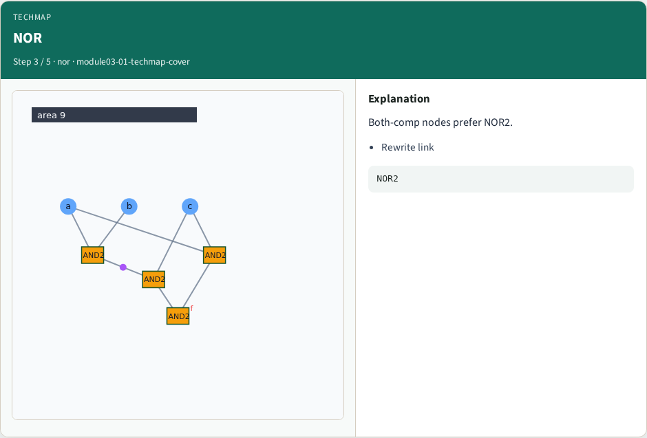
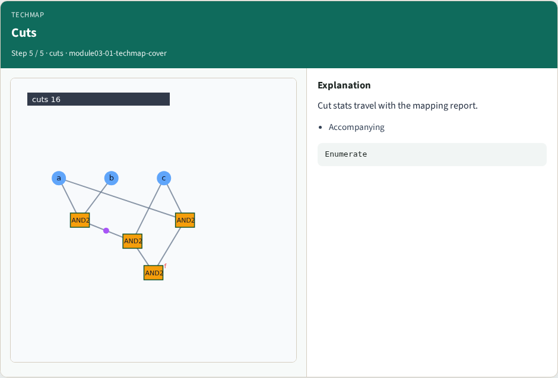

# Techmapping cover (area) — step-by-step (for slides / transcript)

**Module:** `module03-01-techmap-cover`  
**Lab / algo:** `techmap-cover`  
**Viewer:** `/tools/algorithm-walkthrough/?algo=techmap-cover&step=1`

Use each **Caption** as spoken prose (or a shortened slide note).
Use **Bullets** on the PPT; pair with the PNG in `assets/steps/`.

## Step 1 — Run



**Caption (transcript):** Techmap area paints orange cells on ANDs.

**Slide bullets:**

- Cover

**On-screen metrics:**

```
AND2/NOR2
```

## Step 2 — Area



**Caption (transcript):** Total area includes AND cells plus INVs.

**Slide bullets:**

- Sum

**On-screen metrics:**

```
≥8
```

## Step 3 — NOR



**Caption (transcript):** Both-comp nodes prefer NOR2.

**Slide bullets:**

- Rewrite link

**On-screen metrics:**

```
NOR2
```

## Step 4 — Inv


**Caption (transcript):** Complement bubbles add INV area.

**Slide bullets:**

- invArea

**On-screen metrics:**

```
Cost
```

## Step 5 — Cuts



**Caption (transcript):** Cut stats travel with the mapping report.

**Slide bullets:**

- Accompanying

**On-screen metrics:**

```
Enumerate
```

