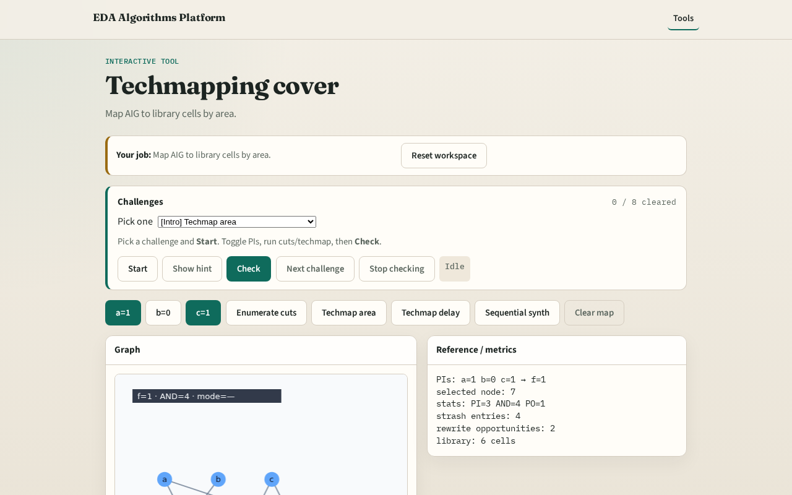

# Techmapping cover (area)

**Module id:** module03-01-techmap-cover
**Lab:** techmap-cover
**Tracks:** A (implement) · B (browser lab)

## Slide 1 — Techmap

A cover assigns a library cell to each subject node (or cut).

## Slide 2 — The idea

Greedy: AND→AND2, AND(~,~)→NOR2, plus INV per complemented edge; sum areas.

<!-- algorithm-walkthrough -->

## Slide 3 — Run

Techmap area paints orange cells on ANDs.

## Slide 4 — Area

Total area includes AND cells plus INVs.

## Slide 5 — NOR

Both-comp nodes prefer NOR2.

## Slide 6 — Inv

Complement bubbles add INV area.

## Slide 7 — Cuts

Cut stats travel with the mapping report.

<!-- /algorithm-walkthrough -->

## Slide 8 — Browser lab track

Open **techmap-cover**. Click Techmap area; read total area.

## Slide 9 — Implement track

Call techmap_area; assert area ≥ mapAreaMin.

## Slide 10 — Pitfalls

Forgetting INV cost. Mapping PIs to gates.

## Slide 11 — Your turn

Next: area vs delay tradeoff.
