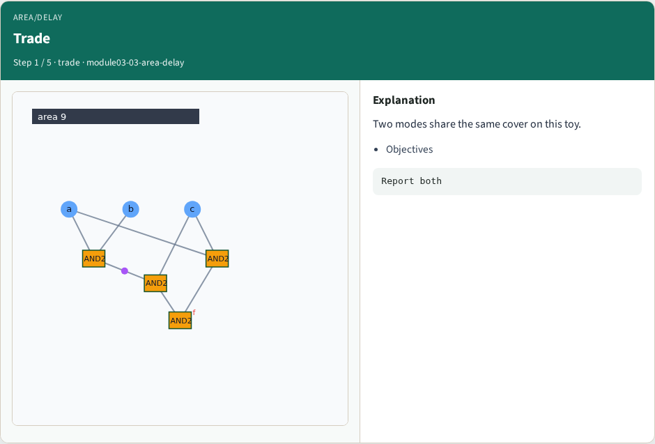
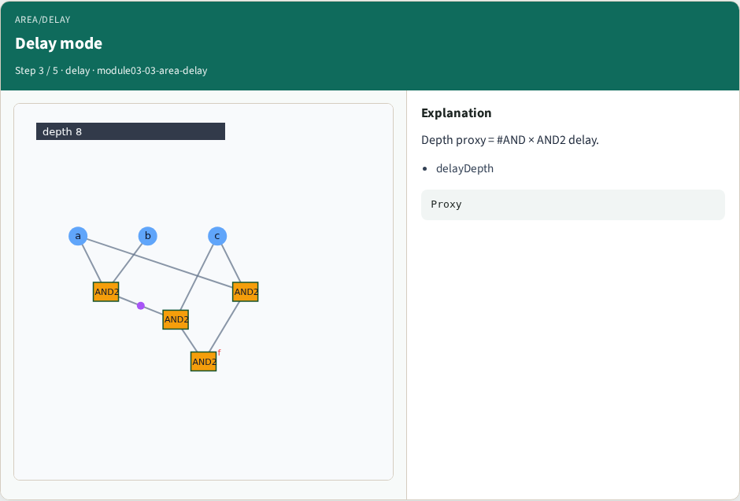
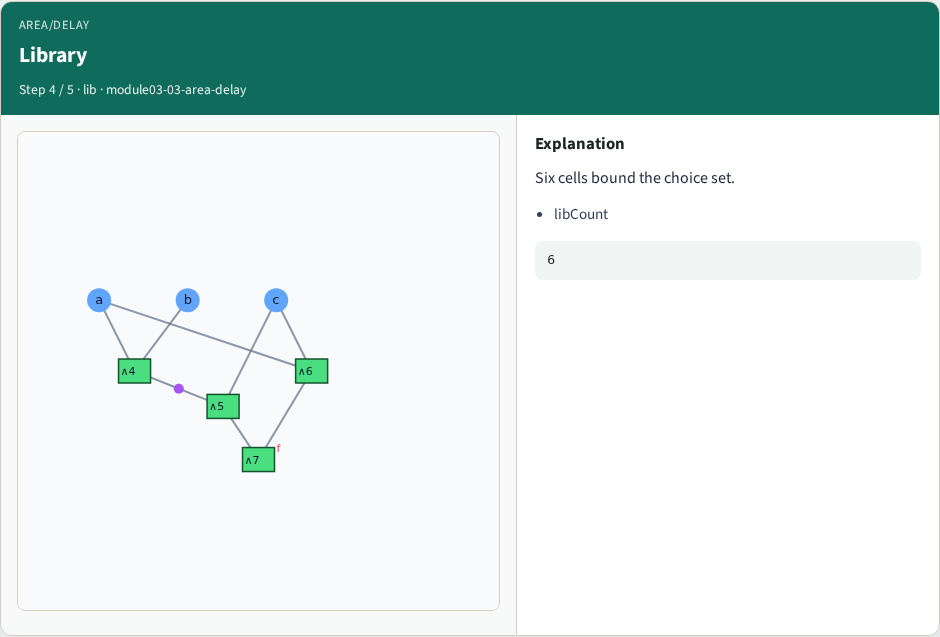
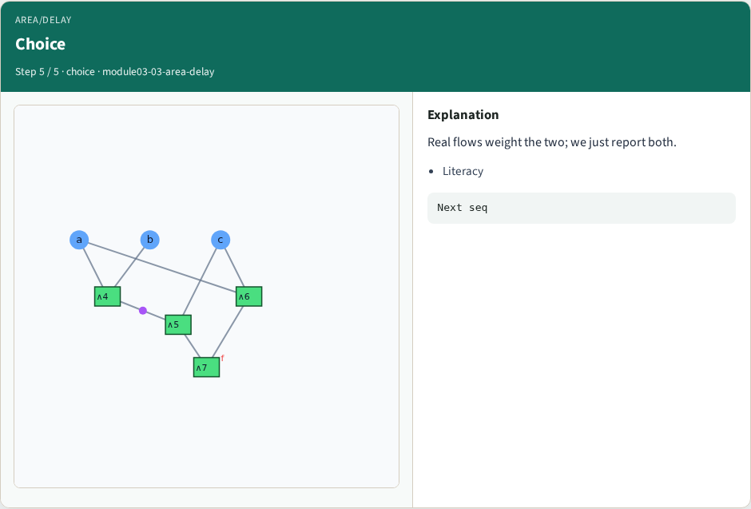

# Area vs delay tradeoff — step-by-step (for slides / transcript)

**Module:** `module03-03-area-delay`  
**Lab / algo:** `area-delay`  
**Viewer:** `/tools/algorithm-walkthrough/?algo=area-delay&step=1`

Use each **Caption** as spoken prose (or a shortened slide note).
Use **Bullets** on the PPT; pair with the PNG in `assets/steps/`.

## Step 1 — Trade



**Caption (transcript):** Two modes share the same cover on this toy.

**Slide bullets:**

- Objectives

**On-screen metrics:**

```
Report both
```

## Step 2 — Area mode


**Caption (transcript):** Sum of cell areas (plus INV).

**Slide bullets:**

- areaMode

**On-screen metrics:**

```
Primary
```

## Step 3 — Delay mode



**Caption (transcript):** Depth proxy = #AND × AND2 delay.

**Slide bullets:**

- delayDepth

**On-screen metrics:**

```
Proxy
```

## Step 4 — Library



**Caption (transcript):** Six cells bound the choice set.

**Slide bullets:**

- libCount

**On-screen metrics:**

```
6
```

## Step 5 — Choice



**Caption (transcript):** Real flows weight the two; we just report both.

**Slide bullets:**

- Literacy

**On-screen metrics:**

```
Next seq
```

