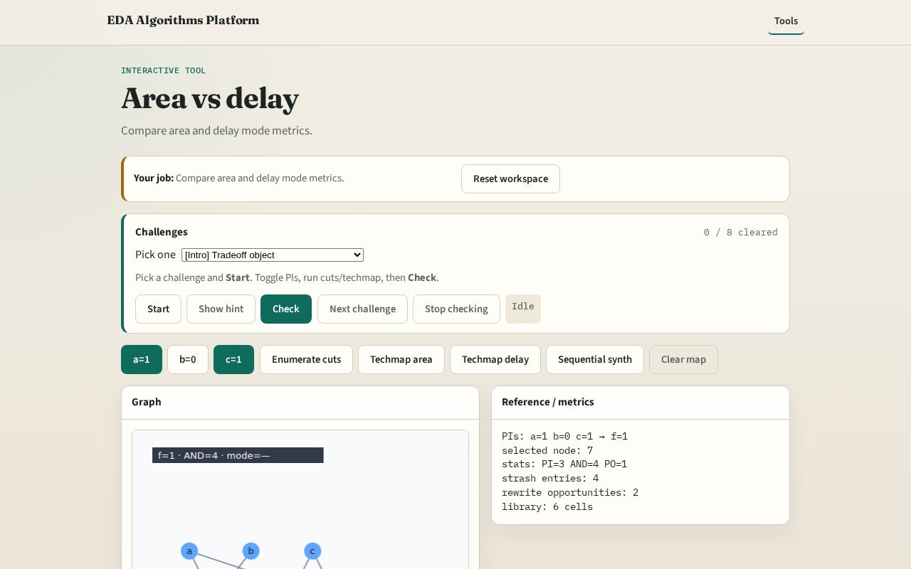

# Area/delay

Mappers optimize different objectives: area, delay, or a blend

---

## The idea
- Area_mode reports area + delay_sum; delay_mode reports depth×AND delay

---

## Trade

---

## Area mode

---

## Delay mode

---

## Library

---

## Choice

---

## Browser lab track

---

## Implement track
- Call area_delay_tradeoff; print both modes

---

## Pitfalls
- Treating delay_sum as critical path blindly
- Ignoring depth

---

## Your turn
- Next: full sequential synth pass

