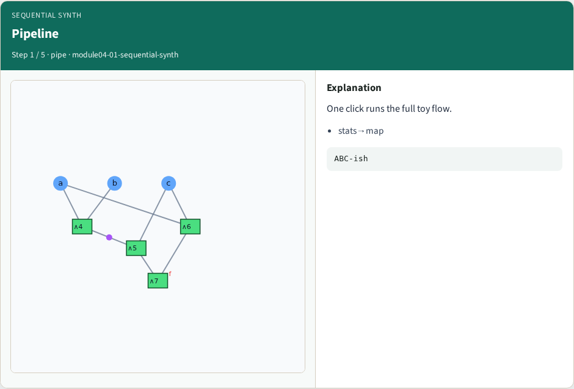
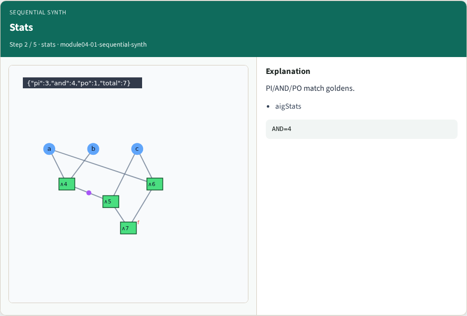
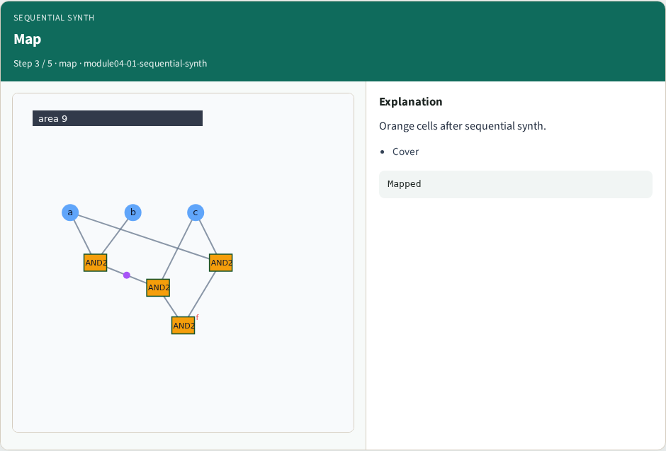
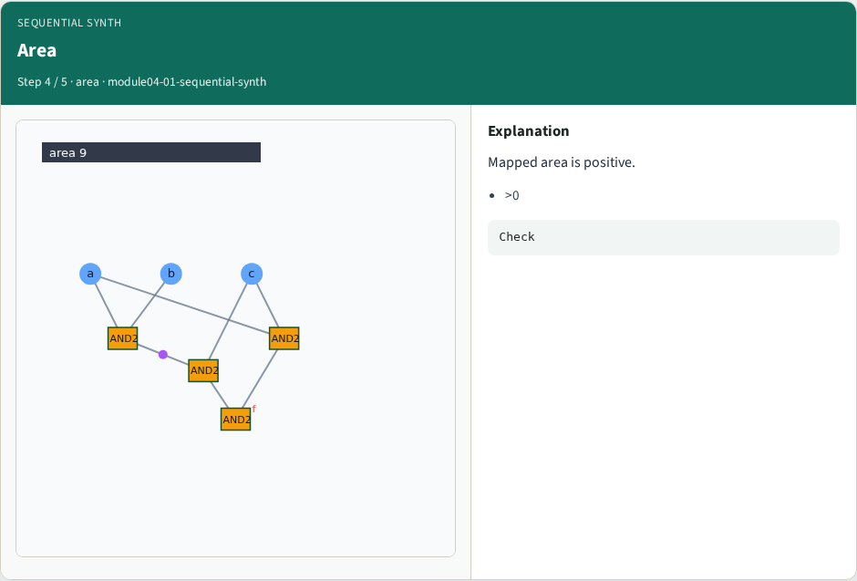
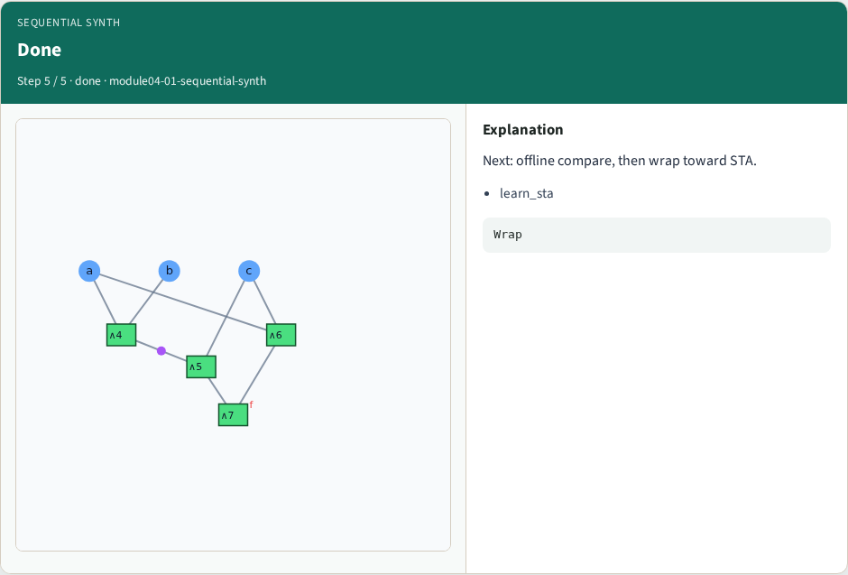
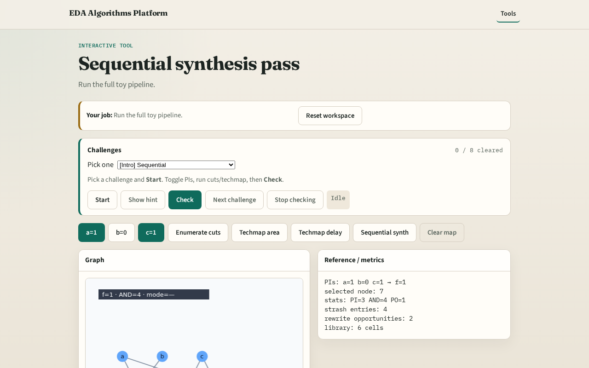

# Sequential

A full pass chains cleanup and mapping like a tiny ABC script

---

## The idea
- Sequential_synth returns stats, strash size, rewrite, cuts, mapping, tradeoff

---

## Pipeline

---

## Stats

---

## Map

---

## Area

---

## Done

---

## Browser lab track

---

## Implement track
- Call sequential_synth(data); assert mapping.area > 0

---

## Pitfalls
- Skipping strash
- Mixing delay and area covers without clearing

---

## Your turn
- Next: offline benchmark, then wrap

