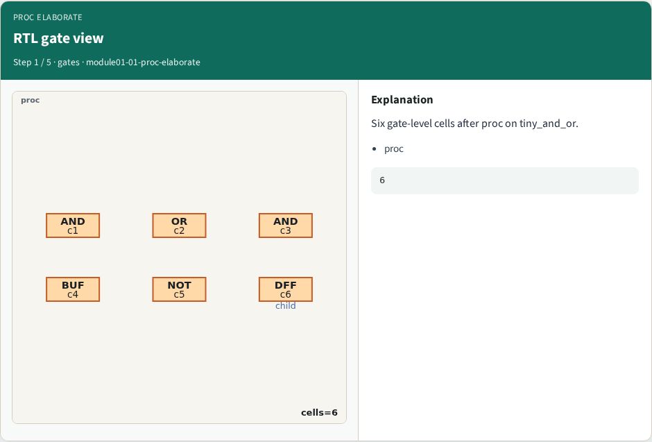
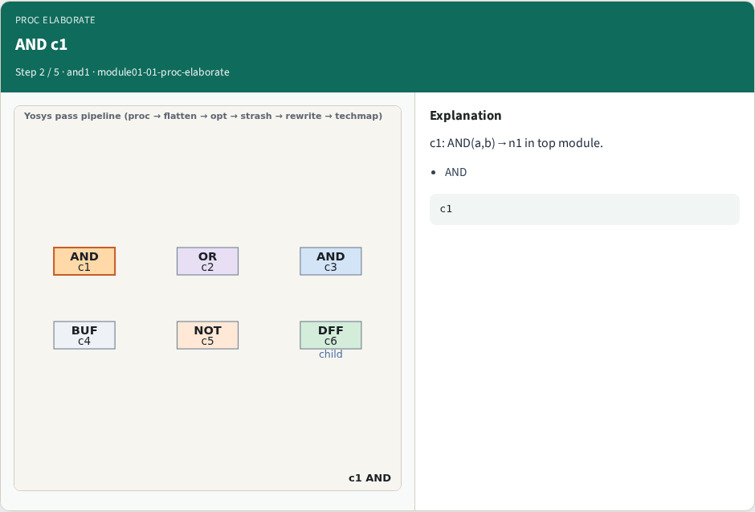
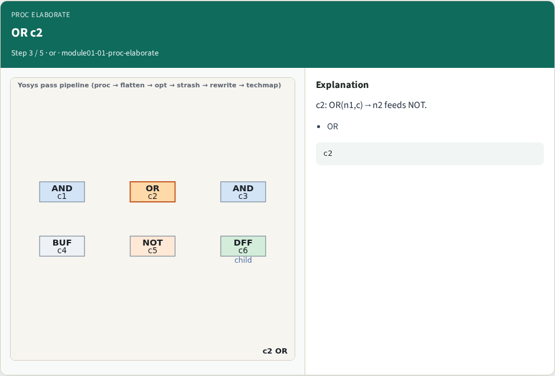
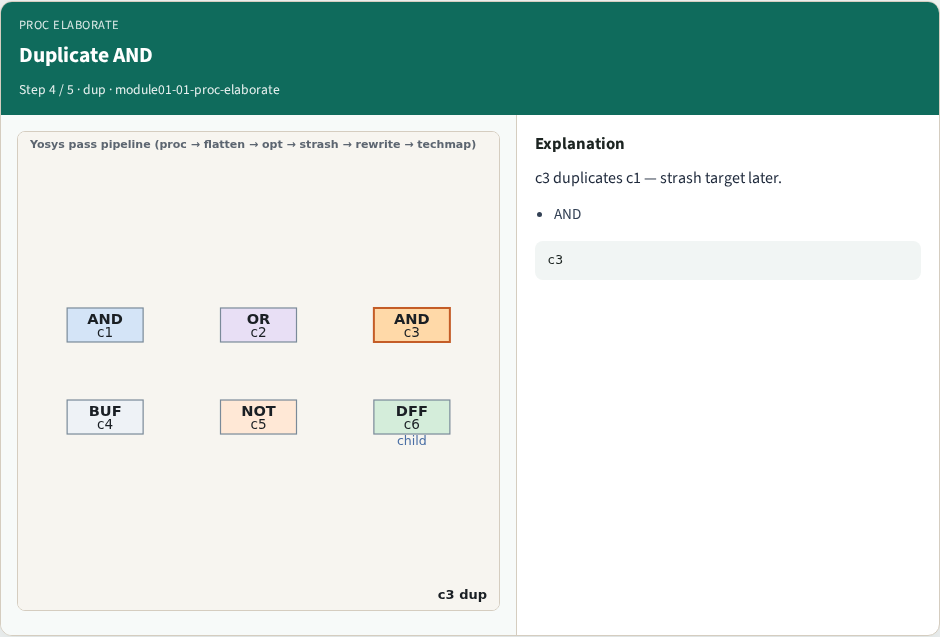
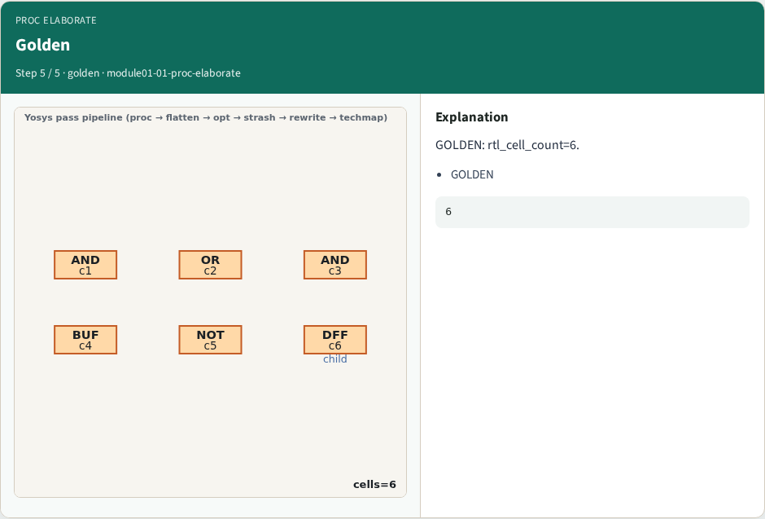

# Proc elaborate — step-by-step (for slides / transcript)

**Module:** `module01-01-proc-elaborate`  
**Lab / algo:** `proc-elaborate`  
**Viewer:** `/tools/algorithm-walkthrough/?algo=proc-elaborate&step=1`

Use each **Caption** as spoken prose (or a shortened slide note).
Use **Bullets** on the PPT; pair with the PNG in `assets/steps/`.

## Step 1 — RTL gate view



**Caption (transcript):** Six gate-level cells after proc on tiny_and_or.

**Slide bullets:**

- proc

**On-screen metrics:**

```
6
```

## Step 2 — AND c1



**Caption (transcript):** c1: AND(a,b)→n1 in top module.

**Slide bullets:**

- AND

**On-screen metrics:**

```
c1
```

## Step 3 — OR c2



**Caption (transcript):** c2: OR(n1,c)→n2 feeds NOT.

**Slide bullets:**

- OR

**On-screen metrics:**

```
c2
```

## Step 4 — Duplicate AND



**Caption (transcript):** c3 duplicates c1 — strash target later.

**Slide bullets:**

- AND

**On-screen metrics:**

```
c3
```

## Step 5 — Golden



**Caption (transcript):** GOLDEN: rtl_cell_count=6.

**Slide bullets:**

- GOLDEN

**On-screen metrics:**

```
6
```

