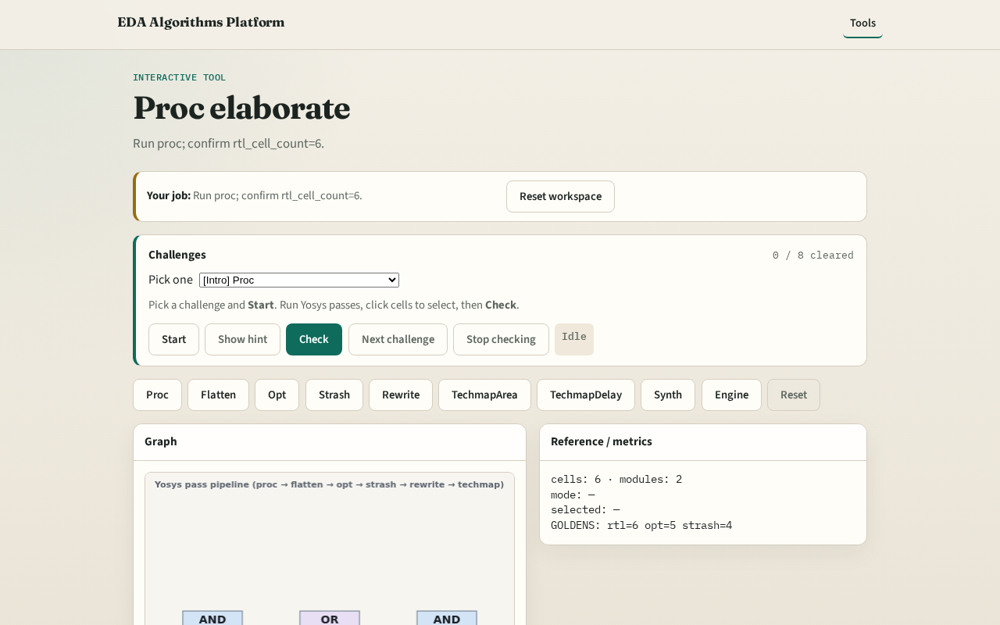

# Proc elaborate

**Module id:** module01-01-proc-elaborate
**Lab:** proc-elaborate
**Tracks:** A (implement) · B (browser lab)

## Slide 1 — Why proc

The proc pass lowers RTL to a gate-level netlist Yosys can optimize.

## Slide 2 — The idea

GOLDEN: rtl_cell_count=6, module_count=2.

<!-- algorithm-walkthrough -->

## Slide 3 — RTL gate view

Six gate-level cells after proc on tiny_and_or.

## Slide 4 — AND c1

c1: AND(a,b)→n1 in top module.

## Slide 5 — OR c2

c2: OR(n1,c)→n2 feeds NOT.

## Slide 6 — Duplicate AND

c3 duplicates c1 — strash target later.

## Slide 7 — Golden

GOLDEN: rtl_cell_count=6.

<!-- /algorithm-walkthrough -->

## Slide 8 — Browser lab track

Open **proc-elaborate**. Inspect tiny_yosys; confirm 6 cells.

## Slide 9 — Implement track

Call pass_proc(); assert cell_count==6.

## Slide 10 — Pitfalls

Confusing proc with synth. Expecting fewer cells before opt.

## Slide 11 — Your turn

Next: hierarchy flatten.
