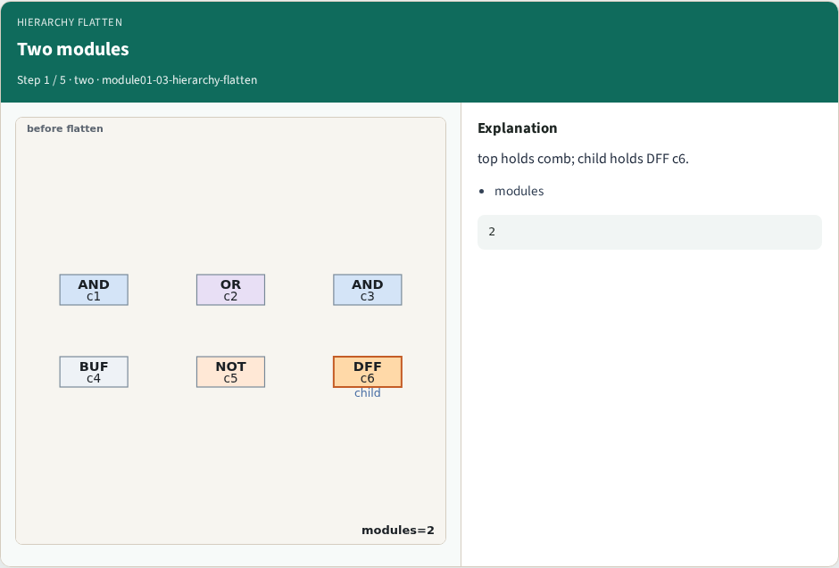
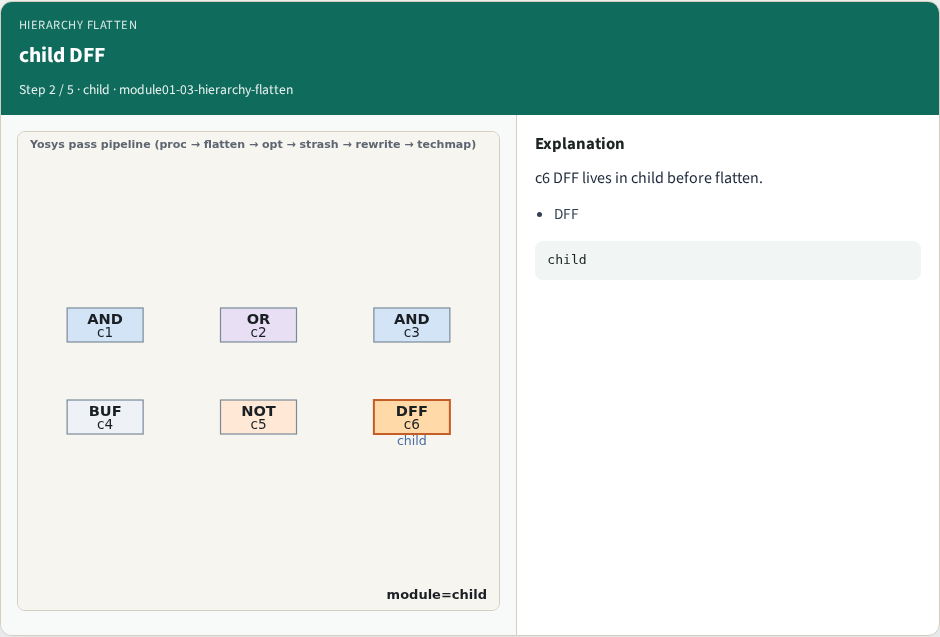
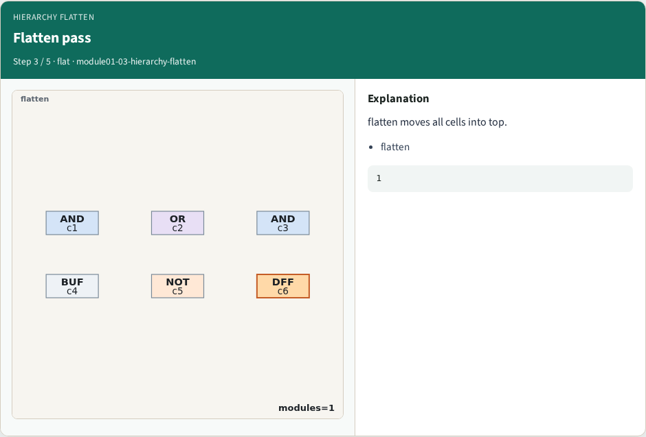
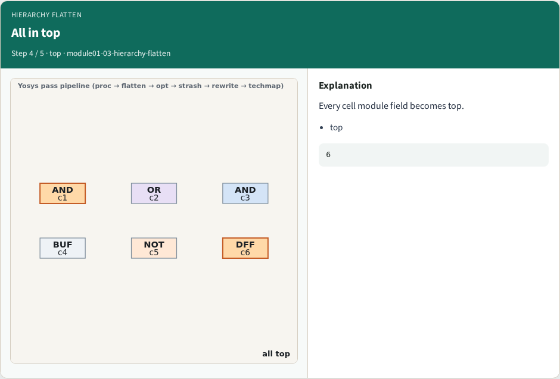
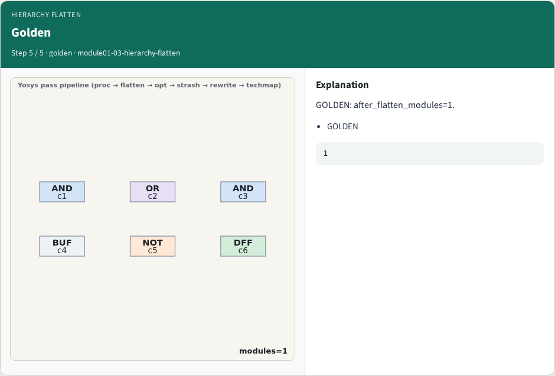
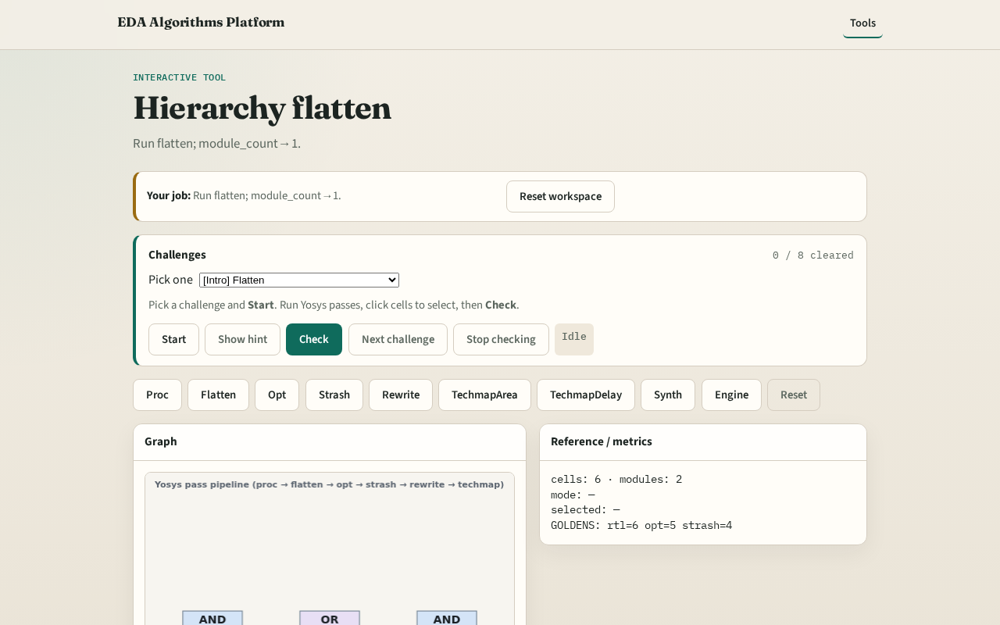

# Hierarchy flatten

**Module id:** module01-03-hierarchy-flatten
**Lab:** hierarchy-flatten
**Tracks:** A (implement) · B (browser lab)

## Slide 1 — Why flatten

Flatten merges child hierarchy so later passes see one module.

## Slide 2 — The idea

GOLDEN: after_flatten_modules=1.

<!-- algorithm-walkthrough -->

## Slide 3 — Two modules

top holds comb; child holds DFF c6.

## Slide 4 — child DFF

c6 DFF lives in child before flatten.

## Slide 5 — Flatten pass

flatten moves all cells into top.

## Slide 6 — All in top

Every cell module field becomes top.

## Slide 7 — Golden

GOLDEN: after_flatten_modules=1.

<!-- /algorithm-walkthrough -->

## Slide 8 — Browser lab track

Open **hierarchy-flatten**. Confirm module_count=1.

## Slide 9 — Implement track

Call pass_hierarchy_flatten(); assert module_count==1.

## Slide 10 — Pitfalls

Flattening before proc. Forgetting DFF in child.

## Slide 11 — Your turn

Next: opt/DCE.
