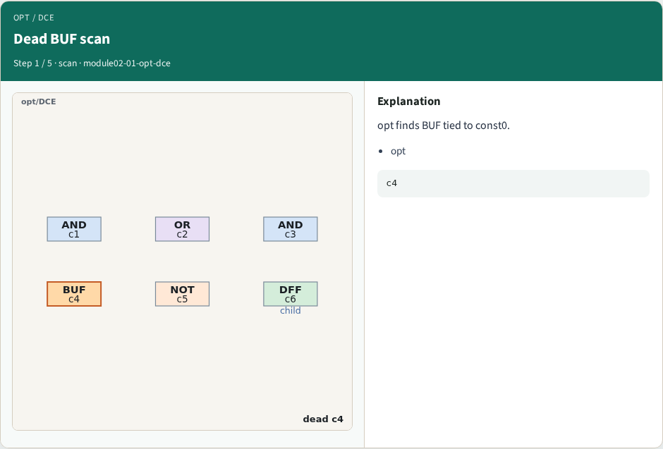
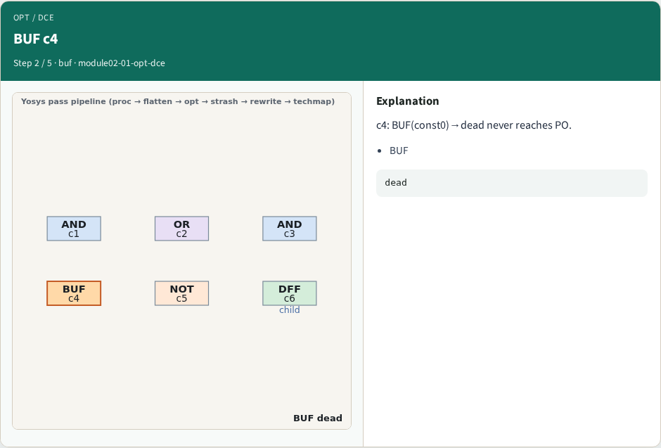
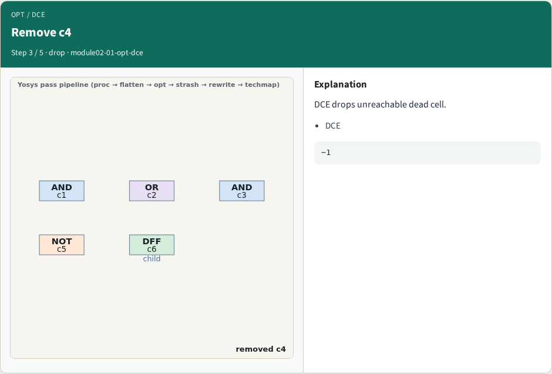
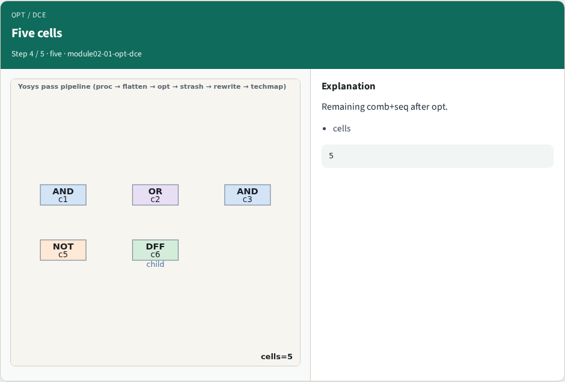
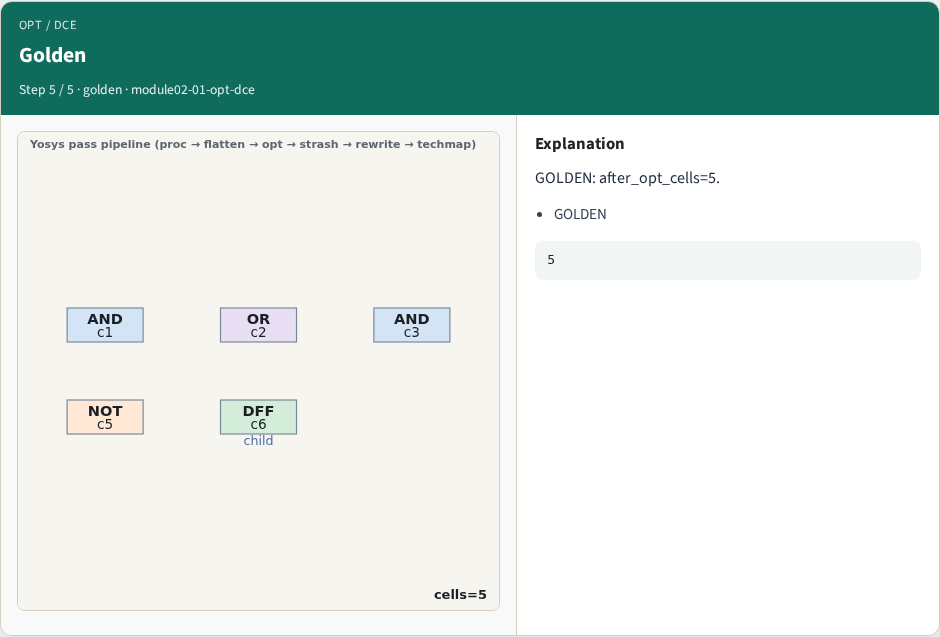
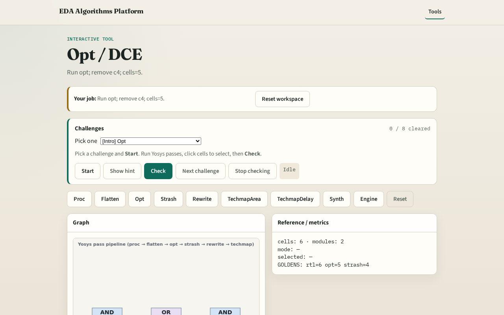

# Opt / DCE

**Module id:** module02-01-opt-dce
**Lab:** opt-dce
**Tracks:** A (implement) · B (browser lab)

## Slide 1 — Why opt

opt removes unreachable logic such as BUF tied to const0.

## Slide 2 — The idea

GOLDEN: after_opt_cells=5, removed c4.

<!-- algorithm-walkthrough -->

## Slide 3 — Dead BUF scan

opt finds BUF tied to const0.

## Slide 4 — BUF c4

c4: BUF(const0)→dead never reaches PO.

## Slide 5 — Remove c4

DCE drops unreachable dead cell.

## Slide 6 — Five cells

Remaining comb+seq after opt.

## Slide 7 — Golden

GOLDEN: after_opt_cells=5.

<!-- /algorithm-walkthrough -->

## Slide 8 — Browser lab track

Open **opt-dce**. Run opt; confirm cells=5 and c4 removed.

## Slide 9 — Implement track

Call pass_opt_dce(); assert cell_count==5 and c4 in removed.

## Slide 10 — Pitfalls

Removing live cells. Skipping opt before strash.

## Slide 11 — Your turn

Next: AIG strash.
