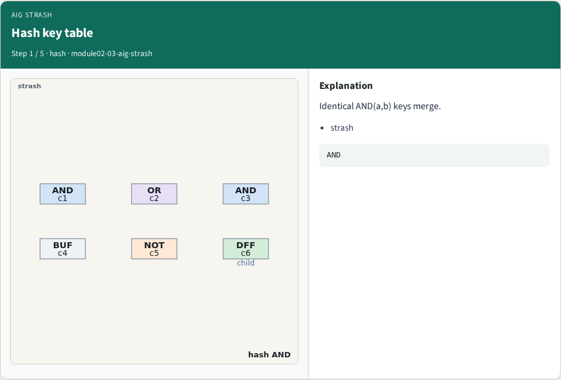
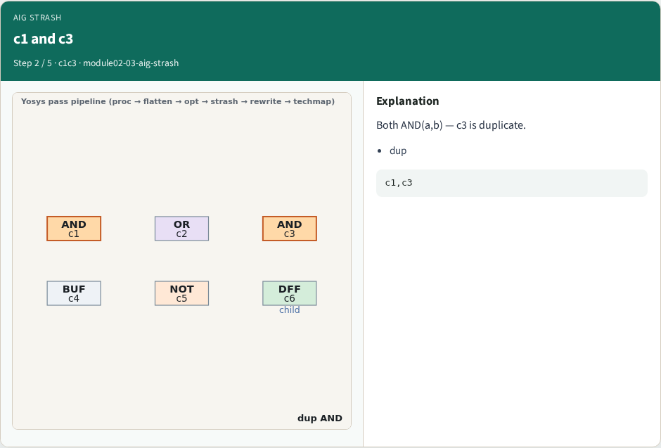
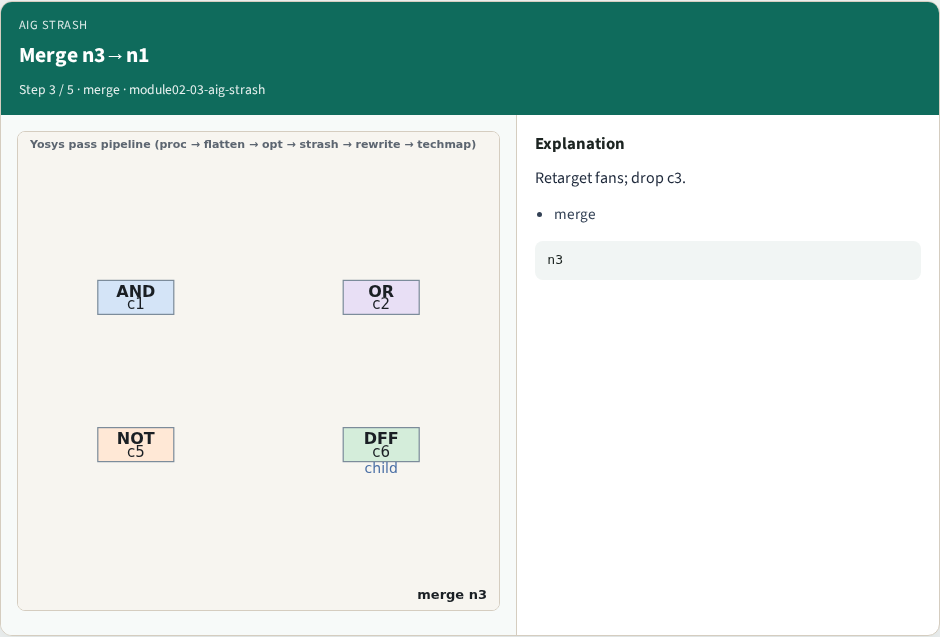
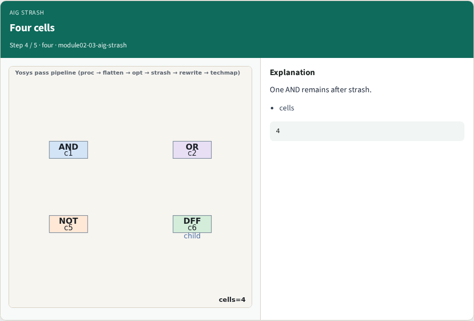
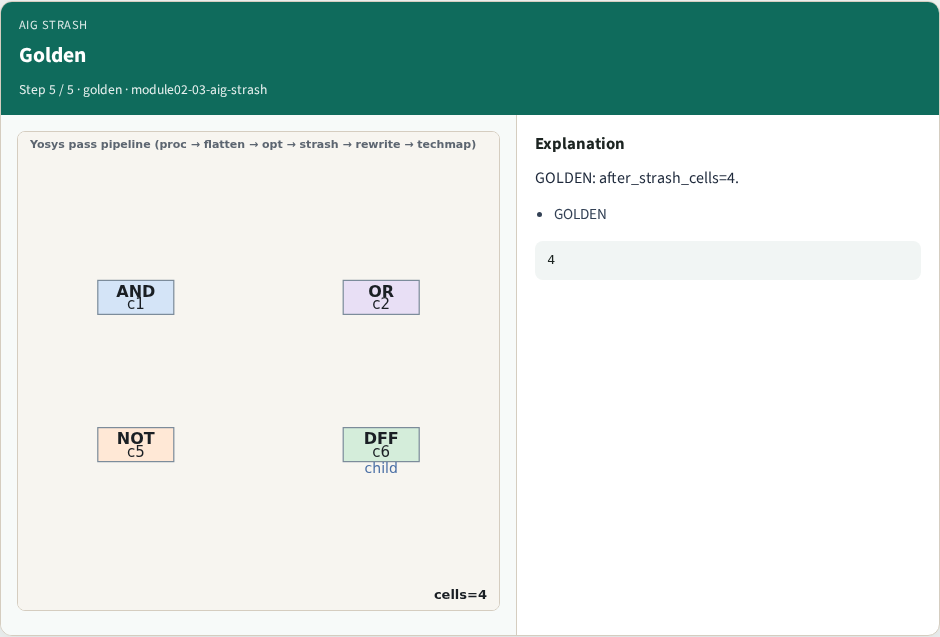
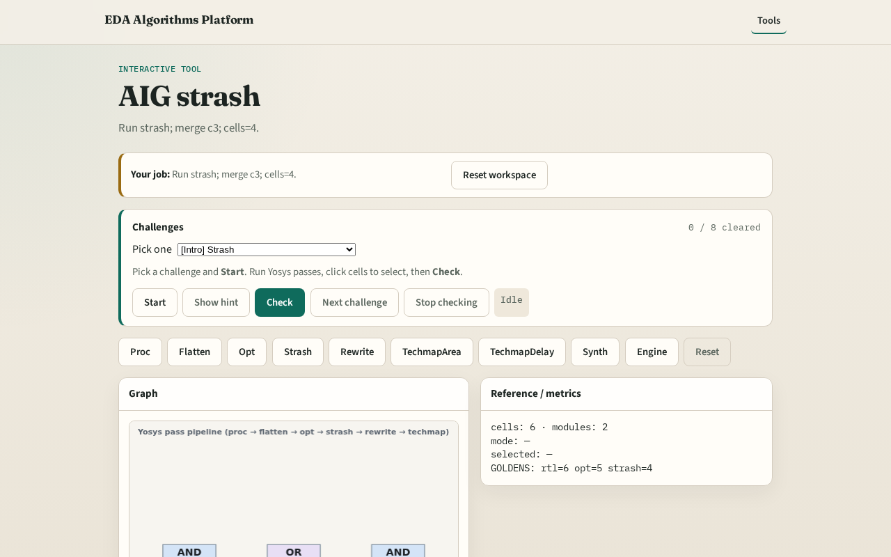

# Why strash

Strash merges structurally identical AND(a,b) and retargets fans

---

## The idea
- GOLDEN: after_strash_cells=4, merge n3→n1

---

## Hash key table

---

## c1 and c3

---

## Merge n3→n1

---

## Four cells

---

## Golden

---

## Browser lab track

---

## Implement track
- Call pass_aig_strash(); assert cell_count==4

---

## Pitfalls
- Merging unlike cells
- Forgetting fan retarget

---

## Your turn
- Next: rewrite

