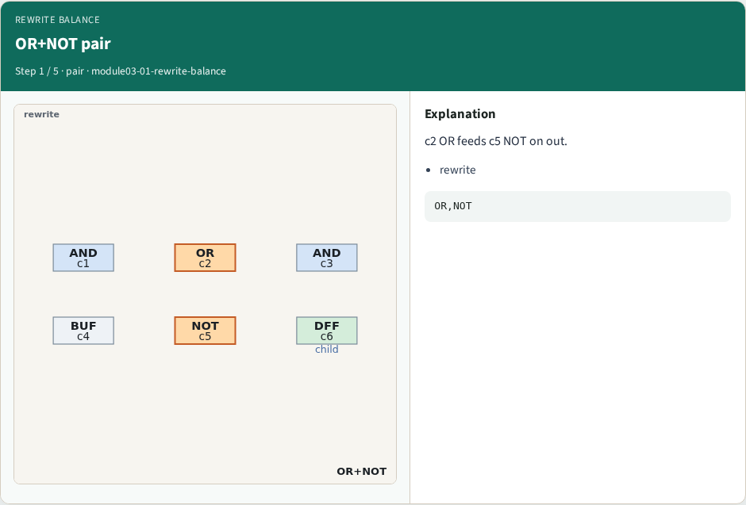
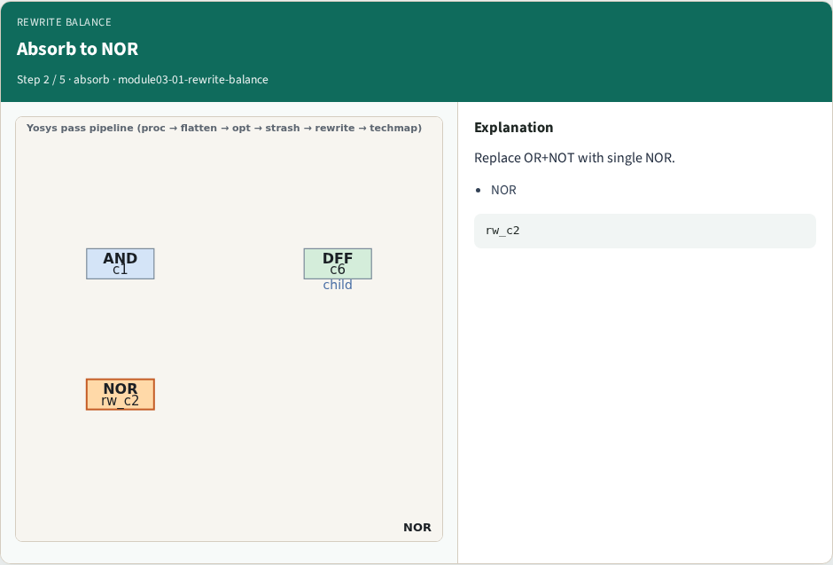
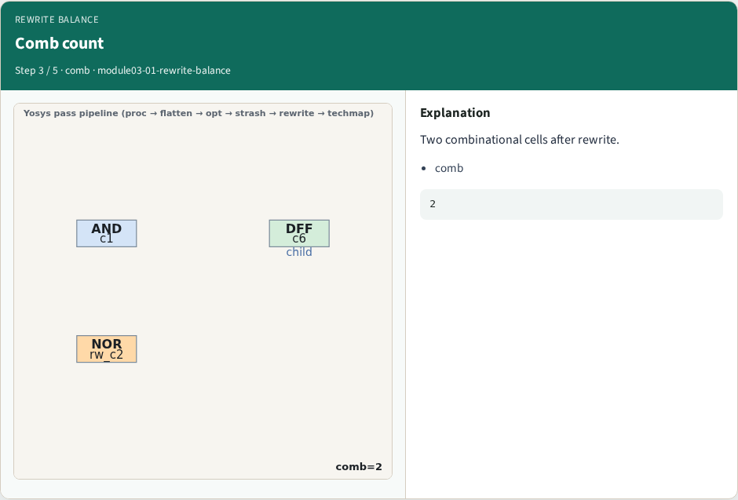
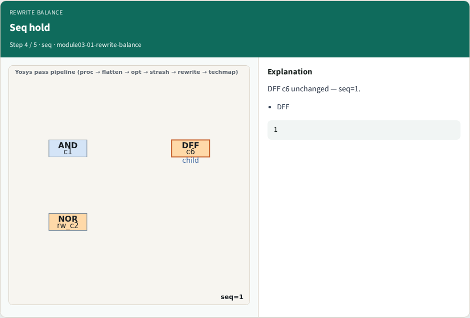
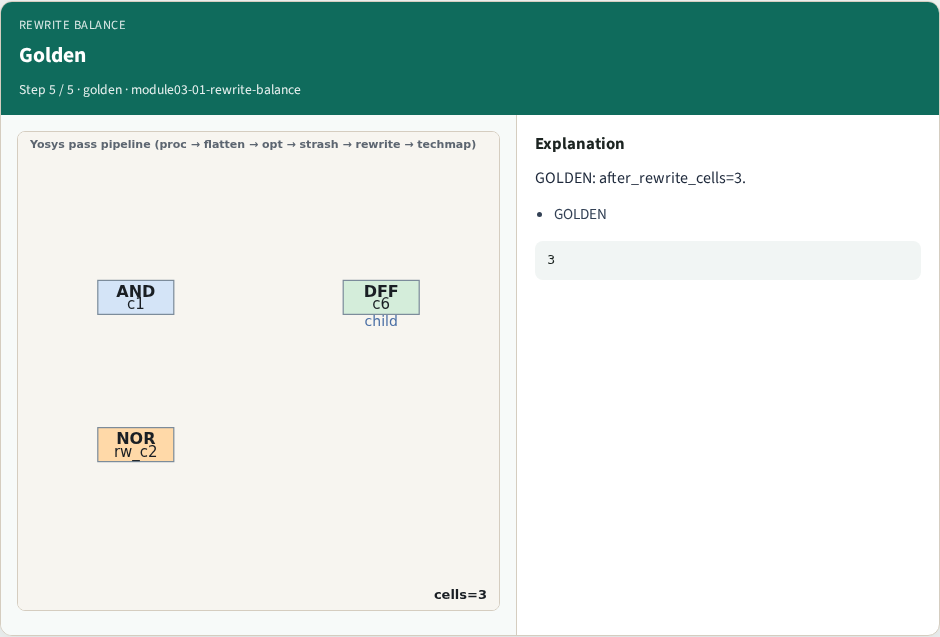
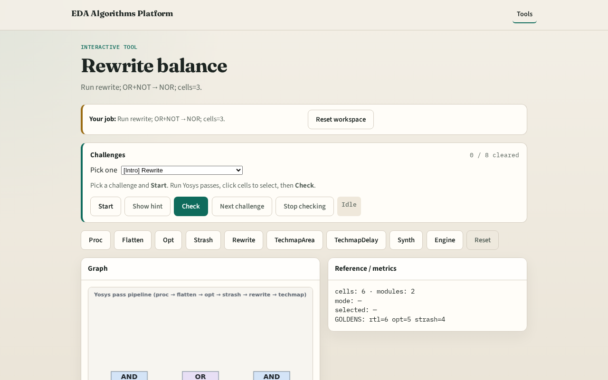

# Rewrite balance

**Module id:** module03-01-rewrite-balance
**Lab:** rewrite-balance
**Tracks:** A (implement) · B (browser lab)

## Slide 1 — Why rewrite

rewrite absorbs OR followed by NOT into a single NOR cell.

## Slide 2 — The idea

GOLDEN: after_rewrite_cells=3, comb=2, seq=1.

<!-- algorithm-walkthrough -->

## Slide 3 — OR+NOT pair

c2 OR feeds c5 NOT on out.

## Slide 4 — Absorb to NOR

Replace OR+NOT with single NOR.

## Slide 5 — Comb count

Two combinational cells after rewrite.

## Slide 6 — Seq hold

DFF c6 unchanged — seq=1.

## Slide 7 — Golden

GOLDEN: after_rewrite_cells=3.

<!-- /algorithm-walkthrough -->

## Slide 8 — Browser lab track

Open **rewrite-balance**. Confirm cells=3 and NOR present.

## Slide 9 — Implement track

Call pass_rewrite(); assert cell_count==3 and comb_count==2.

## Slide 10 — Pitfalls

Rewriting DFF. Missing OR+NOT pattern.

## Slide 11 — Your turn

Next: techmap area.
