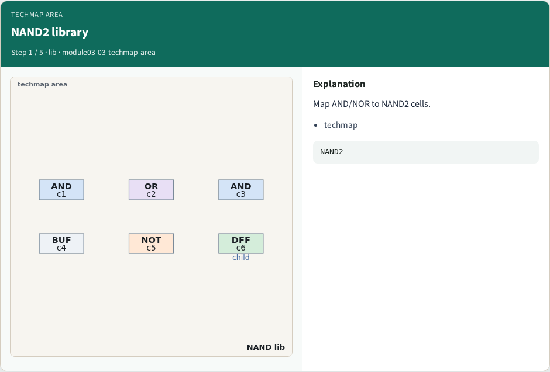
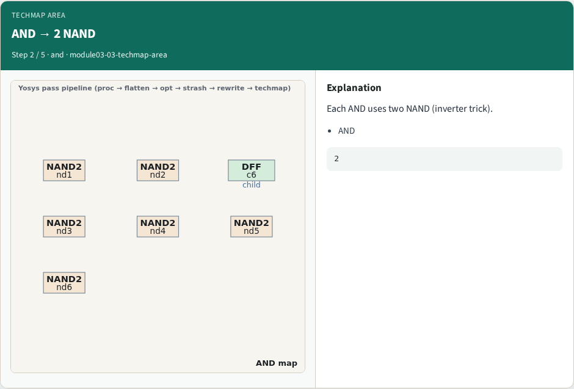
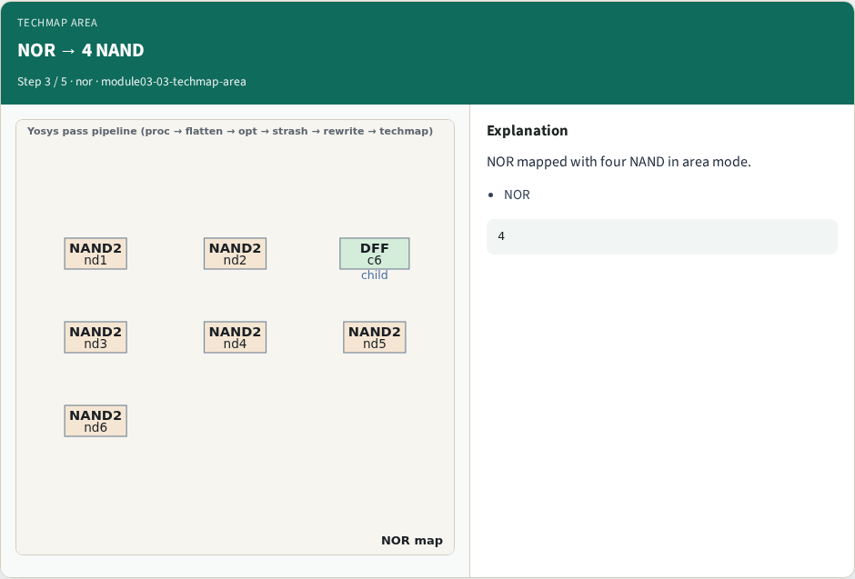
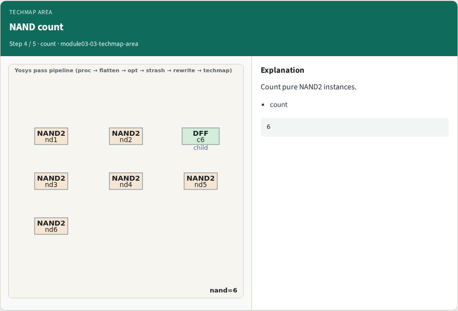
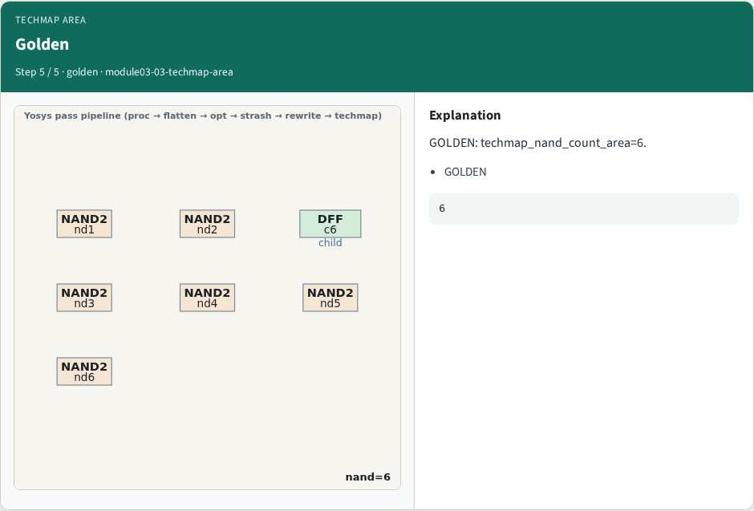
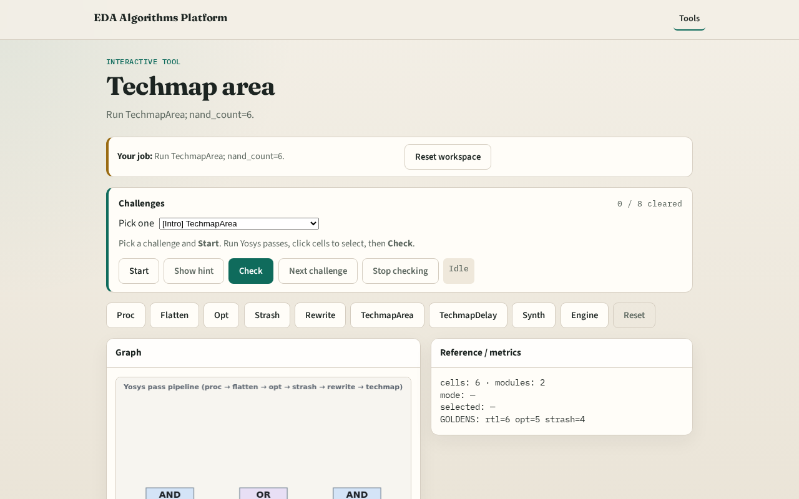

# Why area map

Techmap maps AND/NOR to a NAND2 library minimizing cell count

---

## The idea
- GOLDEN: techmap_nand_count_area=6

---

## NAND2 library

---

## AND → 2 NAND

---

## NOR → 4 NAND

---

## NAND count

---

## Golden

---

## Browser lab track

---

## Implement track
- Call pass_techmap(mode='area'); assert nand_count==6

---

## Pitfalls
- Counting DFF as NAND
- Using delay mapping

---

## Your turn
- Next: techmap delay

