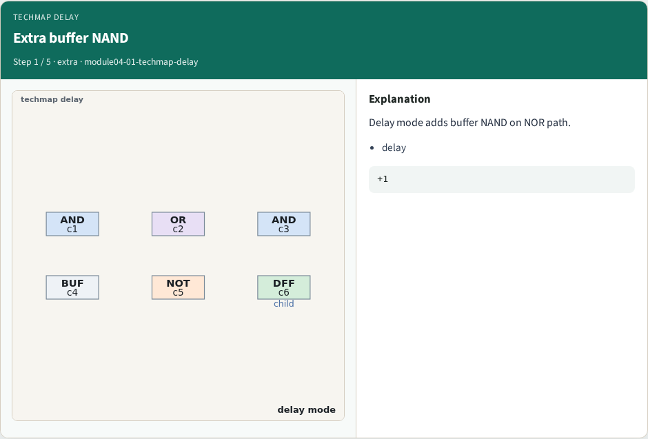
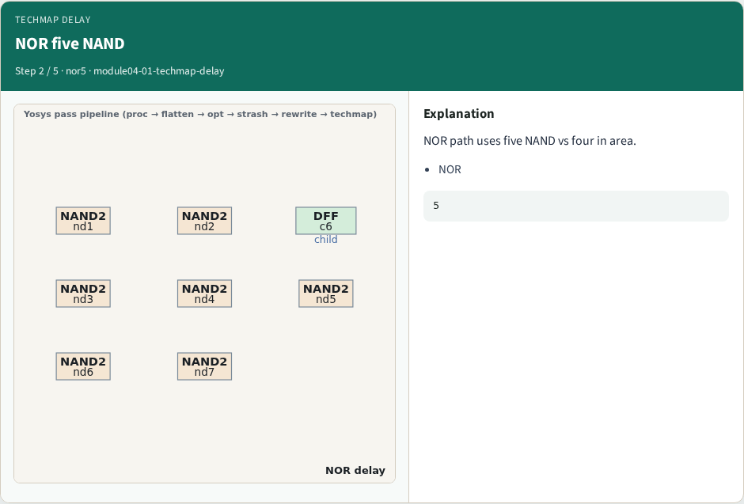
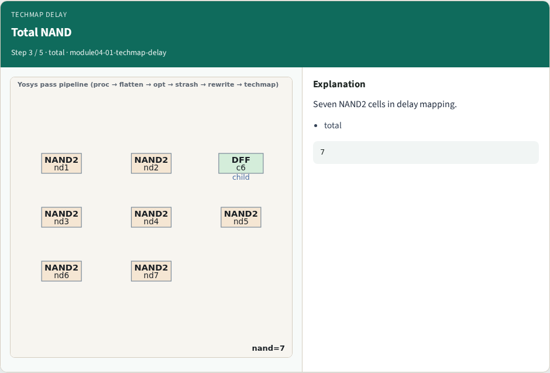
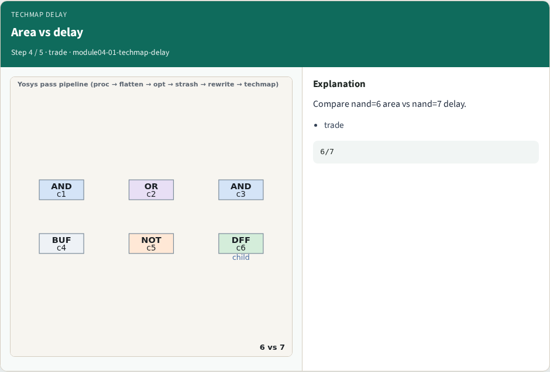
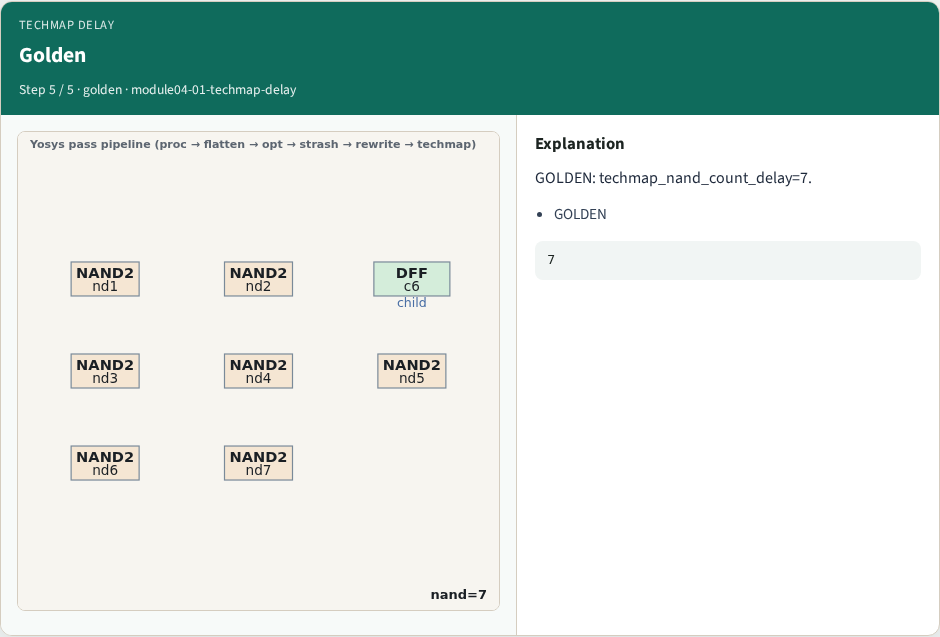
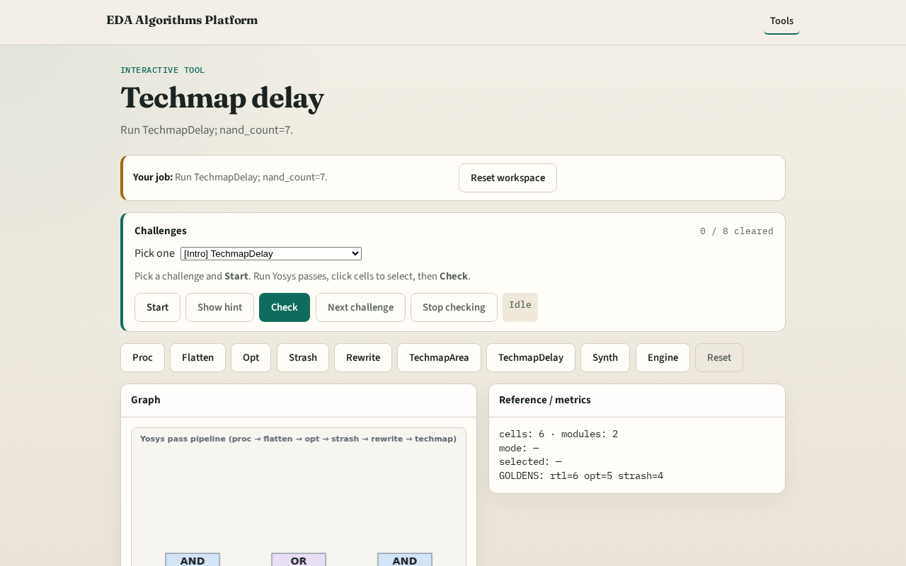

# Techmap delay

**Module id:** module04-01-techmap-delay
**Lab:** techmap-delay
**Tracks:** A (implement) · B (browser lab)

## Slide 1 — Why delay map

Delay-oriented techmap adds buffer NAND for timing literacy.

## Slide 2 — The idea

GOLDEN: techmap_nand_count_delay=7.

<!-- algorithm-walkthrough -->

## Slide 3 — Extra buffer NAND

Delay mode adds buffer NAND on NOR path.

## Slide 4 — NOR five NAND

NOR path uses five NAND vs four in area.

## Slide 5 — Total NAND

Seven NAND2 cells in delay mapping.

## Slide 6 — Area vs delay

Compare nand=6 area vs nand=7 delay.

## Slide 7 — Golden

GOLDEN: techmap_nand_count_delay=7.

<!-- /algorithm-walkthrough -->

## Slide 8 — Browser lab track

Open **techmap-delay**. Confirm nand_count=7.

## Slide 9 — Implement track

Call pass_techmap(mode='delay'); assert nand_count==7.

## Slide 10 — Pitfalls

Expecting same count as area. Ignoring DFF passthrough.

## Slide 11 — Your turn

Next: synth script.
