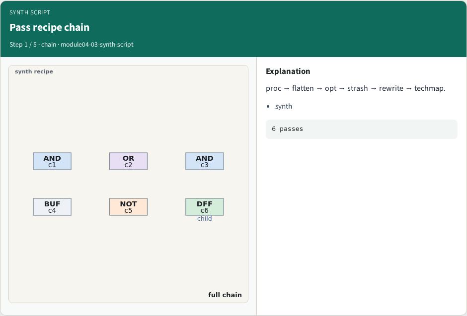
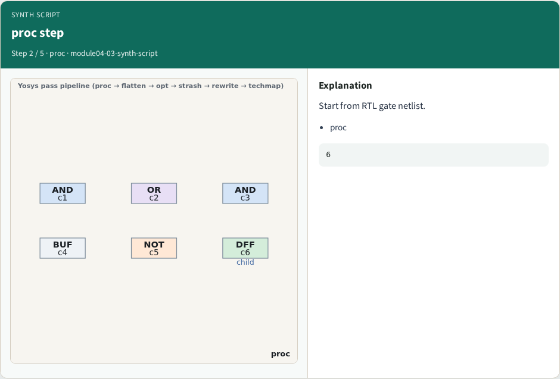
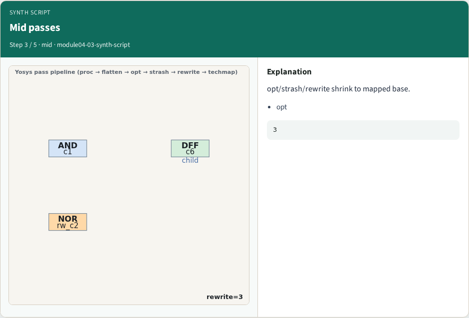
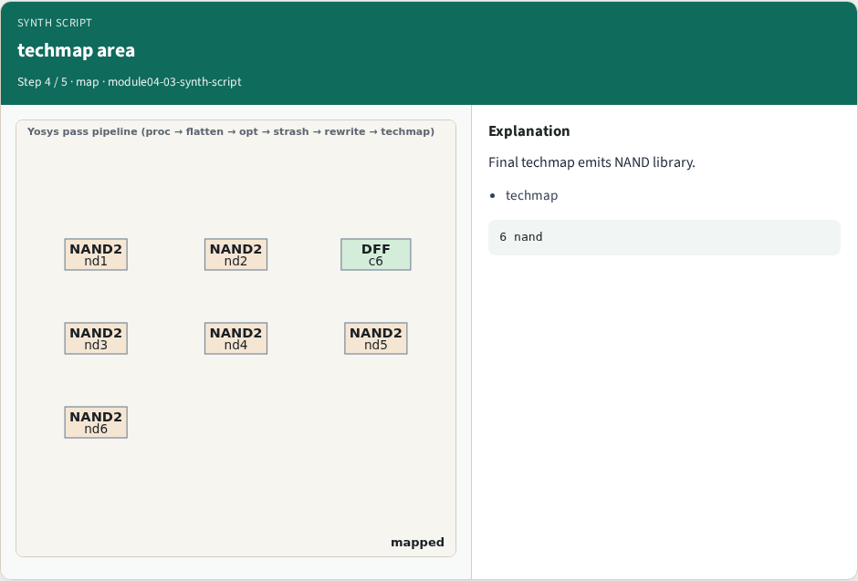
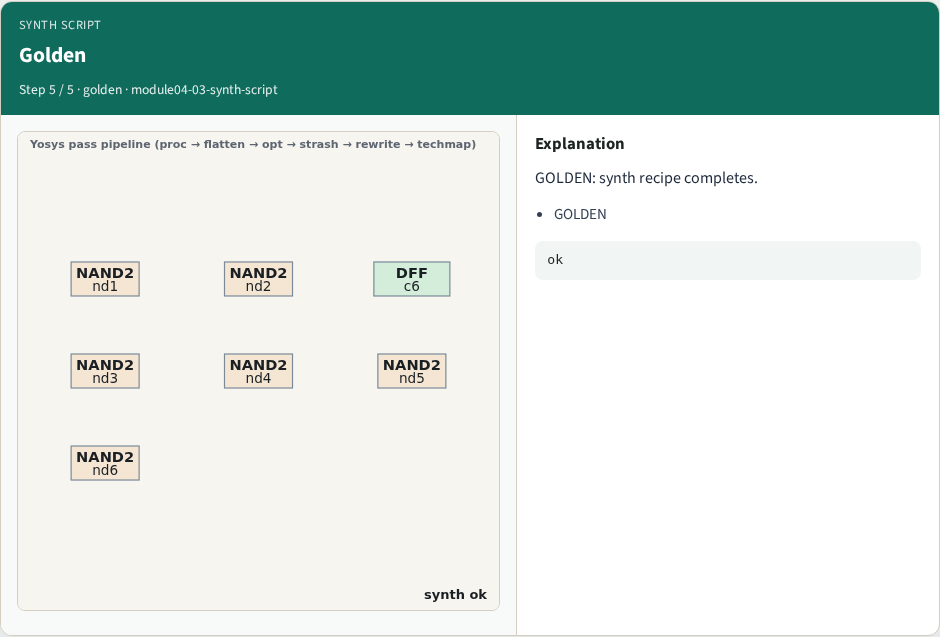
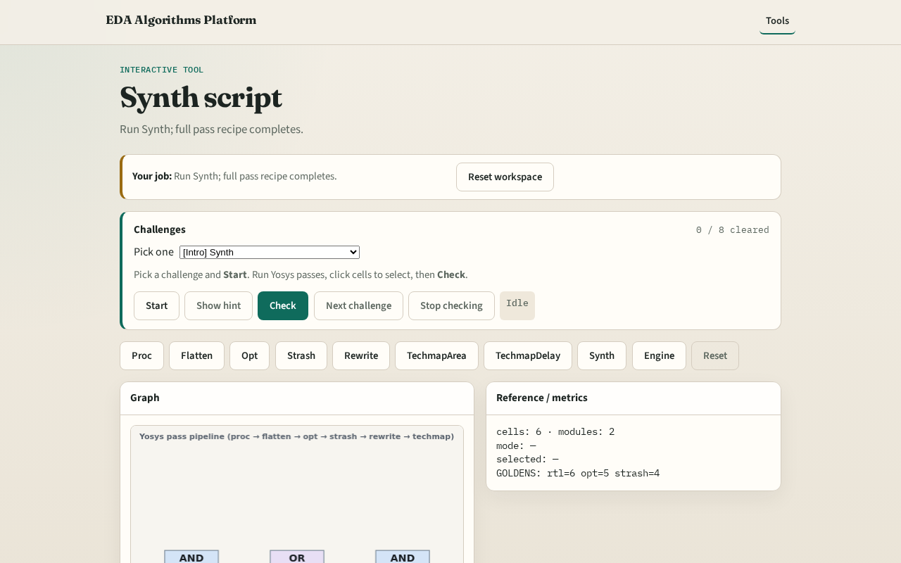

# Synth script

**Module id:** module04-03-synth-script
**Lab:** synth-script
**Tracks:** A (implement) · B (browser lab)

## Slide 1 — Why synth

A Yosys synth script chains named passes into one recipe.

## Slide 2 — The idea

GOLDEN: full chain completes with nand area mapping.

<!-- algorithm-walkthrough -->

## Slide 3 — Pass recipe chain

proc → flatten → opt → strash → rewrite → techmap.

## Slide 4 — proc step

Start from RTL gate netlist.

## Slide 5 — Mid passes

opt/strash/rewrite shrink to mapped base.

## Slide 6 — techmap area

Final techmap emits NAND library.

## Slide 7 — Golden

GOLDEN: synth recipe completes.

<!-- /algorithm-walkthrough -->

## Slide 8 — Browser lab track

Open **synth-script**. Run synth; confirm mapped netlist.

## Slide 9 — Implement track

Call pass_synth_script(); assert nand_count==6.

## Slide 10 — Pitfalls

Skipping flatten. Wrong pass order.

## Slide 11 — Your turn

Next: yosys engine.
