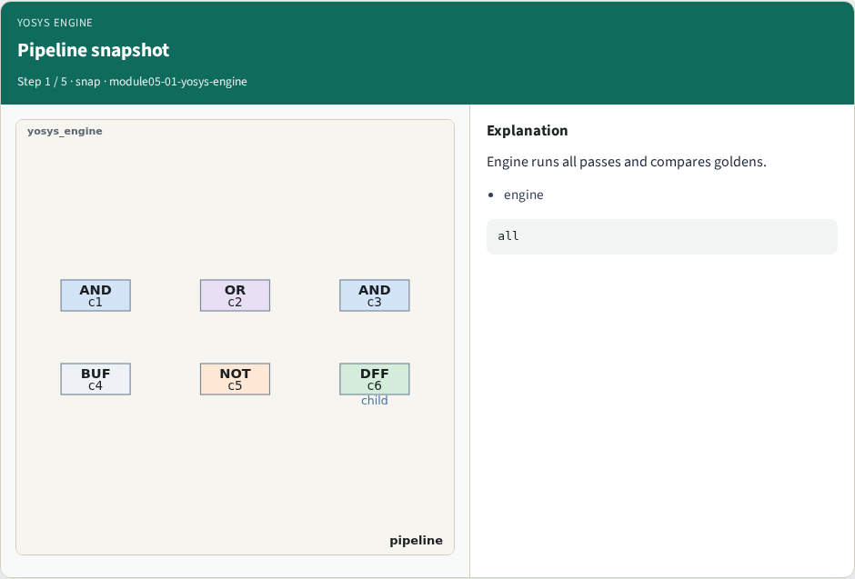
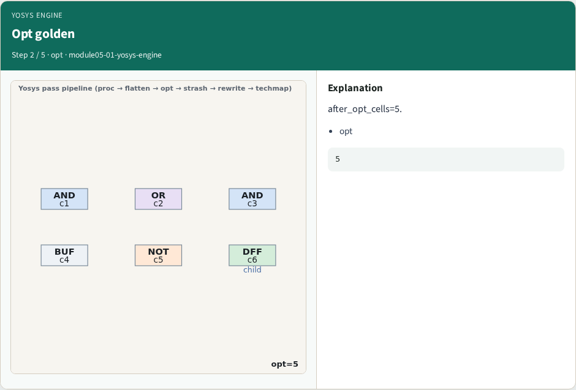
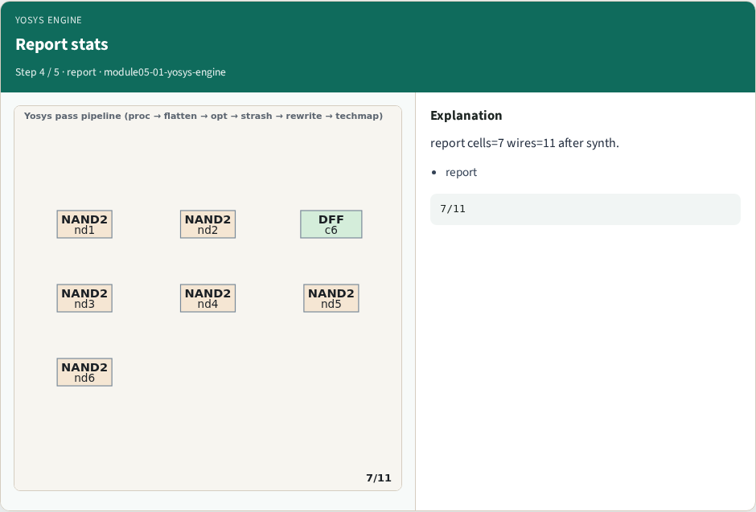
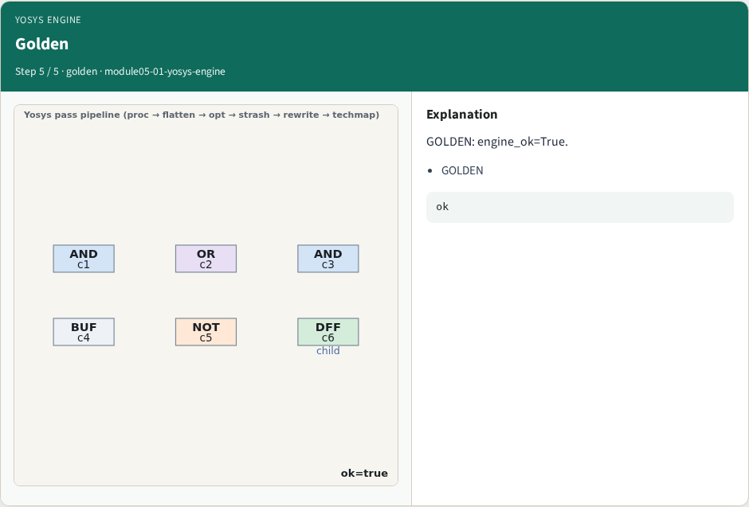
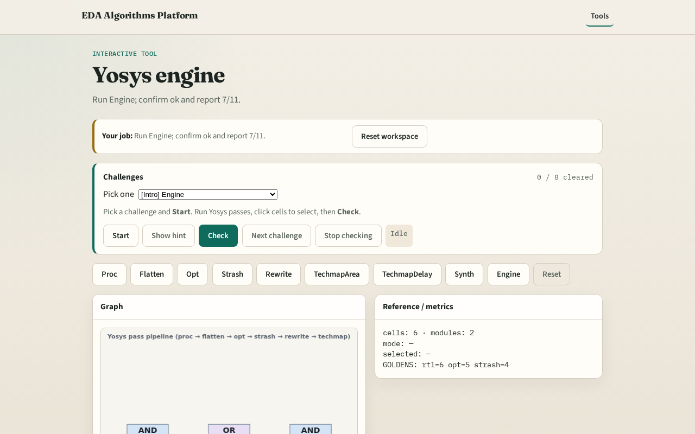

# Yosys engine integration

**Module id:** module05-01-yosys-engine
**Lab:** yosys-engine
**Tracks:** A (implement) · B (browser lab)

## Slide 1 — Engine

A tiny engine chains all passes and compares report stats to goldens.

## Slide 2 — The idea

GOLDEN: engine_ok=True, report_cells=7, report_wires=11.

<!-- algorithm-walkthrough -->

## Slide 3 — Pipeline snapshot

Engine runs all passes and compares goldens.

## Slide 4 — Opt golden

after_opt_cells=5.

## Slide 5 — Strash golden

after_strash_cells=4.

## Slide 6 — Report stats

report cells=7 wires=11 after synth.

## Slide 7 — Golden

GOLDEN: engine_ok=True.

<!-- /algorithm-walkthrough -->

## Slide 8 — Browser lab track

Open **yosys-engine**. Run engine; confirm ok and report 7/11.

## Slide 9 — Implement track

Call yosys_engine(); assert ok and report cell/wire counts.

## Slide 10 — Pitfalls

Reporting partial passes. Changing toy without updating goldens.

## Slide 11 — Your turn

Next: offline compare, then wrap.
