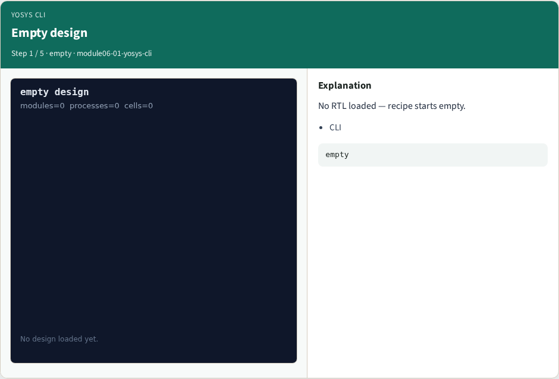
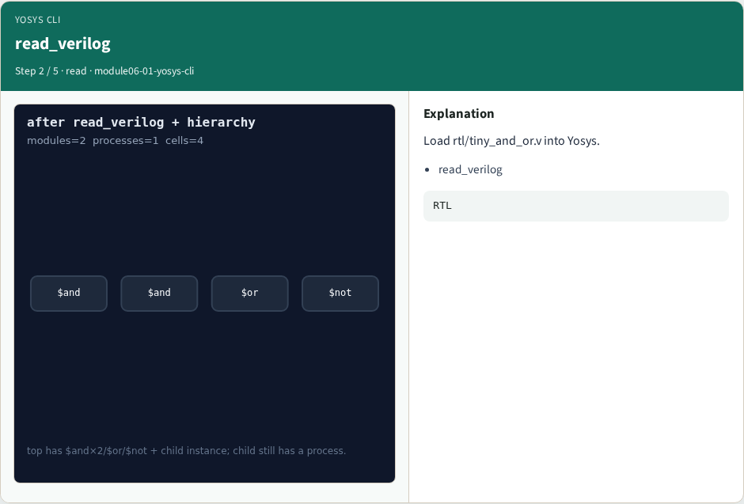
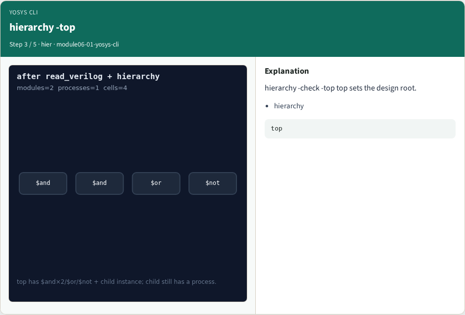
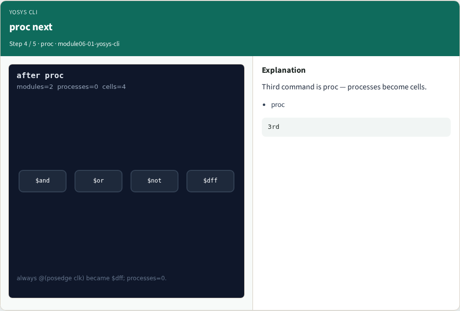

# Yosys CLI & scripts — step-by-step (for slides / transcript)

**Module:** `module06-01-yosys-cli`  
**Lab / algo:** `yosys-cli`  
**Viewer:** `/tools/algorithm-walkthrough/?algo=yosys-cli&step=1`

Use each **Caption** as spoken prose (or a shortened slide note).
Use **Bullets** on the PPT; pair with the PNG in `assets/steps/`.

## Step 1 — Empty design



**Caption (transcript):** No RTL loaded — recipe starts empty.

**Slide bullets:**

- CLI

**On-screen metrics:**

```
empty
```

## Step 2 — read_verilog



**Caption (transcript):** Load rtl/tiny_and_or.v into Yosys.

**Slide bullets:**

- read_verilog

**On-screen metrics:**

```
RTL
```

## Step 3 — hierarchy -top



**Caption (transcript):** hierarchy -check -top top sets the design root.

**Slide bullets:**

- hierarchy

**On-screen metrics:**

```
top
```

## Step 4 — proc next



**Caption (transcript):** Third command is proc — processes become cells.

**Slide bullets:**

- proc

**On-screen metrics:**

```
3rd
```

## Step 5 — Golden order


**Caption (transcript):** GOLDEN: read → hierarchy → proc.

**Slide bullets:**

- GOLDEN

**On-screen metrics:**

```
prefix
```

