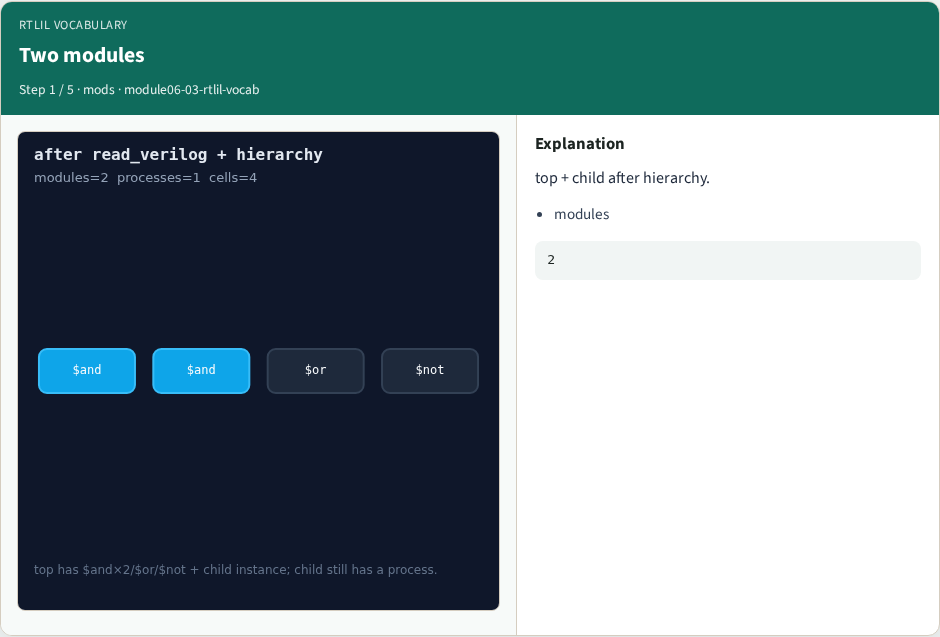
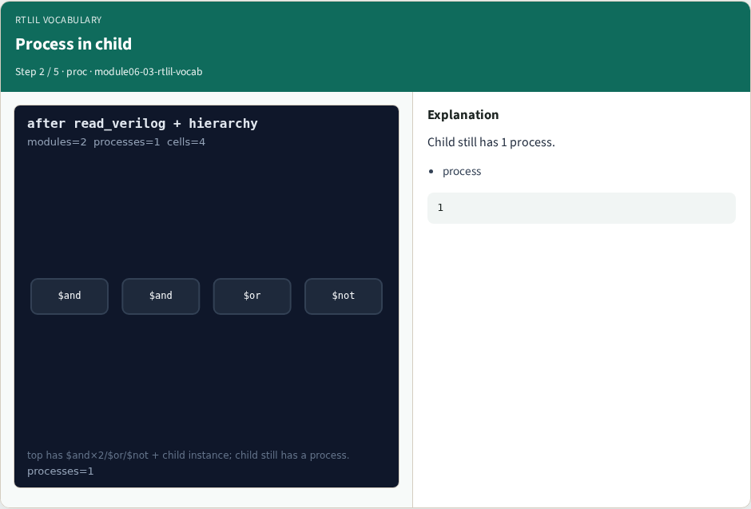
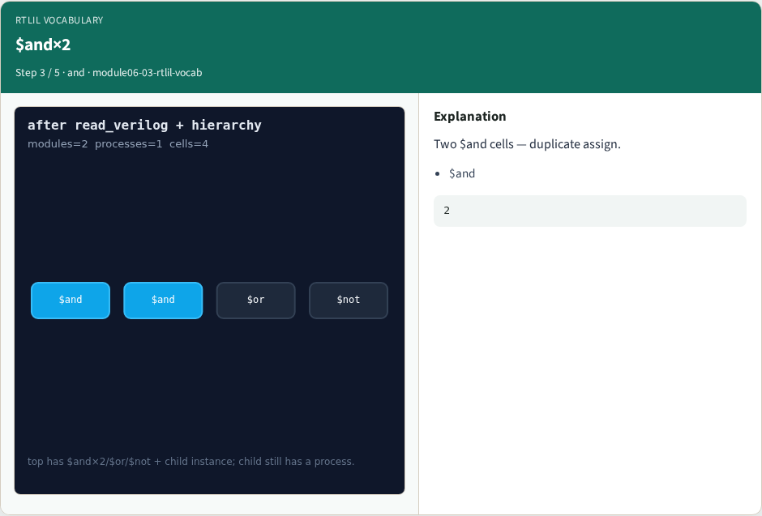
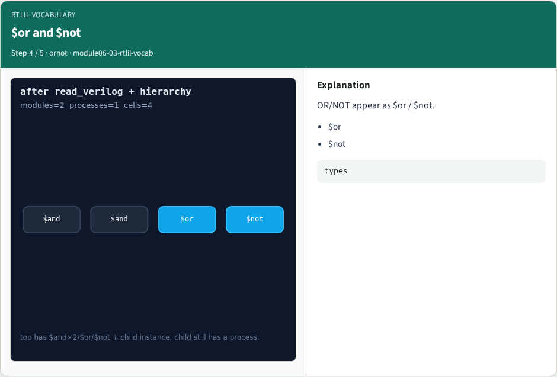
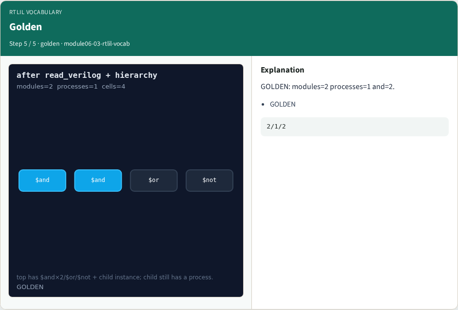

# RTLIL vocabulary

**Module id:** module06-03-rtlil-vocab
**Lab:** rtlil-vocab
**Tracks:** A (implement) · B (browser lab)

## Slide 1 — Why rtlil

Yosys stores designs in RTLIL — modules, wires, processes, and $-typed cells you see in dump/stat.

## Slide 2 — The idea

GOLDEN: after_read modules=2 processes=1 and_count=2; vocab includes $and $or $not $dff.

<!-- algorithm-walkthrough -->

## Slide 3 — Two modules



top + child after hierarchy.

## Slide 4 — Process in child



Child still has 1 process.

## Slide 5 — $and×2



Two $and cells — duplicate assign.

## Slide 6 — $or and $not



OR/NOT appear as $or / $not.

## Slide 7 — Golden



GOLDEN: modules=2 processes=1 and=2.

<!-- /algorithm-walkthrough -->


## Slide 8 — Browser lab track

Open **rtlil-vocab**. Open **rtlil-vocab**. Show read_hierarchy stage; select $and.

## Slide 9 — Implement track

Call pass_rtlil_vocab(); assert ok and and_count==2.

## Slide 10 — Pitfalls

Calling RTLIL 'gates' without $ prefix. Ignoring processes.

## Slide 11 — Try these

```bash
cd courses/learn_yosys/common
python3 -c "from real_solvers import pass_rtlil_vocab; print(pass_rtlil_vocab())"
```

## Slide 12 — Pseudocode

```text
load evidence; assert modules=2; processes=1; cells[$and]=2
```

## Slide 13 — Next

Next: real proc.
