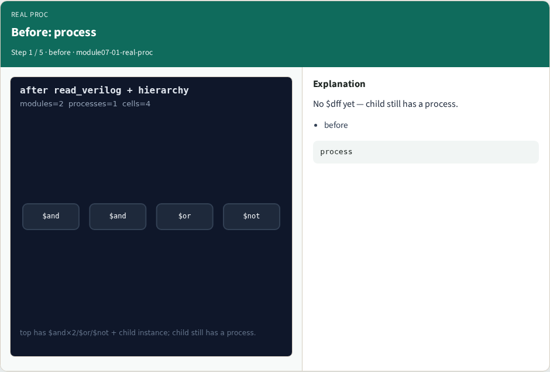
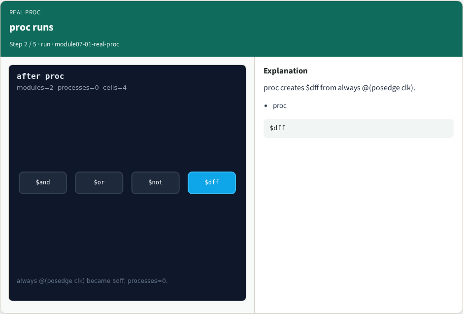
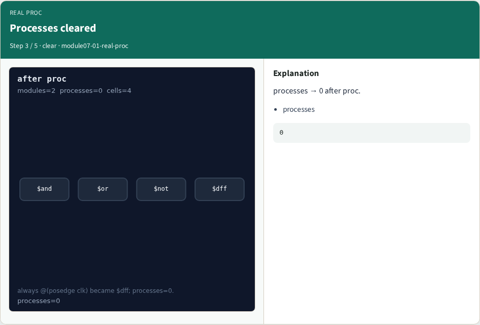
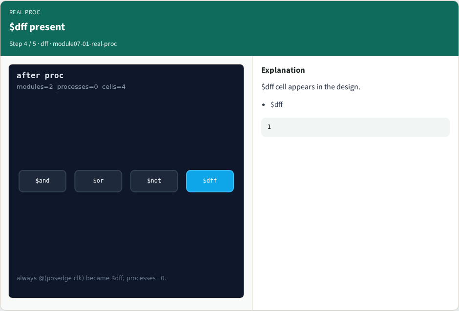

# Real proc pass — step-by-step (for slides / transcript)

**Module:** `module07-01-real-proc`  
**Lab / algo:** `real-proc`  
**Viewer:** `/tools/algorithm-walkthrough/?algo=real-proc&step=1`

Use each **Caption** as spoken prose (or a shortened slide note).
Use **Bullets** on the PPT; pair with the PNG in `assets/steps/`.

## Step 1 — Before: process



**Caption (transcript):** No $dff yet — child still has a process.

**Slide bullets:**

- before

**On-screen metrics:**

```
process
```

## Step 2 — proc runs



**Caption (transcript):** proc creates $dff from always @(posedge clk).

**Slide bullets:**

- proc

**On-screen metrics:**

```
$dff
```

## Step 3 — Processes cleared



**Caption (transcript):** processes → 0 after proc.

**Slide bullets:**

- processes

**On-screen metrics:**

```
0
```

## Step 4 — $dff present



**Caption (transcript):** $dff cell appears in the design.

**Slide bullets:**

- $dff

**On-screen metrics:**

```
1
```

## Step 5 — Golden


**Caption (transcript):** GOLDEN: processes=0 has_dff=True.

**Slide bullets:**

- GOLDEN

**On-screen metrics:**

```
ok
```

