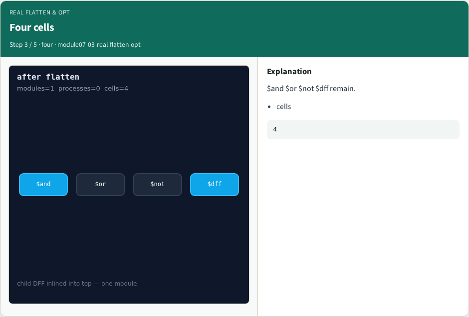
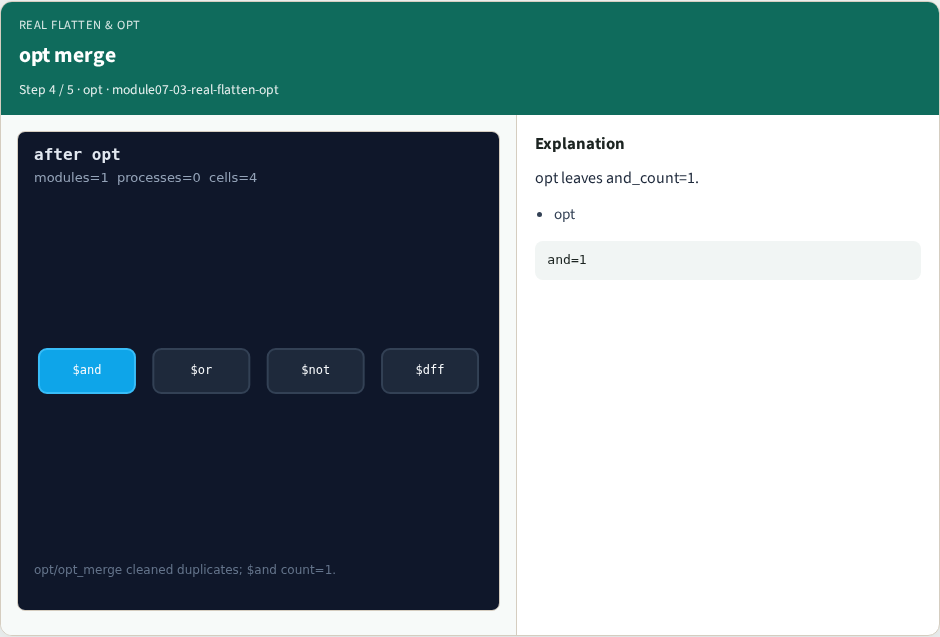
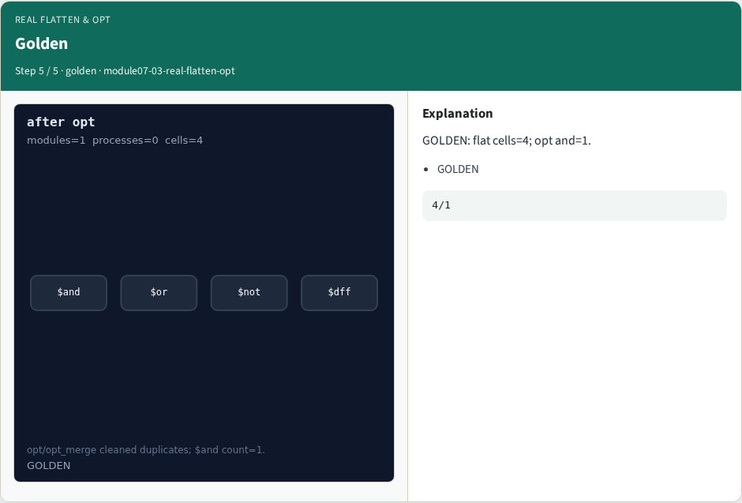

# Real flatten & opt — step-by-step (for slides / transcript)

**Module:** `module07-03-real-flatten-opt`  
**Lab / algo:** `real-flatten-opt`  
**Viewer:** `/tools/algorithm-walkthrough/?algo=real-flatten-opt&step=1`

Use each **Caption** as spoken prose (or a shortened slide note).
Use **Bullets** on the PPT; pair with the PNG in `assets/steps/`.

## Step 1 — Before flatten


**Caption (transcript):** Still two modules with a child instance.

**Slide bullets:**

- hierarchy

**On-screen metrics:**

```
2
```

## Step 2 — flatten


**Caption (transcript):** Child $dff inlined — module_count=1.

**Slide bullets:**

- flatten

**On-screen metrics:**

```
1
```

## Step 3 — Four cells



**Caption (transcript):** $and $or $not $dff remain.

**Slide bullets:**

- cells

**On-screen metrics:**

```
4
```

## Step 4 — opt merge



**Caption (transcript):** opt leaves and_count=1.

**Slide bullets:**

- opt

**On-screen metrics:**

```
and=1
```

## Step 5 — Golden



**Caption (transcript):** GOLDEN: flat cells=4; opt and=1.

**Slide bullets:**

- GOLDEN

**On-screen metrics:**

```
4/1
```

