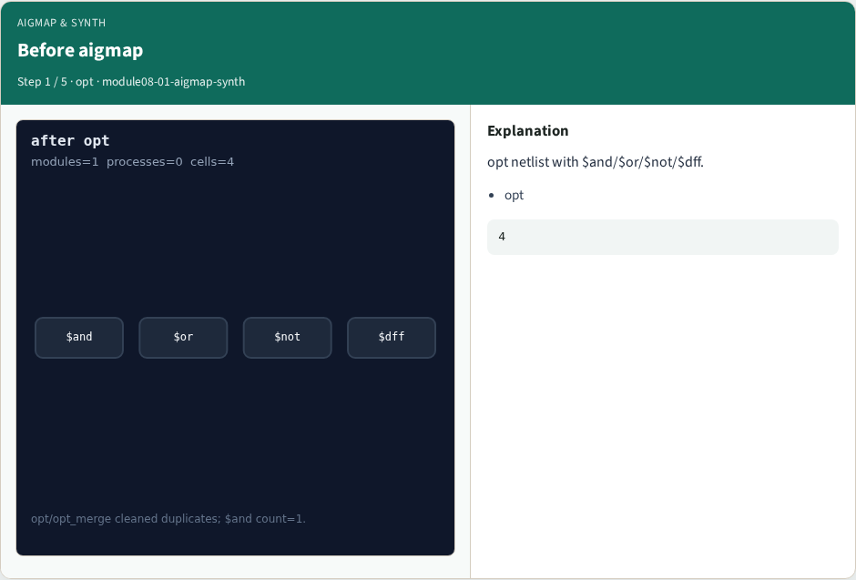
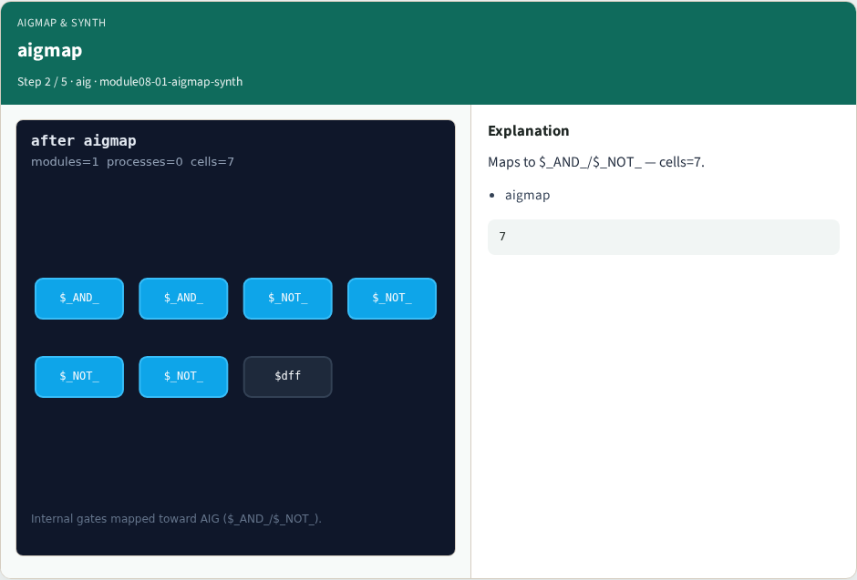
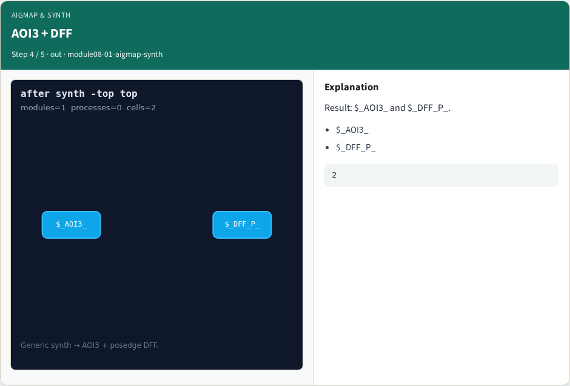
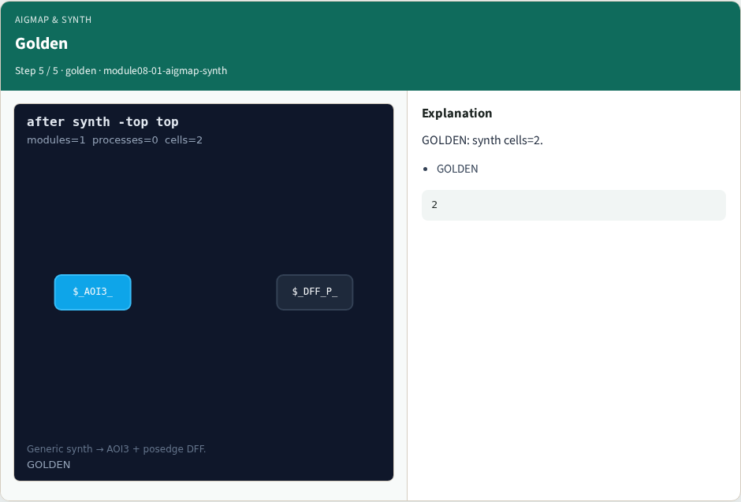

# aigmap & synth — step-by-step (for slides / transcript)

**Module:** `module08-01-aigmap-synth`  
**Lab / algo:** `aigmap-synth`  
**Viewer:** `/tools/algorithm-walkthrough/?algo=aigmap-synth&step=1`

Use each **Caption** as spoken prose (or a shortened slide note).
Use **Bullets** on the PPT; pair with the PNG in `assets/steps/`.

## Step 1 — Before aigmap



**Caption (transcript):** opt netlist with $and/$or/$not/$dff.

**Slide bullets:**

- opt

**On-screen metrics:**

```
4
```

## Step 2 — aigmap



**Caption (transcript):** Maps to $_AND_/$_NOT_ — cells=7.

**Slide bullets:**

- aigmap

**On-screen metrics:**

```
7
```

## Step 3 — synth recipe


**Caption (transcript):** synth -top top runs the built-in flow.

**Slide bullets:**

- synth

**On-screen metrics:**

```
recipe
```

## Step 4 — AOI3 + DFF



**Caption (transcript):** Result: $_AOI3_ and $_DFF_P_.

**Slide bullets:**

- $_AOI3_
- $_DFF_P_

**On-screen metrics:**

```
2
```

## Step 5 — Golden



**Caption (transcript):** GOLDEN: synth cells=2.

**Slide bullets:**

- GOLDEN

**On-screen metrics:**

```
2
```

