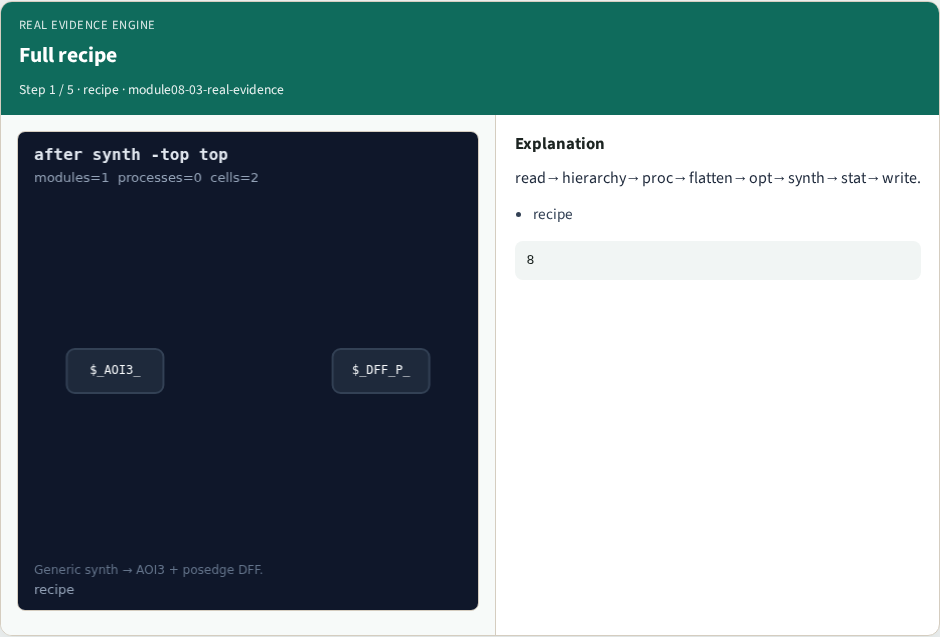
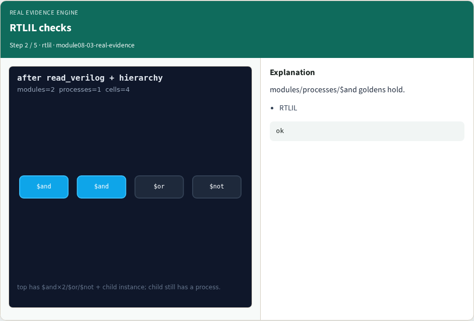
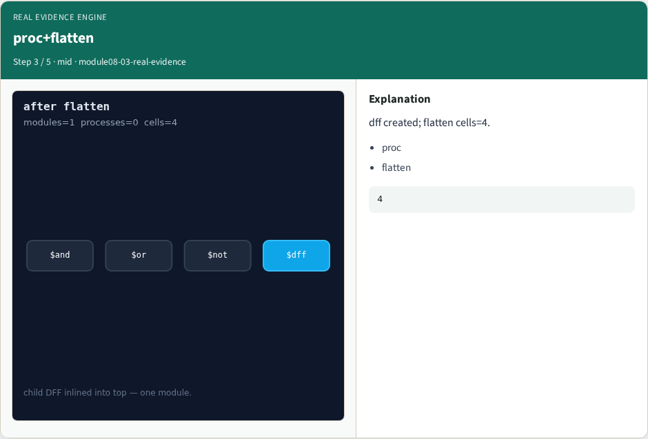
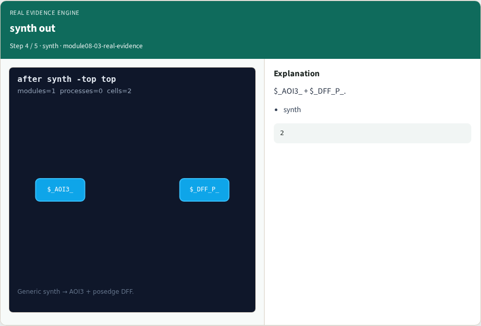
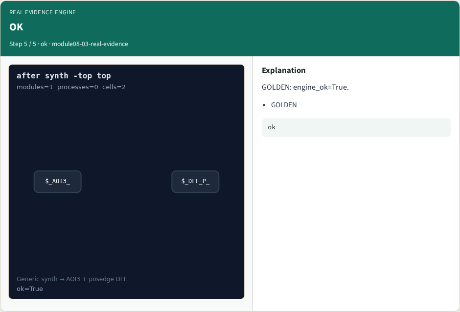

# Why real

The evidence engine checks CLI order, RTLIL goldens, proc/flatten/opt, and synth outputs together

---

## The idea
- GOLDEN: engine ok=True; after_synth_cells=2

---

## Full recipe


---

## RTLIL checks


---

## proc+flatten


---

## synth out


---

## OK


---

## Browser lab track
- Open **real-evidence**
- Open **real-evidence**
- Build golden recipe; run Engine; confirm ok

---

## Implement track
- Call real_yosys_engine(); assert ok

---

## Pitfalls
- Stopping at toy yosys_engine
- Wrong recipe order

---

## Try these
- From the common folder

---

## Try these — try these

```
cd courses/learn_yosys/common
python3 real_solvers.py
```

---

## Pseudocode
- Here is the check in plain steps

---

## Pseudocode — try these

```
run full golden recipe
assert engine ok and synth cells two
```

---

## Next
- Complete the quiz for this part
- Next: offline compare, then wrap

