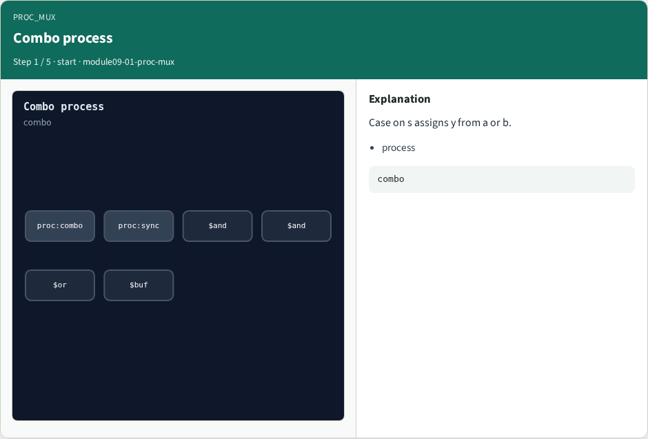
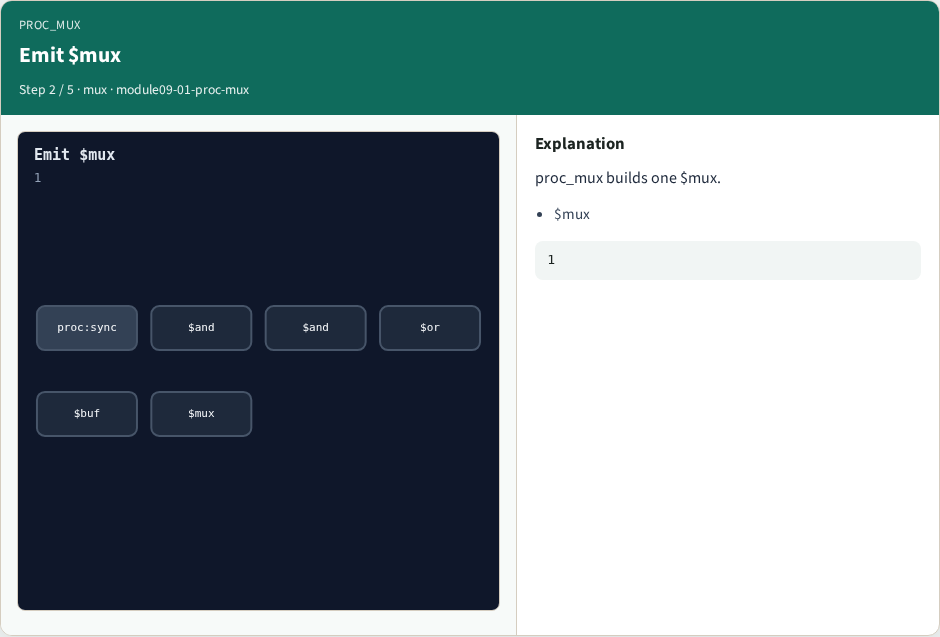
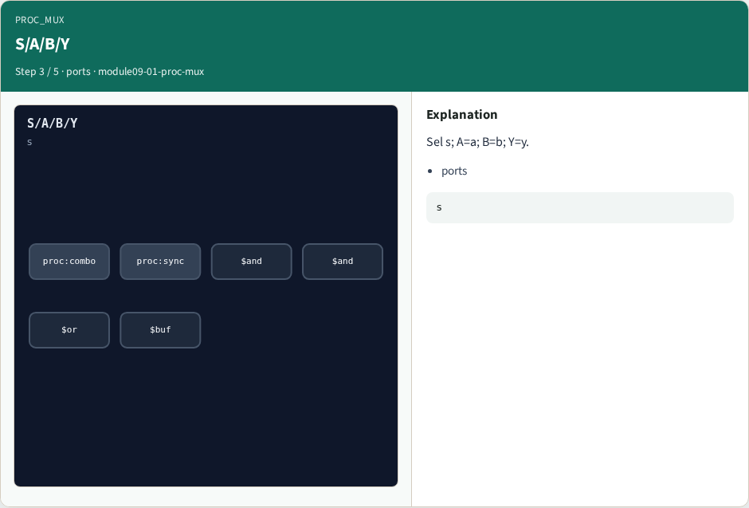
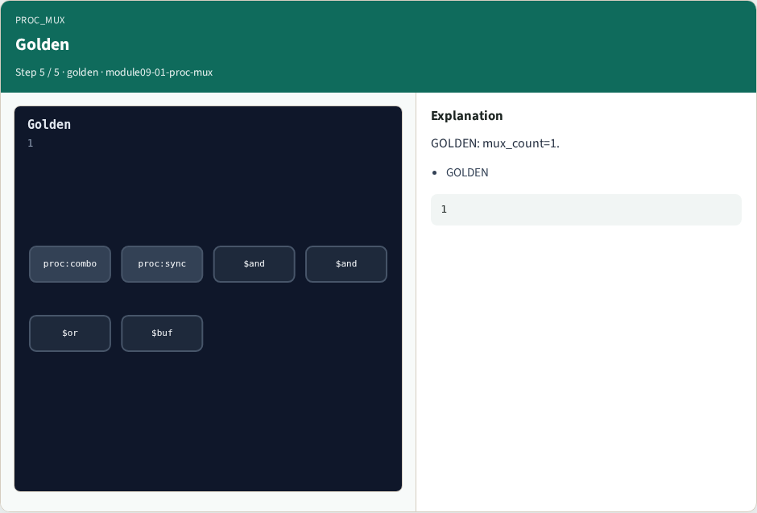

# Why proc mux

Combo case and if processes become mux cells before registers appear

---

## The idea
- GOLDEN: mux_count=1; type is dollar mux

---

## Combo process


---

## Emit $mux


---

## S/A/B/Y


---

## Combo removed


---

## Golden


---

## Browser lab track
- Open **proc-mux**
- Replace the combo process with one mux cell and Check

---

## Implement track
- Call algo_proc_mux(); assert mux_count == 1 and the cell type is dollar mux

---

## Pitfalls
- Leaving the combo process in place
- Mapping sync processes as muxes

---

## Try these
- From the common folder, run the algo solvers self-test, or call `algo_proc_mux` directly

---

## Try these — try these

```
cd courses/learn_yosys/common
python3 algo_solvers.py
```

---

## Pseudocode
- Here is the check in plain steps

---

## Pseudocode — try these

```
for each combo process with two cases:
  emit dollar mux (S,A,B,Y)
  drop that process
ok if mux_count == 1
```

---

## Next
- Complete the quiz for this part
- Next: proc_dff with async reset

