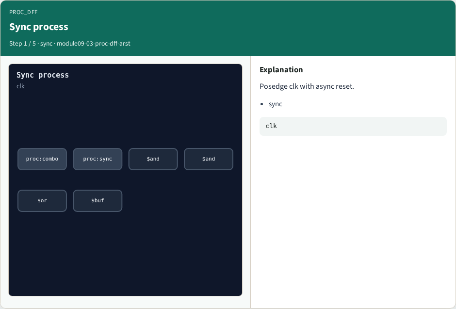
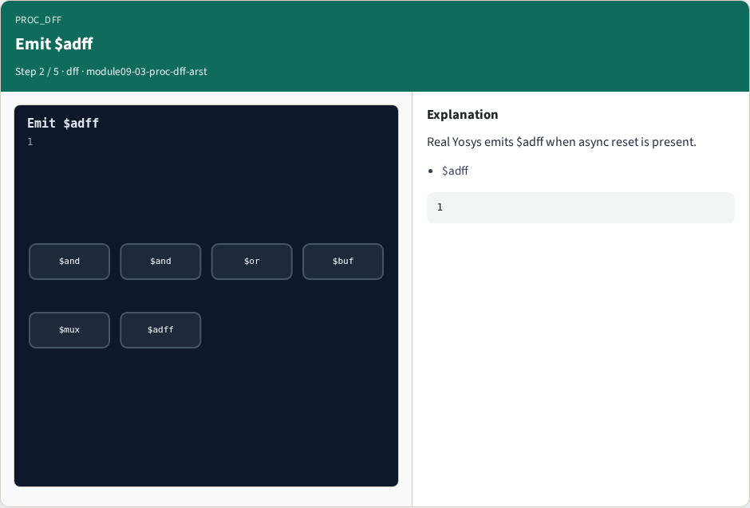
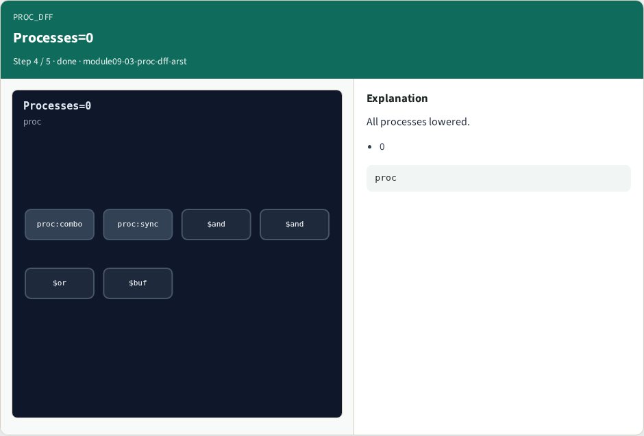
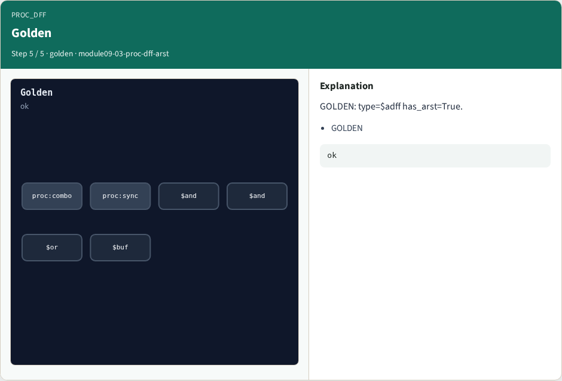

# Why proc dff

Sync processes become flip-flops; async reset rides on the ARST ports

---

## The idea
- GOLDEN: one dollar adff with arst; processes left = 0
- Real Yosys binds the same

---

## Sync process


---

## Emit $adff


---

## ARST port


---

## Processes=0


---

## Golden


---

## Browser lab track
- Open **proc-dff-arst**
- Emit the $adff with reset ports, clear all processes, and confirm the real bind

---

## Implement track
- Call algo_proc_dff(); assert reg_type is $adff, has_arst is True, processes == 0
- Then run partc_bind.py

---

## Pitfalls
- Emitting plain $dff when async reset is present
- Stopping before processes reach zero

---

## Try these
- From the common folder

---

## Try these — try these

```
cd courses/learn_yosys/common
python3 algo_solvers.py
python3 partc_bind.py
```

---

## Pseudocode
- Here is the check in plain steps

---

## Pseudocode — try these

```
run proc_mux first
for each sync process:
  if reset present: emit $adff (CLK,D,Q,ARST)
  else: emit $dff (CLK,D,Q)
ok if reg_type==$adff and processes==0
```

---

## Next
- Complete the quiz for this part
- Next: opt_clean and opt_expr goldens

