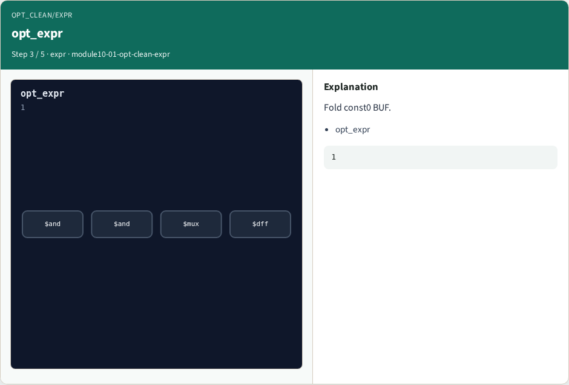
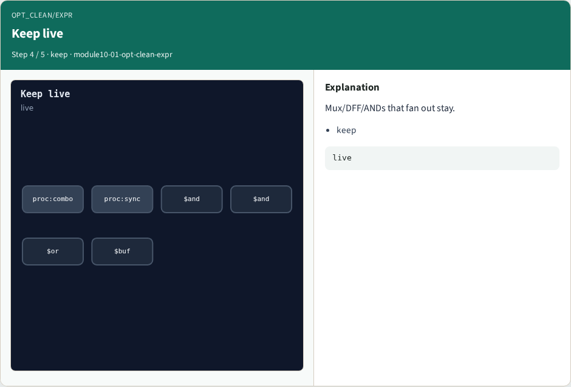
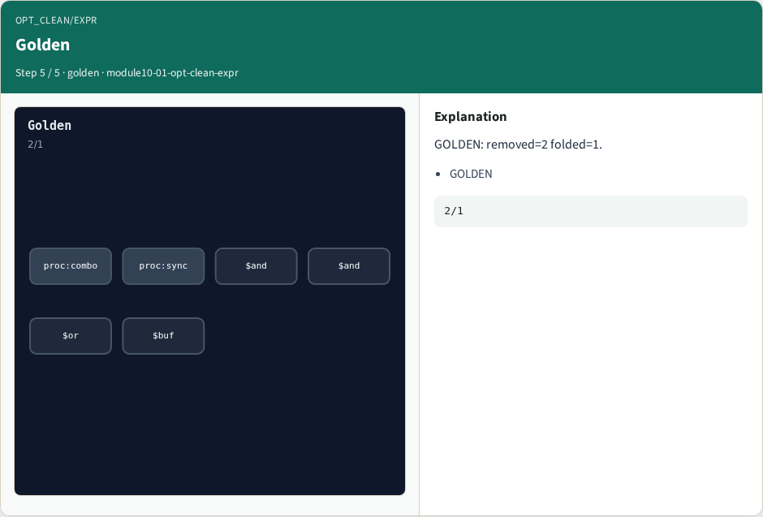

# opt_clean + opt_expr — step-by-step (for slides / transcript)

**Module:** `module10-01-opt-clean-expr`  
**Lab / algo:** `opt-clean-expr`  
**Viewer:** `/tools/algorithm-walkthrough/?algo=opt-clean-expr&step=1`

Use each **Caption** as spoken prose (or a shortened slide note).
Use **Bullets** on the PPT; pair with the PNG in `assets/steps/`.

## Step 1 — Dead cells


**Caption (transcript):** OR to dead and BUF const0.

**Slide bullets:**

- dead

**On-screen metrics:**

```
2
```

## Step 2 — opt_clean


**Caption (transcript):** Remove 2 unused cells.

**Slide bullets:**

- opt_clean

**On-screen metrics:**

```
2
```

## Step 3 — opt_expr



**Caption (transcript):** Fold const0 BUF.

**Slide bullets:**

- opt_expr

**On-screen metrics:**

```
1
```

## Step 4 — Keep live



**Caption (transcript):** Mux/DFF/ANDs that fan out stay.

**Slide bullets:**

- keep

**On-screen metrics:**

```
live
```

## Step 5 — Golden



**Caption (transcript):** GOLDEN: removed=2 folded=1.

**Slide bullets:**

- GOLDEN

**On-screen metrics:**

```
2/1
```

