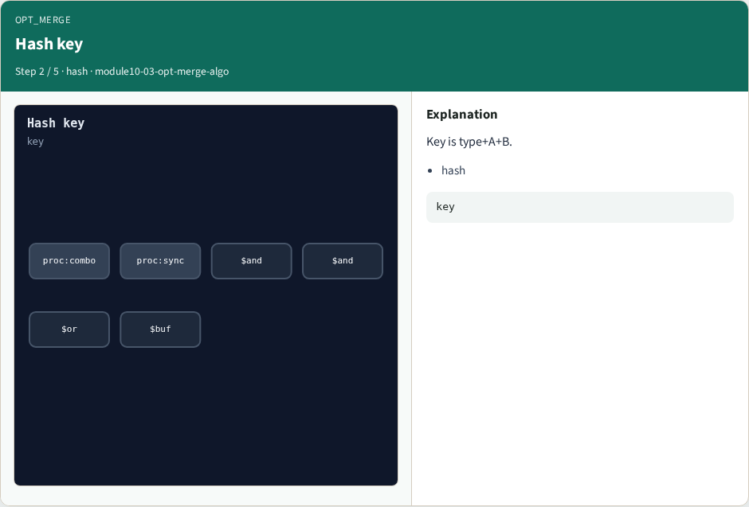
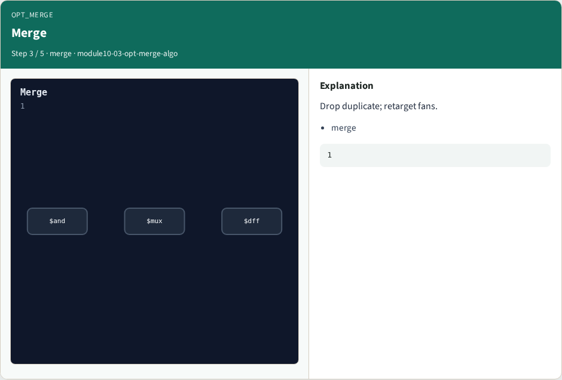
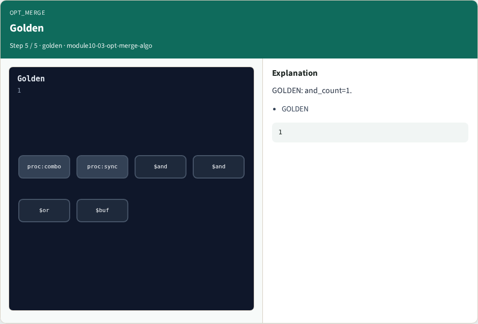

# opt_merge algorithm

**Module id:** module10-03-opt-merge-algo
**Lab:** opt-merge-algo
**Tracks:** A (implement) · B (browser lab)

## Slide 1 — Why opt merge

Identical gates sharing inputs are the same node; merge retargets fans.

## Slide 2 — The idea

GOLDEN: after merge and_count=1 (one duplicate AND removed).

<!-- algorithm-walkthrough -->

## Slide 3 — Duplicate AND


Two $and(a,b) cells.

## Slide 4 — Hash key



Key is type+A+B.

## Slide 5 — Merge



Drop duplicate; retarget fans.

## Slide 6 — One AND


and_count=1.

## Slide 7 — Golden



GOLDEN: and_count=1.

<!-- /algorithm-walkthrough -->


## Slide 8 — Browser lab track

Open **opt-merge-algo**. Merge the twin ANDs and Check and_count.

## Slide 9 — Implement track

Call algo_opt_merge(); assert and_count == 1.

## Slide 10 — Pitfalls

Merging cells with different inputs. Forgetting to remap fanins.

## Slide 11 — Try these

From the common folder, run the algo solvers self-test, or call `algo_opt_merge` directly.

```bash
cd courses/learn_yosys/common
python3 algo_solvers.py
```

## Slide 12 — Pseudocode

Here is the check in plain steps.

```text
after opt_clean
key ← (type,A,B) for and/or
if key seen: remap Y and drop duplicate
ok if and_count == 1
```

## Slide 13 — Next

Next: techmap with a map file.
