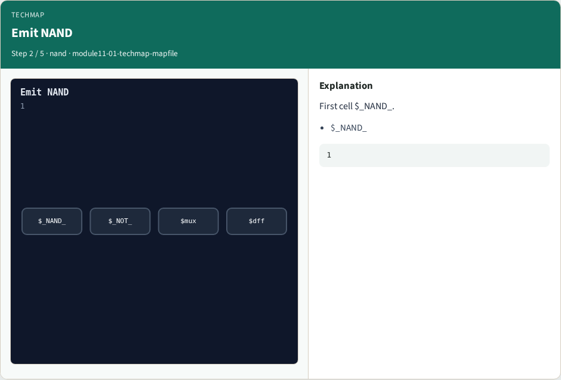
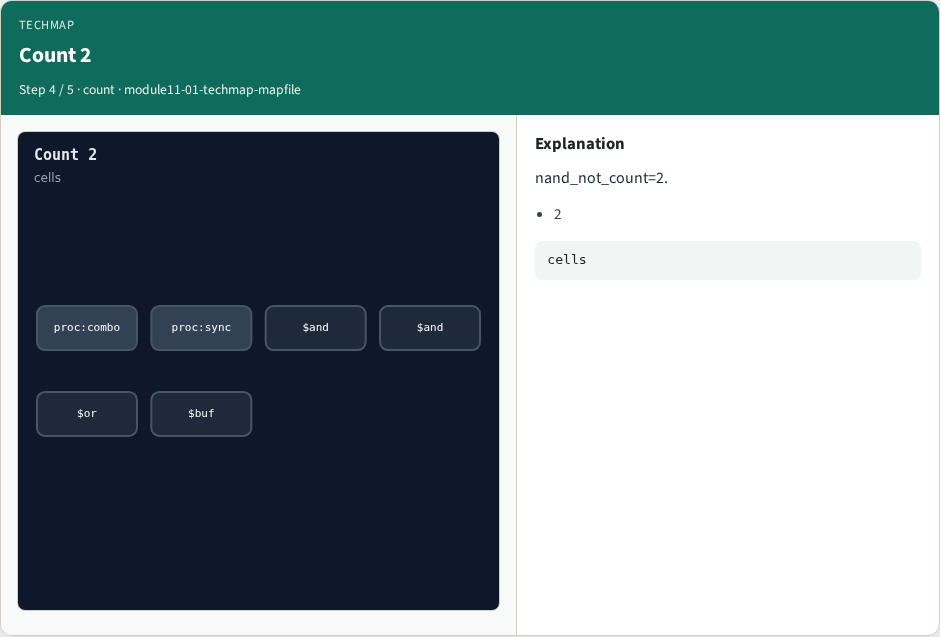
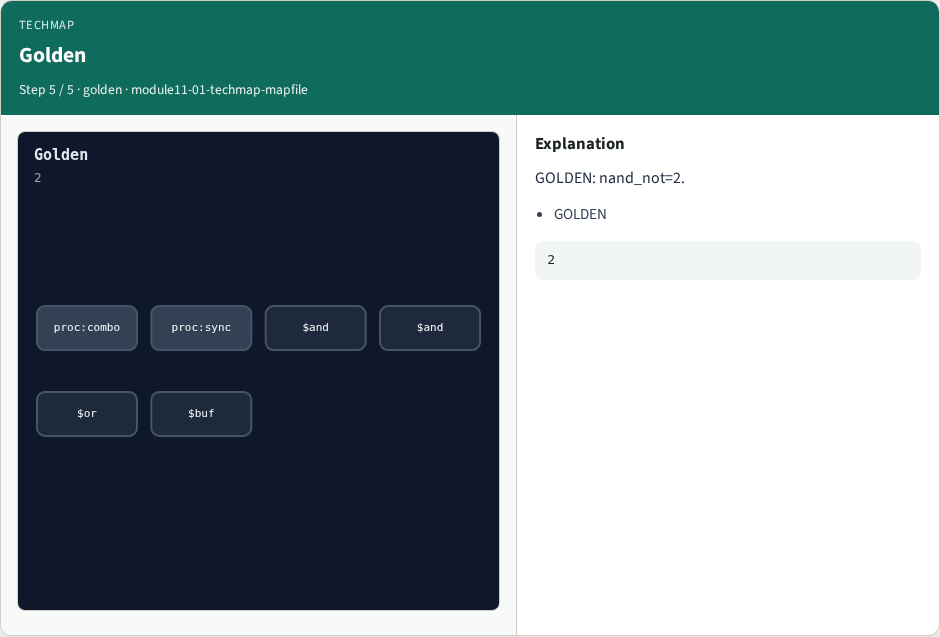

# Why techmap

Techmap rewrites generic cells into library primitives via map rules

---

## The idea
- GOLDEN: nand_not_count=2 (NAND + NOT)

---

## Map rule


---

## Emit NAND


---

## Emit NOT


---

## Count 2


---

## Golden


---

## Browser lab track
- Open **techmap-mapfile**
- Apply the map rule and Check NAND/NOT count

---

## Implement track
- Call algo_techmap_mapfile(); assert nand_not_count == 2

---

## Pitfalls
- Mapping every cell type at once
- Counting NAND without the following NOT

---

## Try these
- From the common folder

---

## Try these — try these

```
cd courses/learn_yosys/common
python3 algo_solvers.py
```

---

## Pseudocode
- Here is the check in plain steps

---

## Pseudocode — try these

```
after opt_merge
match dollar and → emit $_NAND_ then $_NOT_
ok if nand_not_count == 2
```

---

## Next
- Complete the quiz for this part
- Next: extract ANDOR2 subcircuit

