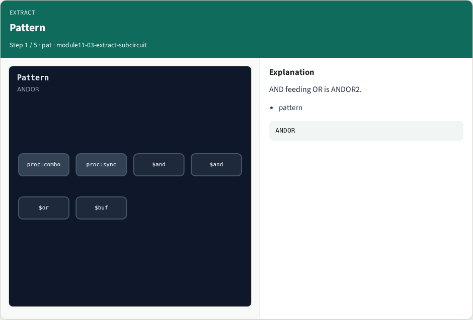
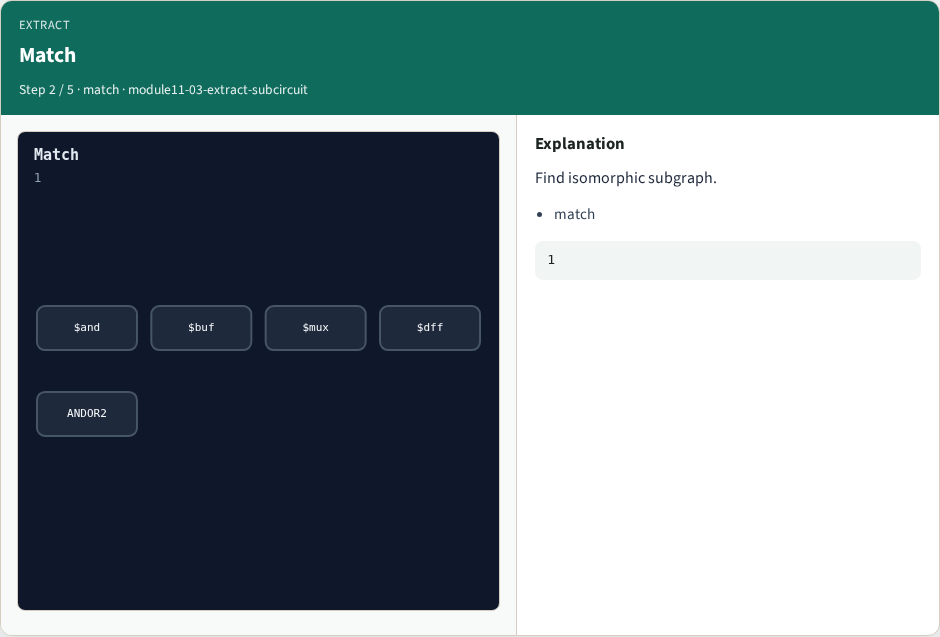
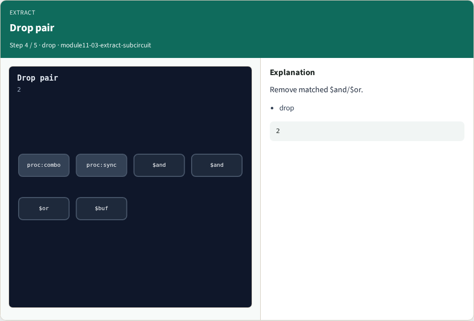
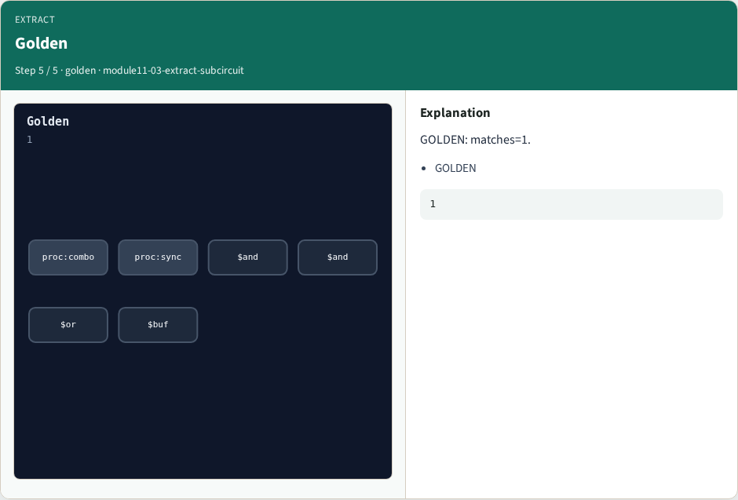

# extract subcircuit — step-by-step (for slides / transcript)

**Module:** `module11-03-extract-subcircuit`  
**Lab / algo:** `extract-subcircuit`  
**Viewer:** `/tools/algorithm-walkthrough/?algo=extract-subcircuit&step=1`

Use each **Caption** as spoken prose (or a shortened slide note).
Use **Bullets** on the PPT; pair with the PNG in `assets/steps/`.

## Step 1 — Pattern



**Caption (transcript):** AND feeding OR is ANDOR2.

**Slide bullets:**

- pattern

**On-screen metrics:**

```
ANDOR
```

## Step 2 — Match



**Caption (transcript):** Find isomorphic subgraph.

**Slide bullets:**

- match

**On-screen metrics:**

```
1
```

## Step 3 — Macro cell


**Caption (transcript):** Replace with ANDOR2.

**Slide bullets:**

- ANDOR2

**On-screen metrics:**

```
1
```

## Step 4 — Drop pair



**Caption (transcript):** Remove matched $and/$or.

**Slide bullets:**

- drop

**On-screen metrics:**

```
2
```

## Step 5 — Golden



**Caption (transcript):** GOLDEN: matches=1.

**Slide bullets:**

- GOLDEN

**On-screen metrics:**

```
1
```

