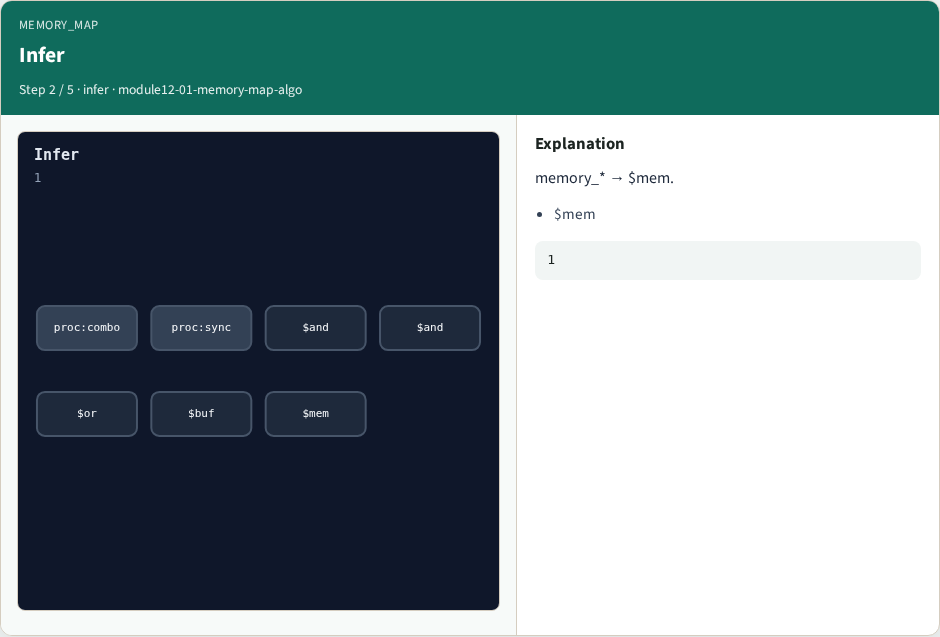
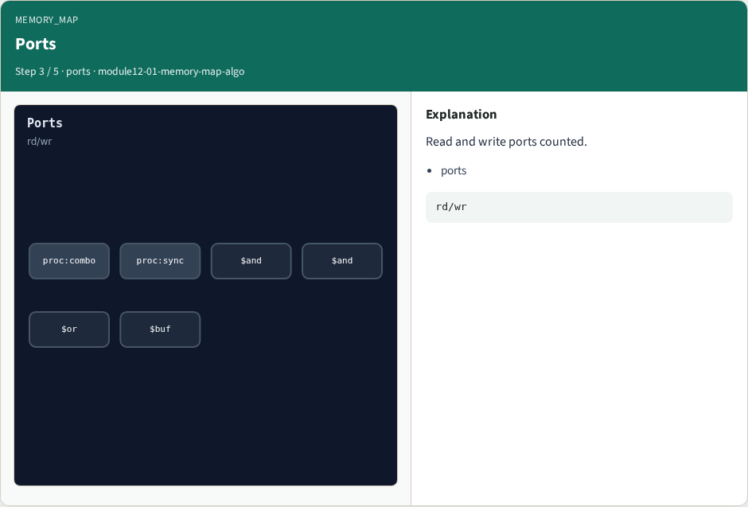
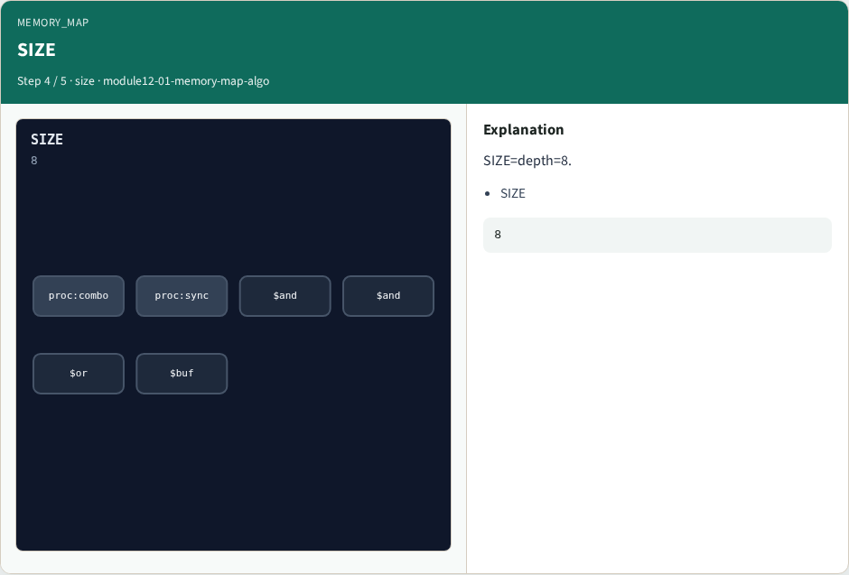
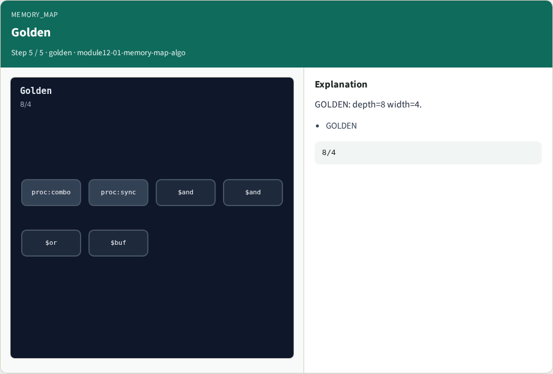

# memory_map algorithm

**Module id:** module12-01-memory-map-algo
**Lab:** memory-map-algo
**Tracks:** A (implement) · B (browser lab)

## Slide 1 — Why memory

Memory passes turn array descriptions into dollar-mem cells with size and width.

## Slide 2 — The idea

GOLDEN: one dollar mem; depth=8; width=4.

<!-- algorithm-walkthrough -->

## Slide 3 — Array


Width 4 depth 8.

## Slide 4 — Infer



memory_* → $mem.

## Slide 5 — Ports



Read and write ports counted.

## Slide 6 — SIZE



SIZE=depth=8.

## Slide 7 — Golden



GOLDEN: depth=8 width=4.

<!-- /algorithm-walkthrough -->


## Slide 8 — Browser lab track

Open **memory-map-algo**. Build the mem cell and Check depth and width.

## Slide 9 — Implement track

Call algo_memory_map(); assert depth == 8 and width == 4.

## Slide 10 — Pitfalls

Swapping depth and width. Ignoring read versus write ports.

## Slide 11 — Try these

From the common folder, run the algo solvers self-test, or call `algo_memory_map` directly.

```bash
cd courses/learn_yosys/common
python3 algo_solvers.py
```

## Slide 12 — Pseudocode

Here is the check in plain steps.

```text
read memory block from tiny_algo
emit dollar mem WIDTH=width SIZE=depth
ok if depth==8 and width==4
```

## Slide 13 — Next

Next: FSM detect and encoding bits.
