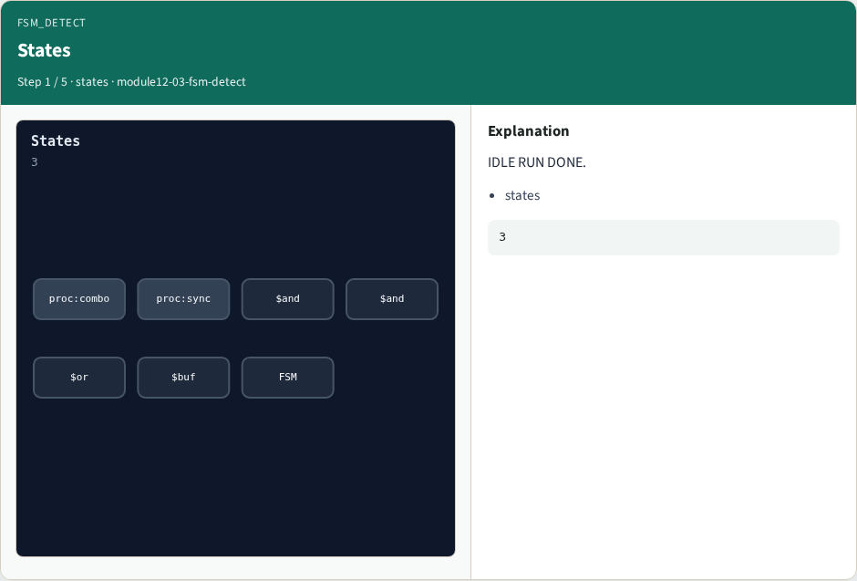
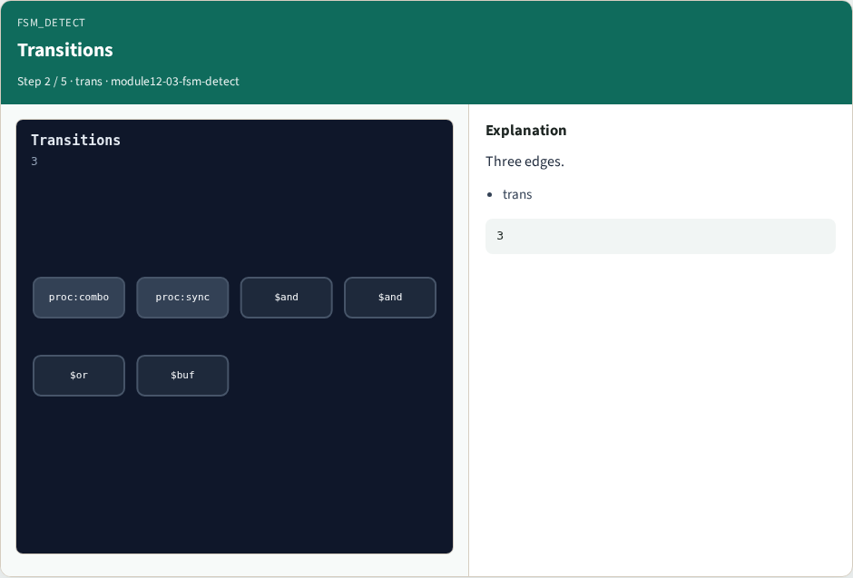
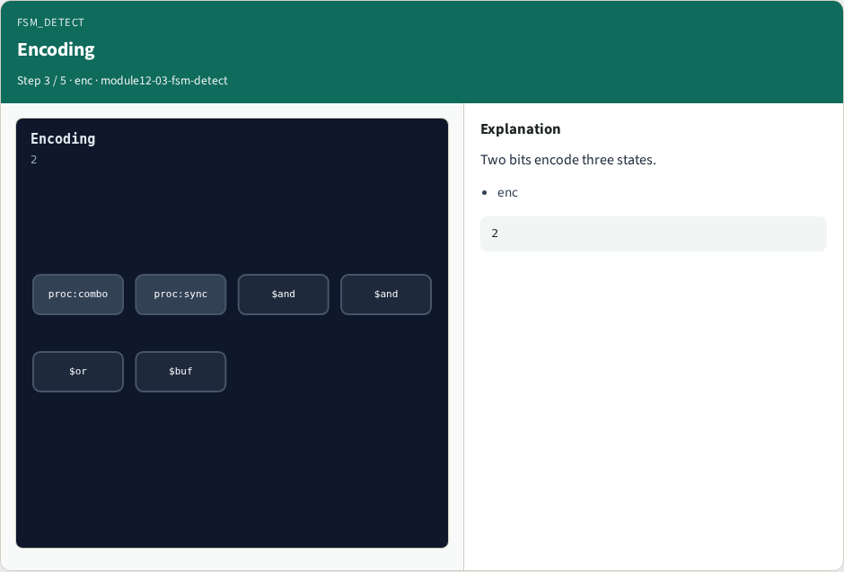
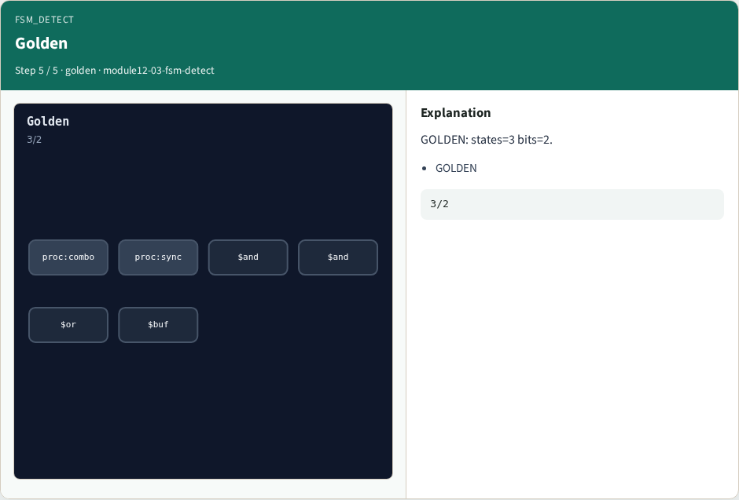

# fsm detect

**Module id:** module12-03-fsm-detect
**Lab:** fsm-detect
**Tracks:** A (implement) · B (browser lab)

## Slide 1 — Why fsm

FSM passes count states and transitions, then choose encoding width.

## Slide 2 — The idea

GOLDEN: states=3; transitions=3; encoding_bits=2.

<!-- algorithm-walkthrough -->

## Slide 3 — States



IDLE RUN DONE.

## Slide 4 — Transitions



Three edges.

## Slide 5 — Encoding



Two bits encode three states.

## Slide 6 — Reset


Reset state IDLE.

## Slide 7 — Golden



GOLDEN: states=3 bits=2.

<!-- /algorithm-walkthrough -->


## Slide 8 — Browser lab track

Open **fsm-detect**. Read states, edges, and encoding width.

## Slide 9 — Implement track

Call algo_fsm_detect(); assert states == 3, transitions == 3, encoding_bits == 2.

## Slide 10 — Pitfalls

Counting encoding bits as state count. Missing a transition edge.

## Slide 11 — Try these

From the common folder, run the algo solvers self-test, or call `algo_fsm_detect` directly.

```bash
cd courses/learn_yosys/common
python3 algo_solvers.py
```

## Slide 12 — Pseudocode

Here is the check in plain steps.

```text
states ← fsm.states; trans ← fsm.transitions
bits ← max encoding string length
ok if 3, 3, and 2
```

## Slide 13 — Next

Next: ABC handoff AND count.
