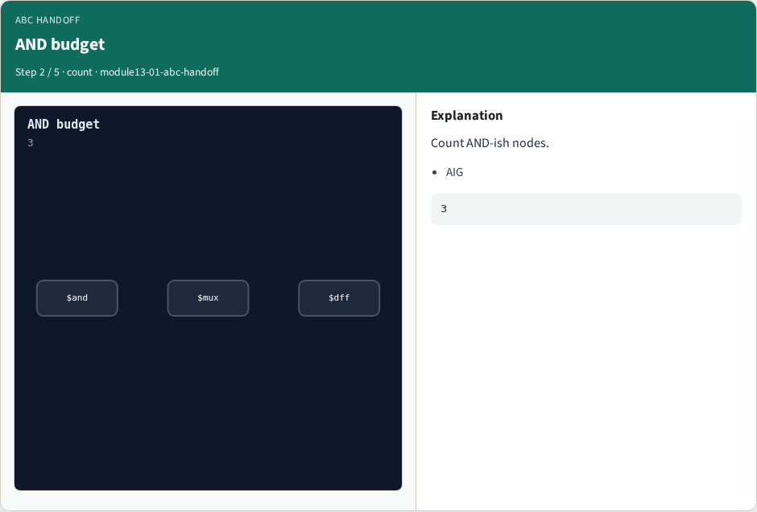
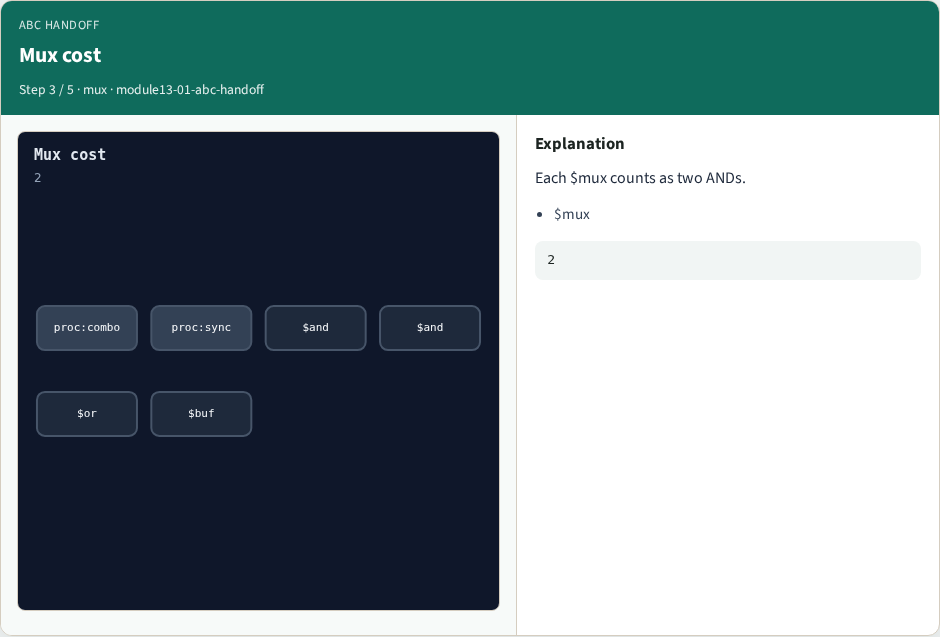
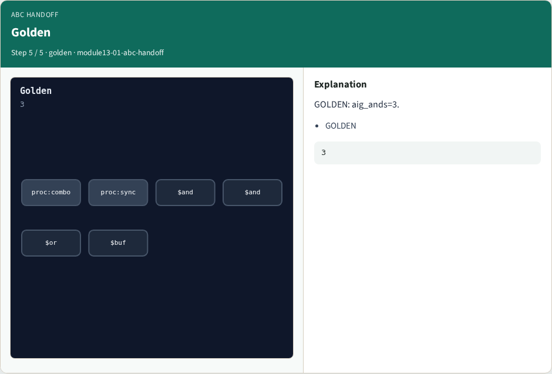

# ABC handoff — step-by-step (for slides / transcript)

**Module:** `module13-01-abc-handoff`  
**Lab / algo:** `abc-handoff`  
**Viewer:** `/tools/algorithm-walkthrough/?algo=abc-handoff&step=1`

Use each **Caption** as spoken prose (or a shortened slide note).
Use **Bullets** on the PPT; pair with the PNG in `assets/steps/`.

## Step 1 — After opt


**Caption (transcript):** Merged netlist ready for ABC.

**Slide bullets:**

- opt

**On-screen metrics:**

```
ready
```

## Step 2 — AND budget



**Caption (transcript):** Count AND-ish nodes.

**Slide bullets:**

- AIG

**On-screen metrics:**

```
3
```

## Step 3 — Mux cost



**Caption (transcript):** Each $mux counts as two ANDs.

**Slide bullets:**

- $mux

**On-screen metrics:**

```
2
```

## Step 4 — abc pass


**Caption (transcript):** Yosys abc bridges to ABC/ABC9.

**Slide bullets:**

- abc

**On-screen metrics:**

```
bridge
```

## Step 5 — Golden



**Caption (transcript):** GOLDEN: aig_ands=3.

**Slide bullets:**

- GOLDEN

**On-screen metrics:**

```
3
```

