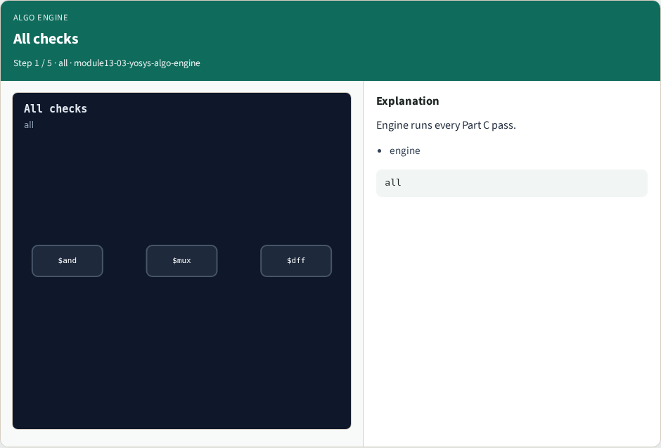
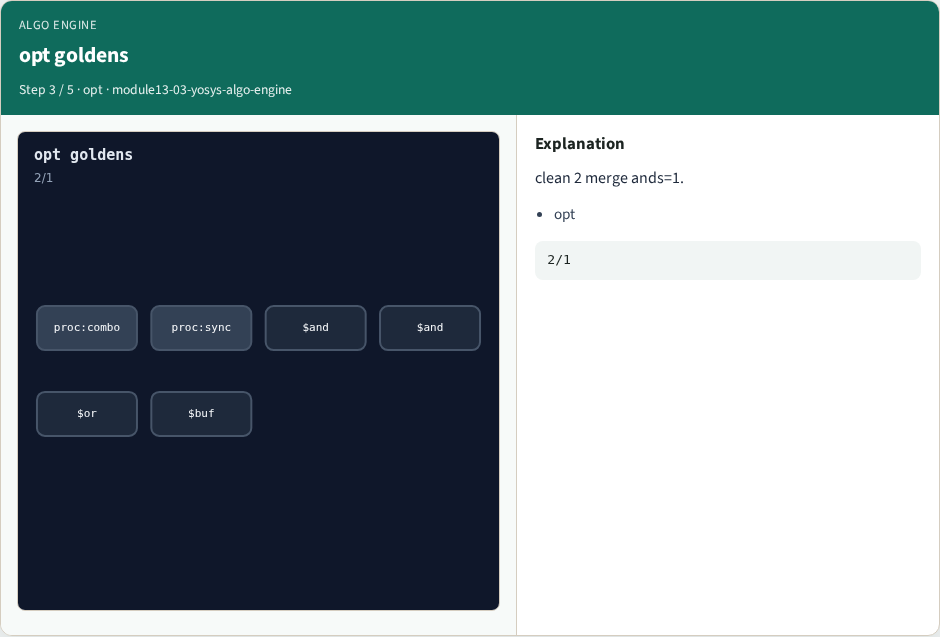
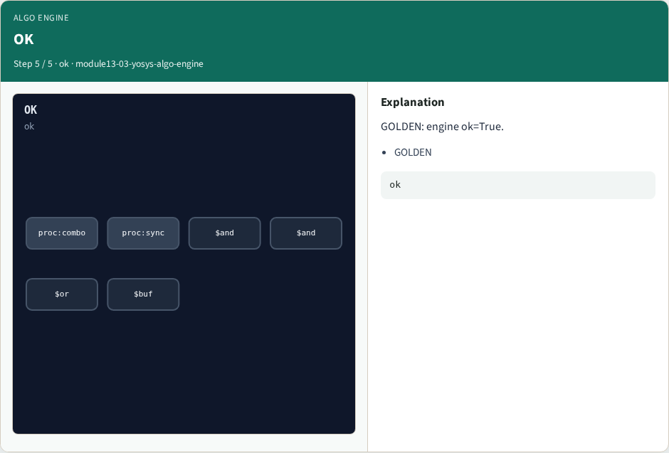

# Why engine

One engine call chains proc, opt, techmap, extract, memory, fsm, and abc goldens

---

## The idea
- GOLDEN: yosys_algo_engine ok=True (all Part C goldens)

---

## All checks


---

## proc goldens


---

## opt goldens


---

## map goldens


---

## OK


---

## Browser lab track
- Open **yosys-algo-engine**
- Run the full chain and Check ok

---

## Implement track
- Call yosys_algo_engine(); assert ok is True

---

## Pitfalls
- Passing a mutated design mid-chain
- Asserting only one stage and calling it done

---

## Try these
- From the common folder

---

## Try these — try these

```
cd courses/learn_yosys/common
python3 algo_solvers.py
```

---

## Pseudocode
- Here is the check in plain steps

---

## Pseudocode — try these

```
run mux, dff, clean, expr, merge, techmap, extract, memory, fsm, abc
ok if every golden matches
```

---

## Next
- Complete the quiz for this part
- Next: offline benchmark compare

