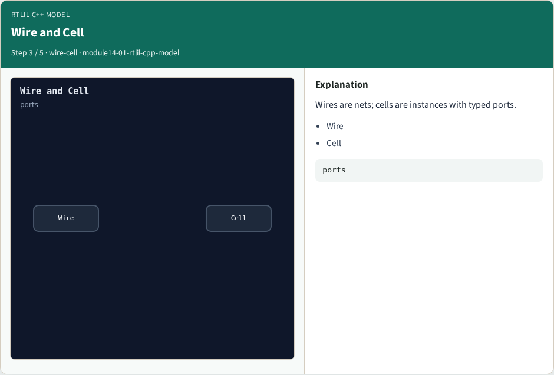
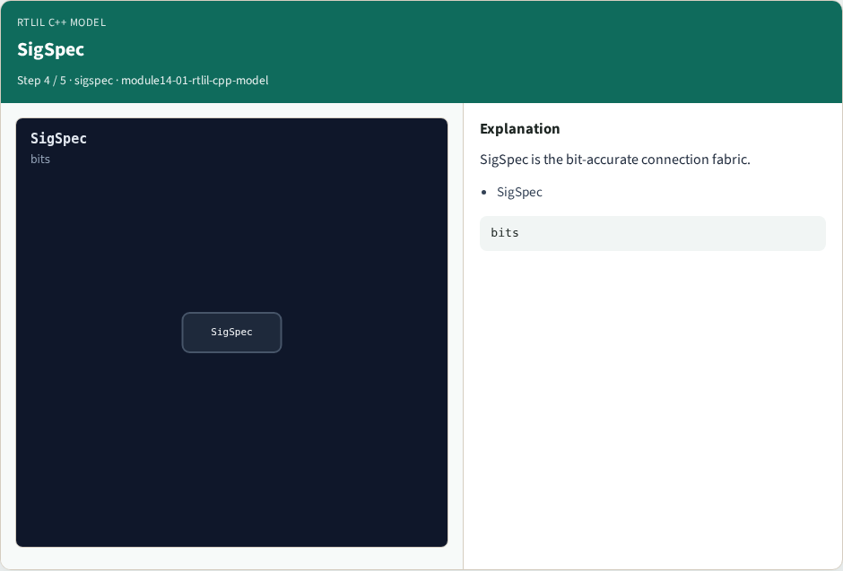

# RTLIL C++ model — step-by-step (for slides / transcript)

**Module:** `module14-01-rtlil-cpp-model`  
**Lab / algo:** `rtlil-cpp-model`  
**Viewer:** `/tools/algorithm-walkthrough/?algo=rtlil-cpp-model&step=1`

Use each **Caption** as spoken prose (or a shortened slide note).
Use **Bullets** on the PPT; pair with the PNG in `assets/steps/`.

## Step 1 — Design


**Caption (transcript):** Design is the root container for modules.

**Slide bullets:**

- Design

**On-screen metrics:**

```
root
```

## Step 2 — Module


**Caption (transcript):** Module holds wires, cells, and processes.

**Slide bullets:**

- Module

**On-screen metrics:**

```
own
```

## Step 3 — Wire and Cell



**Caption (transcript):** Wires are nets; cells are instances with typed ports.

**Slide bullets:**

- Wire
- Cell

**On-screen metrics:**

```
ports
```

## Step 4 — SigSpec



**Caption (transcript):** SigSpec is the bit-accurate connection fabric.

**Slide bullets:**

- SigSpec

**On-screen metrics:**

```
bits
```

## Step 5 — Golden


**Caption (transcript):** GOLDEN: five pillars — Design, Module, Wire, Cell, SigSpec.

**Slide bullets:**

- GOLDEN

**On-screen metrics:**

```
5
```

