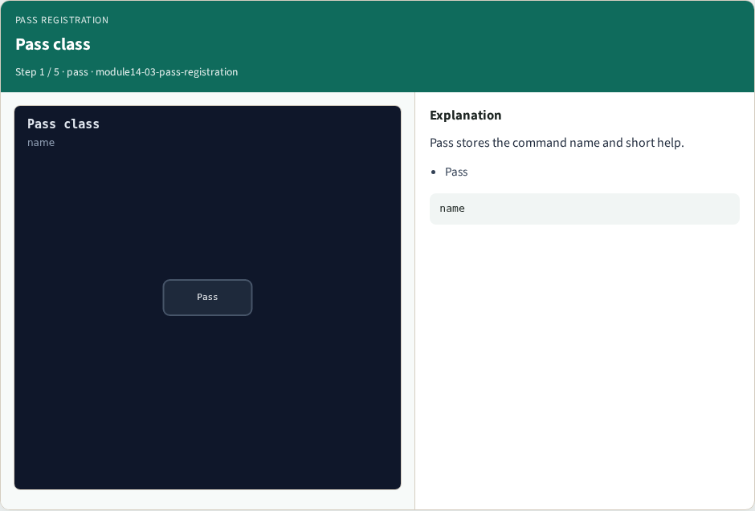
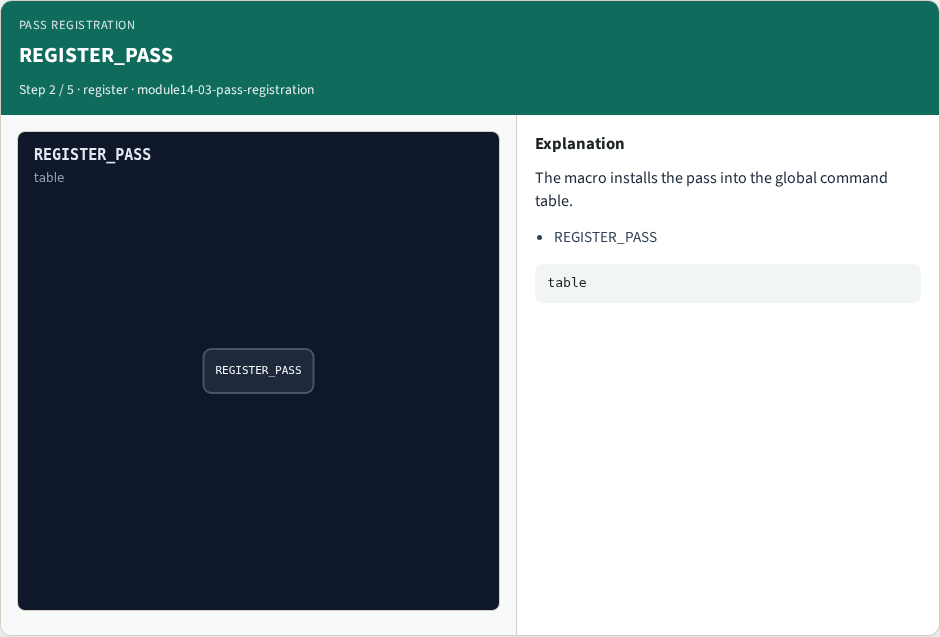
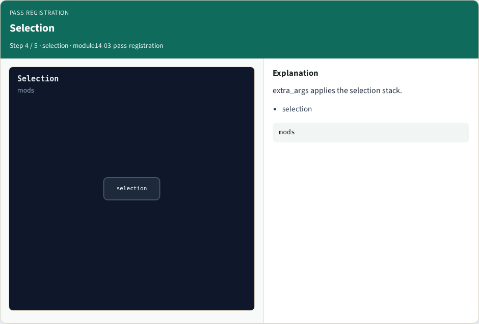
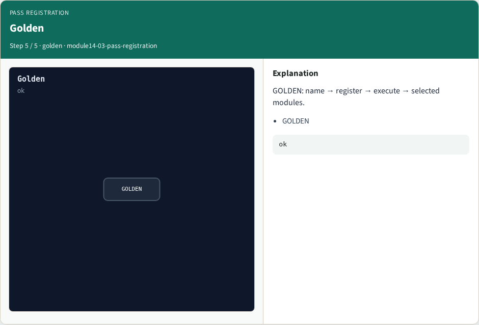

# Why registration

Yosys is a pass engine

---

## The idea
- GOLDEN: subclass Pass, REGISTER_PASS, implement execute(args, design)

---

## Pass class


---

## REGISTER_PASS


---

## execute


---

## Selection


---

## Golden


---

## Browser lab track
- Open **pass-registration**
- Order the registration steps and check

---

## Implement track
- Call pass_registration(); assert recipe ids match the golden sequence

---

## Pitfalls
- Forgetting REGISTER_PASS
- Mutating modules that are not selected

---

## Try these
- From the common folder, call pass_registration and print the recipe

---

## Try these — try these

```
cd courses/learn_yosys/common
python3 -c "from internals_solvers import pass_registration; print(pass_registration())"
```

---

## Pseudocode
- Here is the Pass registration shape in plain steps

---

## Pseudocode — try these

```
struct MyPass : Pass { MyPass(): Pass("my_pass", "help") {}
  void execute(args, design) override { ... } };
REGISTER_PASS(MyPass)
```

---

## Next
- Complete the quiz for this part
- Next: read the real opt_clean shape in the Yosys tree

