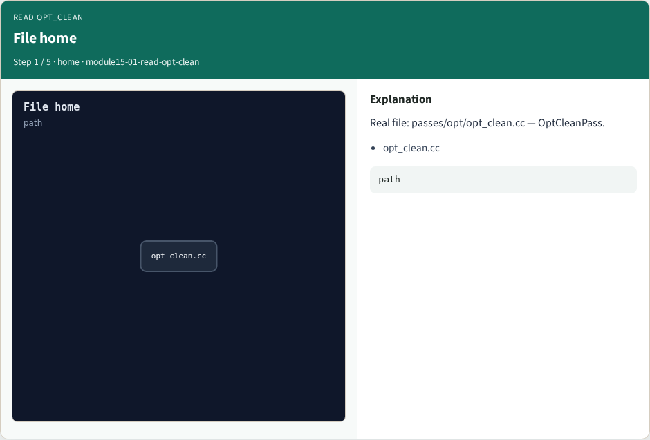
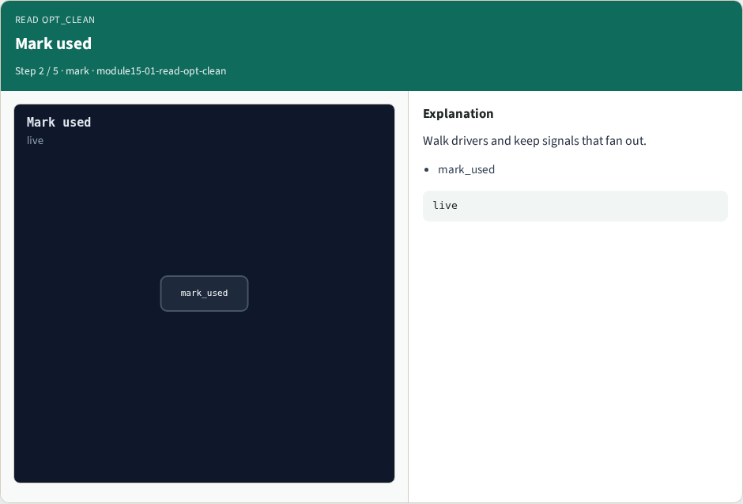
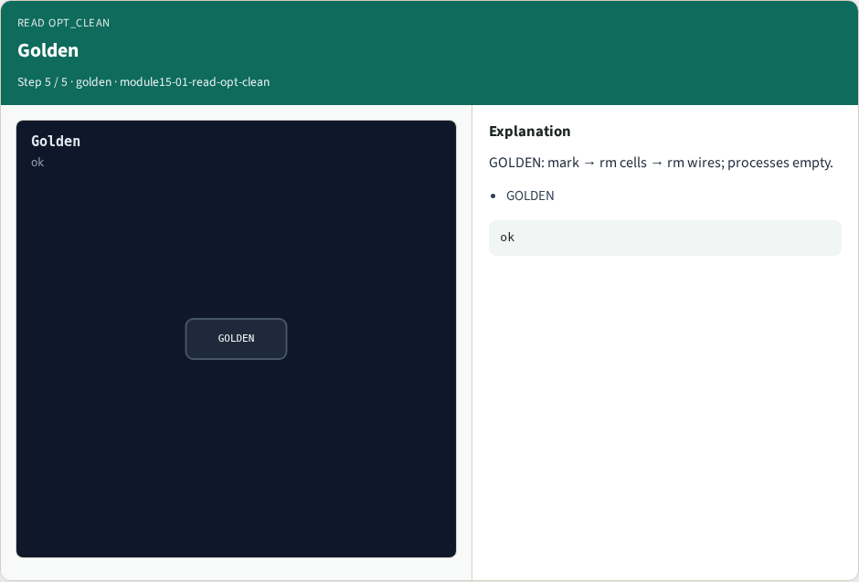

# Read opt_clean

**Module id:** module15-01-read-opt-clean
**Lab:** read-opt-clean
**Tracks:** A (implement) · B (browser lab)

## Slide 1 — Why read a real pass

Algorithms in Part C match moves. Now map those moves onto the real C++ file shape.

## Slide 2 — The idea

GOLDEN: mark used from outputs; delete unused cells; then unused wires. Prefer proc before opt_clean.

<!-- algorithm-walkthrough -->

## Slide 3 — File home



Real file: passes/opt/opt_clean.cc — OptCleanPass.

## Slide 4 — Mark used



Walk drivers and keep signals that fan out.

## Slide 5 — Remove cells


rmunused_module_cells drops unused cells.

## Slide 6 — Remove wires


rmunused_module_signals cleans leftover nets.

## Slide 7 — Golden



GOLDEN: mark → rm cells → rm wires; processes empty.

<!-- /algorithm-walkthrough -->


## Slide 8 — Browser lab track

Open **read-opt-clean**. Step the mark/delete pipeline and check.

## Slide 9 — Implement track

Call read_opt_clean(); assert stage order and process guard.

## Slide 10 — Pitfalls

Expecting opt_clean to lower processes. Deleting wires before cells blindly.

## Slide 11 — Try these

From the common folder, call read_opt_clean and print the stages.

```bash
cd courses/learn_yosys/common
python3 -c "from internals_solvers import read_opt_clean; print(read_opt_clean())"
```

## Slide 12 — Pseudocode

Here is the opt_clean flow in plain steps.

```text
for module in selected:
  if processes: warn/skip
  mark_used(outputs)
  rmunused_module_cells
  rmunused_module_signals
```

## Slide 13 — Next

Next: contribute a minimal pass of your own.
