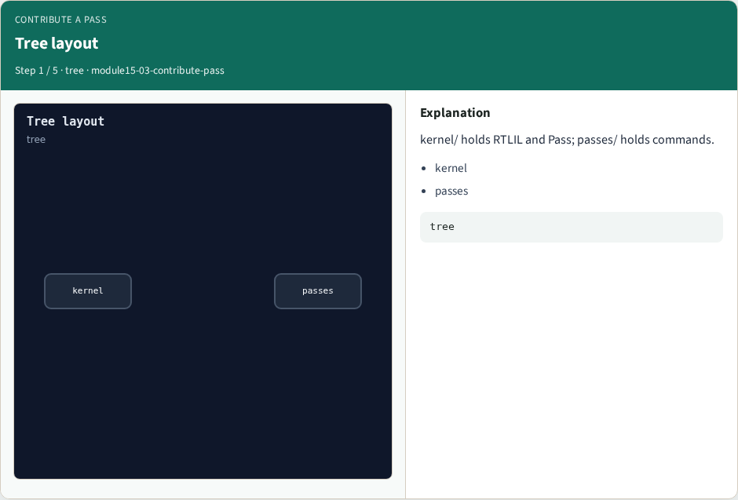
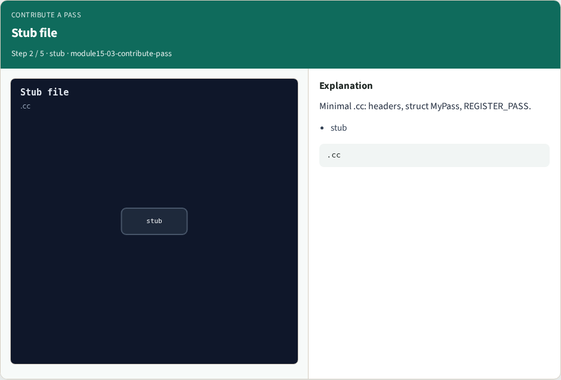
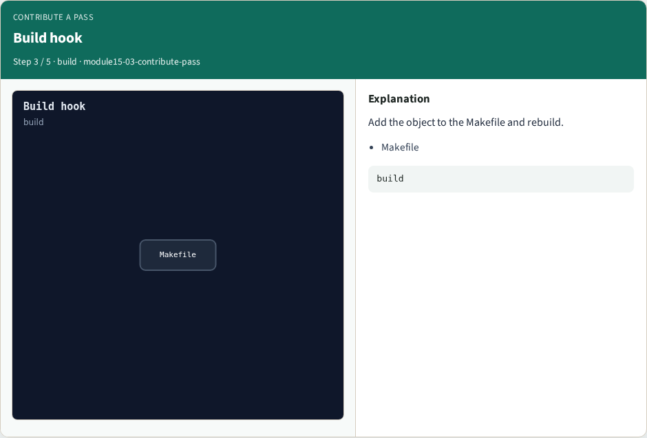
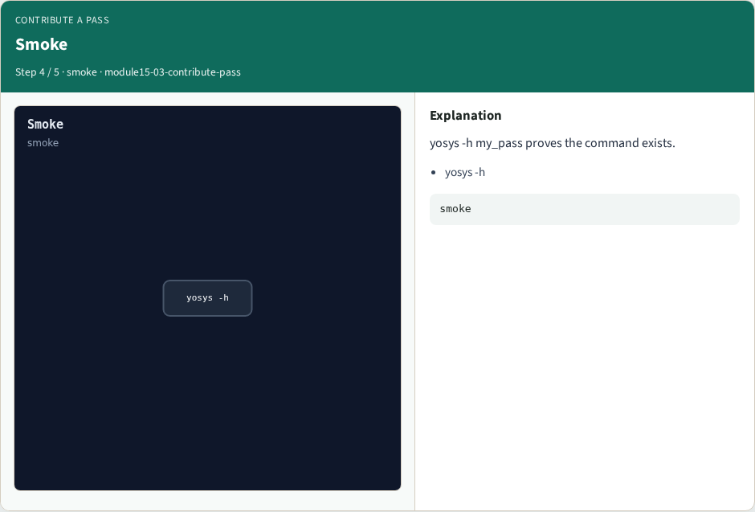

# Contribute a pass

**Module id:** module15-03-contribute-pass
**Lab:** contribute-pass
**Tracks:** A (implement) · B (browser lab)

## Slide 1 — Why contribute

Reading is not enough. A contributor knows where a pass lives and how it enters the build.

## Slide 2 — The idea

GOLDEN: add passes/area/name.cc, register the pass, list it in the Makefile, rebuild, yosys -h name.

<!-- algorithm-walkthrough -->

## Slide 3 — Tree layout



kernel/ holds RTLIL and Pass; passes/ holds commands.

## Slide 4 — Stub file



Minimal .cc: headers, struct MyPass, REGISTER_PASS.

## Slide 5 — Build hook



Add the object to the Makefile and rebuild.

## Slide 6 — Smoke



yosys -h my_pass proves the command exists.

## Slide 7 — Golden


GOLDEN: path + REGISTER_PASS + build + help smoke.

<!-- /algorithm-walkthrough -->


## Slide 8 — Browser lab track

Open **contribute-pass**. Assemble the contribute checklist and check.

## Slide 9 — Implement track

Call contribute_pass(); assert checklist length and smoke cmd.

## Slide 10 — Pitfalls

Editing only docs. Forgetting the build system entry. Skipping help smoke.

## Slide 11 — Try these

From the common folder, call contribute_pass and print the checklist.

```bash
cd courses/learn_yosys/common
python3 -c "from internals_solvers import contribute_pass; print(contribute_pass())"
```

## Slide 12 — Pseudocode

Here is the contribute checklist in plain steps.

```text
path ← passes/demo/hello_pass.cc
REGISTER_PASS(HelloPass)
add to Makefile; rebuild
smoke ← yosys -h hello_pass
```

## Slide 13 — Next

Wrap the Yosys path — you can use Yosys and open the C++ tree with intent.
